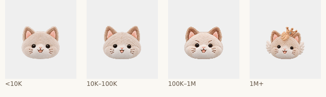
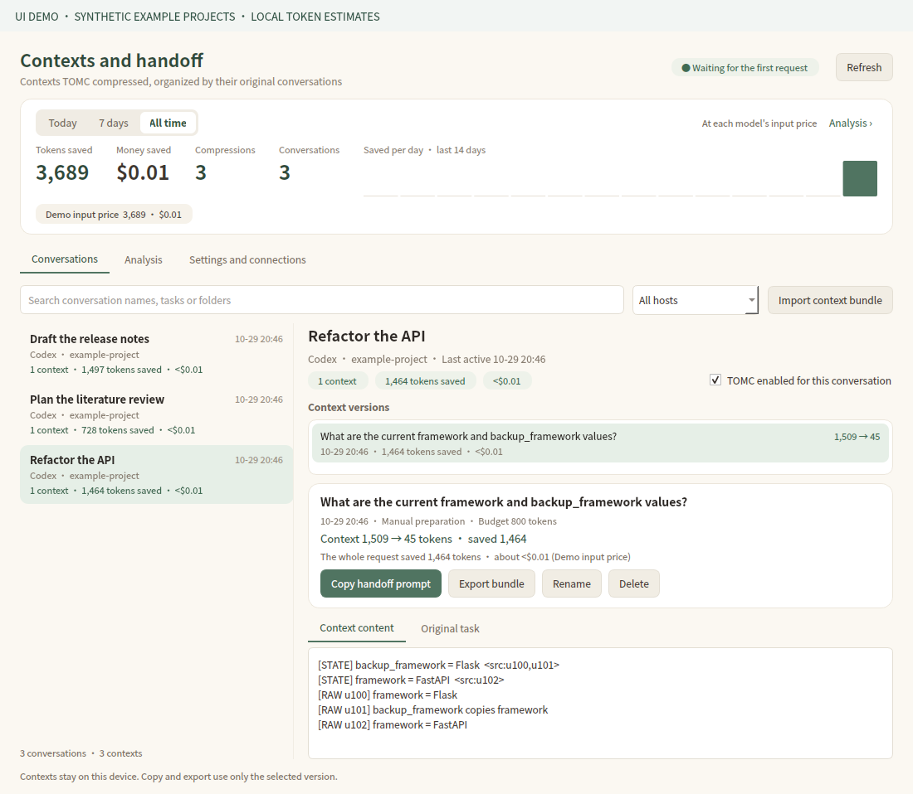
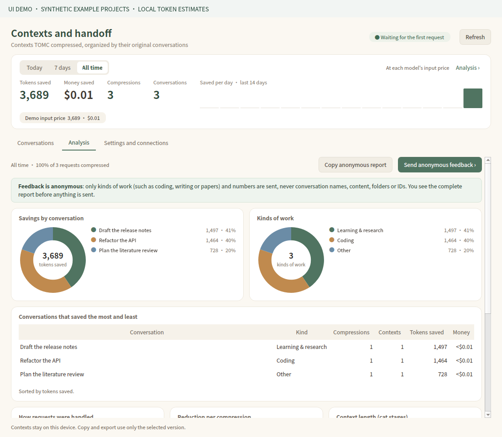
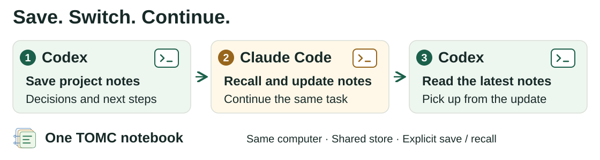
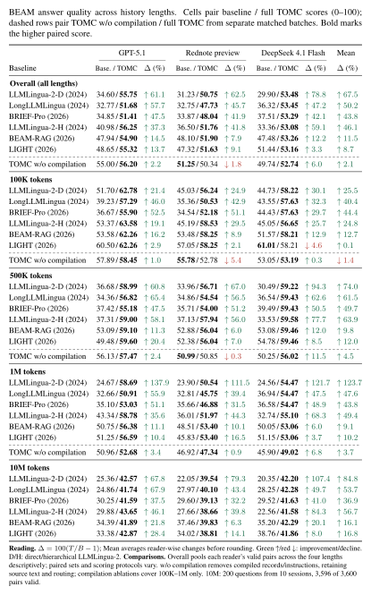
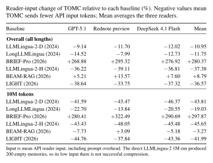
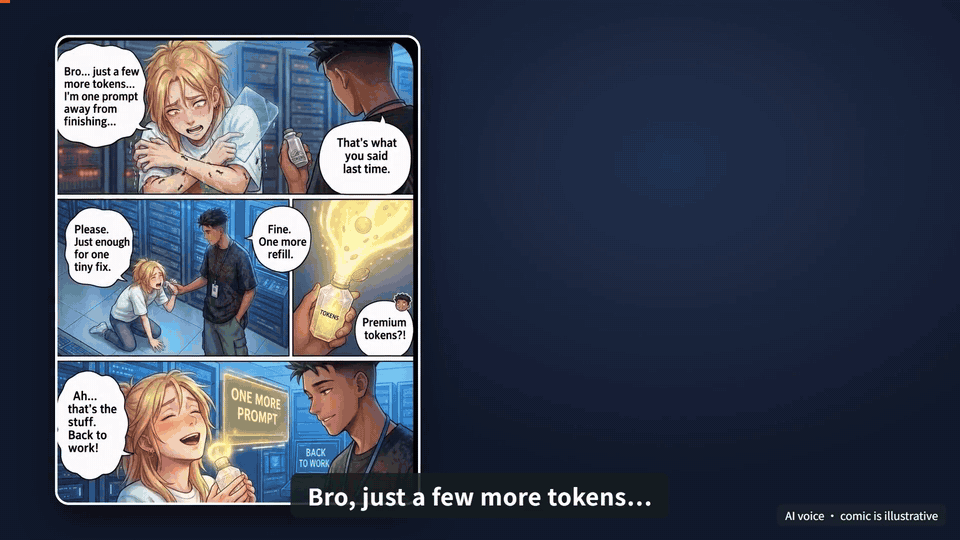

<div align="center">
  
  <h1>TOMC Memory</h1>
  <h3>Save tokens. Keep your work moving.</h3>
  <p>Local context compression and portable task memory for AI assistants.</p>
  <p><a href="#get-started"><strong>Get started</strong></a> · <a href="#desktop-companion">See the desktop companion</a> · <a href="#research">Explore the research</a></p>
  <p><strong>CPU preparation · No auxiliary model · MIT licensed</strong></p>
  <p><strong>English</strong> | <a href="README_zh.md">简体中文</a></p>
</div>

<p align="center">
  <a href="#desktop-companion"></a><br>
  <sub>The companion's work forms, rendered from the application.</sub>
</p>

<a id="use-tomc"></a>

## Same project. Keep going.

The brief has changed. The history has grown. You open a new chat or switch assistants, and the next step starts with another recap.

**TOMC prepares the context for that next step.** Compress long histories locally, inspect the result, and keep saved task context ready to reuse. The desktop cat brings the background work onto your screen; click it to open your report and context library.

| Save tokens | Switch assistants | Switch computers |
|---|---|---|
| Prepare smaller inputs and see the recorded reduction. | Copy a continuation prompt or recall shared task notes. | Export a context bundle, move it, and import it on your other computer. |

Built on **Task-Oriented Memory Compilation**, TOMC combines task-relevant source text with computed state, relation and count records. Preparation runs on CPU; your existing model answers the task.

**Research:** evaluated on 100K–10M-token original histories. [See the BEAM results](#research).

**Current release:** [0.2.1 preview](https://github.com/ZipengWu365/TOMC/releases/tag/v0.2.1-preview.1) · [Recorded examples](https://zipengwu.me/tomc/examples/) · [Usage guides](https://zipengwu.me/tomc/guides/)

Listed on [MCPRush](https://mcprush.com/zipengwu365/tomc-memory-mcp) and [SpaceRing Harness](https://spacering.net/harness/zipengwu365/tomc-memory).

<a id="desktop-companion"></a>

## Meet your context companion

A small cat shows when TOMC prepares context. Its four forms follow the **current context length**. Click it to follow the work from a request to a report and a saved context.

<a href="assets/homepage/contexts-en.png"></a>

*Application UI rendered with synthetic example projects. Token counts are local estimates; dollar displays use a configured input price.*

| Open… | See or do… |
|---|---|
| **The cat** | Review the recorded reduction for today, the last seven days or all time. |
| **Analysis** | Explore reductions by conversation and type of work, and see which requests were processed or passed through. |
| **All records** | Read a prepared context, copy its continuation prompt, or export a portable bundle. |

<details>
<summary>Open the analysis report</summary>

<a href="assets/homepage/analysis-en.png"></a>

The report uses the same synthetic projects as the context-library preview.

</details>

<a id="get-started"></a>
<a id="install-in-your-assistant"></a>

## Choose your setup

| You use… | Start here | What runs |
|---|---|---|
| **Codex or Claude Code on Windows** | [Desktop companion + gateway](#windows) | Optional gateway beta for eligible old history, plus the cat, reports and context library |
| **macOS** | [Desktop companion](docs/macos_usage.md#desktop-companion-beta-macos) | Cat, reports and context library; context preparation through MCP or your application |
| **Claude Code / Codex MCP tools** | [Assistant plugins](#assistant-tools) | Prepare context, save notes and recall them through tool calls |
| **Your own application** | [Python API](#use-before-your-api-call) | Prepare context in your request loop |

[Cursor / TRAE](docs/cursor_trae.md) and [WorkBuddy](docs/workbuddy.md) have **MCP integration previews**. [Claude Desktop extension](docs/assistant_plugin.md#claude-desktop) · [Client validation records](docs/platform_checks.md).

<a id="windows"></a>

### Windows: install the cat and gateway

With **Windows 10/11, Git and Python 3.10+**:

```powershell
git clone https://github.com/ZipengWu365/TOMC.git
cd TOMC
py scripts\install_windows_companion.py
py scripts\install_windows_companion.py --install --gateway
```

The first script invocation previews the installation. The second installs the companion and local gateway, backs up the assistant settings it changes, and prints an uninstall receipt.

**Restart Codex / Claude Code**, continue a task, then click the cat. Open **Analysis** to see how requests were handled, or **All records** to inspect a saved context.

The Codex gateway uses **ChatGPT sign-in**. API-key applications use the [Python route](#use-before-your-api-call). The gateway installer stops when a selected host uses a custom endpoint or Codex profile, preserving the existing setup. For the cat alone, use `--install`; for Claude Code alone, add `--hosts claude`.

[Windows guide, updates and uninstall](docs/desktop_companion.md) · [macOS installation](docs/macos_usage.md#desktop-companion-beta-macos)

<a id="assistant-tools"></a>
<a id="first-run-tomc"></a>

### Assistant tools: save a note, open a new chat, continue

For **Claude Code**, install [uv](https://docs.astral.sh/uv/getting-started/installation/), then run:

```text
/plugin marketplace add ZipengWu365/TOMC
/plugin install tomc-memory@tomc
```

Start a new session and check `/mcp`. Try this first note:

```text
Use TOMC's remember_memory to save a note named api-refactor:
Keep public API routes unchanged. Pagination tests still need to be written.
Show the tool result.
```

In a new chat using the same local notebook:

```text
Use TOMC's recall_memory on api-refactor.
Tell me the saved constraint and the next step. Show the tool result.
```

**Codex CLI:** [download the 0.2.1 plugin](https://github.com/ZipengWu365/TOMC/releases/download/v0.2.1-preview.1/tomc-memory-codex-0.2.1.zip), extract it to a permanent folder, and run `uv run --no-project --python 3.12 install.py --check`, followed by `uv run --no-project --python 3.12 install.py`. Restart the client and try the same note.

[Full plugin guide](docs/assistant_plugin.md) · [Shared-notebook setup](docs/usage_tips.md#reuse-notebooks)

<a id="use-before-your-api-call"></a>

### Python: prepare context before your model call

From the cloned repository, with an activated Python 3.10+ environment:

```bash
python -m pip install -e .
python examples/api_context.py
```

The example runs locally. In your application:

```python
from tomc import prepare_context

prepared = prepare_context(history, task)
response = client.chat.completions.create(
    model=model,
    messages=prepared.messages,
)
```

Use the prepared messages **in place of the history being reduced**, retaining your application's required instructions and tool protocol. For recurring requests, [AutomaticChatSession](docs/context_ownership.md) manages a stable compiled prefix and refreshes it when needed.

[API reference and token counting](docs/api_reference.md) · [Supported operations](docs/method.md)

<a id="switch-assistants"></a>

## New assistant. Bring the work.

You have already established the goal, constraints and next step. Take that saved context into the next session:

**All records → select a context → Copy handoff prompt → paste into your next assistant.**

For shared task notebooks, configure both assistants to use the same TOMC database. Save a decision in Codex, recall it in Claude Code, and append the next update. [Try the three-prompt handoff](docs/usage_tips.md#reuse-notebooks).

<picture>
  <source media="(max-width: 700px)" srcset="assets/shared_notebook_handoff_mobile.svg">
  
</picture>

**Changing computers?** Export a context bundle, transfer it yourself, then import it on the other machine. The bundle carries the selected prepared context; bring your project files separately.

[Context-library and transfer guide](docs/desktop_companion.md)

<a id="research"></a>
<a id="paper-explained"></a>
<a id="same-reader-baseline-memory-vs-tomc-memory"></a>

## Research: from 100K to 10M-token histories

**Task-Oriented Memory Compilation: Executable State Representations for Long-Context Language Models**

What should a reader receive after the relevant evidence has been found? TOMC studies a representation that combines selected text with the state the task needs.

The BEAM study compares TOMC with six baseline configurations using three API readers, keeping the reader fixed within each pair. At the **10M-history tier**, compared with LIGHT:

| Relative mean-score improvement | Reader-input reduction |
|:---:|:---:|
| **+16.8%** | **41.99%** |

*Equal-weight average across the three readers. 10M is the original history length. This tier uses 200 questions from 10 sessions; the six-baseline matrix has 3,596 valid pairs.*

[10M protocol and per-question results](benchmarks/beam_10m_20261010/README.md) · [All results and ablations](docs/paper_results.md) · [Reproduce the published tables](docs/reproducibility.md) · [Citation](CITATION.cff)

<details>
<summary>Full BEAM comparisons: 100K, 500K, 1M and 10M</summary>

<!-- BEAM_TABLE_START -->
<a href="assets/beam_table/beam_quality.png">
  
</a>

<a href="assets/beam_table/beam_input.png">
  
</a>

<details>
<summary>Tables as text</summary>

| Baseline | GPT-5.1 | Δ (%) | Rednote preview | Δ (%) | DeepSeek 4.1 Flash | Δ (%) | Mean Δ (%) |
|---|---:|:---|---:|:---|---:|:---|:---|
| **Overall (all lengths)** | | | | | | | |
| LLMLingua-2-D (2024) | 34.60 / **55.75** | ↑ 61.1 | 31.23 / **50.75** | ↑ 62.5 | 29.90 / **53.48** | ↑ 78.8 | ↑ 67.5 |
| LongLLMLingua (2024) | 32.77 / **51.68** | ↑ 57.7 | 32.75 / **47.73** | ↑ 45.7 | 36.32 / **53.45** | ↑ 47.2 | ↑ 50.2 |
| BRIEF-Pro (2026) | 34.85 / **51.41** | ↑ 47.5 | 33.87 / **48.04** | ↑ 41.9 | 37.51 / **53.29** | ↑ 42.1 | ↑ 43.8 |
| LLMLingua-2-H (2024) | 40.98 / **56.25** | ↑ 37.3 | 36.50 / **51.76** | ↑ 41.8 | 33.36 / **53.08** | ↑ 59.1 | ↑ 46.1 |
| BEAM-RAG (2026) | 47.94 / **54.90** | ↑ 14.5 | 48.10 / **51.90** | ↑ 7.9 | 47.48 / **53.26** | ↑ 12.2 | ↑ 11.5 |
| LIGHT (2026) | 48.65 / **55.32** | ↑ 13.7 | 47.32 / **51.63** | ↑ 9.1 | 51.44 / **53.16** | ↑ 3.3 | ↑ 8.7 |
| TOMC w/o compilation | 55.00 / **56.20** | ↑ 2.2 | **51.25** / 50.34 | ↓ 1.8 | 49.74 / **52.74** | ↑ 6.0 | ↑ 2.1 |
| **100K tokens** | | | | | | | |
| LLMLingua-2-D (2024) | 51.70 / **62.78** | ↑ 21.4 | 45.03 / **56.24** | ↑ 24.9 | 44.73 / **58.22** | ↑ 30.1 | ↑ 25.5 |
| LongLLMLingua (2024) | 39.23 / **57.29** | ↑ 46.0 | 35.36 / **50.53** | ↑ 42.9 | 43.55 / **57.63** | ↑ 32.3 | ↑ 40.4 |
| BRIEF-Pro (2026) | 36.67 / **55.90** | ↑ 52.5 | 34.54 / **52.18** | ↑ 51.1 | 44.43 / **57.63** | ↑ 29.7 | ↑ 44.4 |
| LLMLingua-2-H (2024) | 53.37 / **63.58** | ↑ 19.1 | 45.19 / **58.53** | ↑ 29.5 | 45.05 / **56.65** | ↑ 25.7 | ↑ 24.8 |
| BEAM-RAG (2026) | 53.58 / **62.26** | ↑ 16.2 | 53.48 / **58.25** | ↑ 8.9 | 51.57 / **58.21** | ↑ 12.9 | ↑ 12.7 |
| LIGHT (2026) | 60.50 / **62.26** | ↑ 2.9 | 57.05 / **58.25** | ↑ 2.1 | **61.01** / 58.21 | ↓ 4.6 | ↑ 0.1 |
| TOMC w/o compilation | 57.89 / **58.45** | ↑ 1.0 | **55.78** / 52.78 | ↓ 5.4 | 53.05 / **53.19** | ↑ 0.3 | ↓ 1.4 |
| **500K tokens** | | | | | | | |
| LLMLingua-2-D (2024) | 36.68 / **58.99** | ↑ 60.8 | 33.96 / **56.71** | ↑ 67.0 | 30.49 / **59.22** | ↑ 94.3 | ↑ 74.0 |
| LongLLMLingua (2024) | 34.36 / **56.82** | ↑ 65.4 | 34.86 / **54.54** | ↑ 56.5 | 36.54 / **59.43** | ↑ 62.6 | ↑ 61.5 |
| BRIEF-Pro (2026) | 37.42 / **55.18** | ↑ 47.5 | 35.71 / **54.00** | ↑ 51.2 | 39.49 / **59.43** | ↑ 50.5 | ↑ 49.7 |
| LLMLingua-2-H (2024) | 37.31 / **59.00** | ↑ 58.1 | 37.13 / **57.94** | ↑ 56.0 | 33.53 / **59.58** | ↑ 77.7 | ↑ 63.9 |
| BEAM-RAG (2026) | 53.09 / **59.10** | ↑ 11.3 | 52.88 / **56.04** | ↑ 6.0 | 53.08 / **59.46** | ↑ 12.0 | ↑ 9.8 |
| LIGHT (2026) | 49.48 / **59.60** | ↑ 20.4 | 52.38 / **56.04** | ↑ 7.0 | 54.78 / **59.46** | ↑ 8.5 | ↑ 12.0 |
| TOMC w/o compilation | 56.13 / **57.47** | ↑ 2.4 | **50.99** / 50.85 | ↓ 0.3 | 50.25 / **56.02** | ↑ 11.5 | ↑ 4.5 |
| **1M tokens** | | | | | | | |
| LLMLingua-2-D (2024) | 24.67 / **58.69** | ↑ 137.9 | 23.90 / **50.54** | ↑ 111.5 | 24.56 / **54.47** | ↑ 121.7 | ↑ 123.7 |
| LongLLMLingua (2024) | 32.66 / **50.91** | ↑ 55.9 | 32.81 / **45.75** | ↑ 39.4 | 36.94 / **54.47** | ↑ 47.5 | ↑ 47.6 |
| BRIEF-Pro (2026) | 35.10 / **53.03** | ↑ 51.1 | 35.66 / **46.88** | ↑ 31.5 | 36.58 / **54.47** | ↑ 48.9 | ↑ 43.8 |
| LLMLingua-2-H (2024) | 43.34 / **58.78** | ↑ 35.6 | 36.01 / **51.97** | ↑ 44.3 | 32.74 / **55.10** | ↑ 68.3 | ↑ 49.4 |
| BEAM-RAG (2026) | 50.75 / **56.38** | ↑ 11.1 | 48.51 / **53.40** | ↑ 10.1 | 50.05 / **53.06** | ↑ 6.0 | ↑ 9.1 |
| LIGHT (2026) | 51.25 / **56.59** | ↑ 10.4 | 45.83 / **53.40** | ↑ 16.5 | 51.15 / **53.06** | ↑ 3.7 | ↑ 10.2 |
| TOMC w/o compilation | 50.96 / **52.68** | ↑ 3.4 | 46.92 / **47.34** | ↑ 0.9 | 45.90 / **49.02** | ↑ 6.8 | ↑ 3.7 |
| **10M tokens** | | | | | | | |
| LLMLingua-2-D (2024) | 25.36 / **42.57** | ↑ 67.8 | 22.05 / **39.54** | ↑ 79.3 | 20.35 / **42.20** | ↑ 107.4 | ↑ 84.8 |
| LongLLMLingua (2024) | 24.86 / **41.74** | ↑ 67.9 | 27.97 / **40.10** | ↑ 43.4 | 28.25 / **42.28** | ↑ 49.7 | ↑ 53.7 |
| BRIEF-Pro (2026) | 30.25 / **41.59** | ↑ 37.5 | 29.60 / **39.13** | ↑ 32.2 | 29.52 / **41.63** | ↑ 41.0 | ↑ 36.9 |
| LLMLingua-2-H (2024) | 29.88 / **43.65** | ↑ 46.1 | 27.66 / **38.66** | ↑ 39.8 | 22.56 / **41.58** | ↑ 84.3 | ↑ 56.7 |
| BEAM-RAG (2026) | 34.39 / **41.89** | ↑ 21.8 | 37.46 / **39.83** | ↑ 6.3 | 35.20 / **42.29** | ↑ 20.1 | ↑ 16.1 |
| LIGHT (2026) | 33.38 / **42.87** | ↑ 28.4 | 34.02 / **38.81** | ↑ 14.1 | 38.76 / **41.86** | ↑ 8.0 | ↑ 16.8 |

| Baseline | Overall input change | 10M input change |
|---|---:|---:|
| LLMLingua-2-D (2024) | -10.95% | -43.81% |
| LongLLMLingua (2024) | -11.75% | -19.03% |
| BRIEF-Pro (2026) | +280.37% | +297.87% |
| LLMLingua-2-H (2024) | -37.38% | -45.65% |
| BEAM-RAG (2026) | +8.79% | -3.27% |
| LIGHT (2026) | -36.57% | -41.99% |

</details>
<!-- BEAM_TABLE_END -->

Each cell compares a baseline with TOMC using matched questions and scoring within that pair. Overall pools valid questions across lengths; scoring protocols vary between batches. The combined public set contains 800 distinct questions in 70 sessions. The 10M compilation ablation is tracked separately. See the [result definitions](benchmarks/RESULTS.md) and [10M batch record](benchmarks/beam_10m_20261010/README.md).

</details>

### From a history of changes to the state needed now

```text
framework = Flask
backup_framework copies framework
framework = FastAPI
```

The current framework is `FastAPI`; the backup keeps `Flask`, the value at the time of the copy. TOMC computes supported operations in order and links the resulting records to their sources. For questions requiring original wording, it also selects source text.

```text
History + next task → TOMC on CPU → prepared context → your existing model
```

**No training, auxiliary neural inference, or access to the reader's weights, attention or KV cache is required by the built-in compiler.** The public parser supports explicit operations and lexical evidence selection. [Method semantics](docs/method.md) · [Research and implementation](docs/paper_scope.md).

<a id="measured-savings"></a>

## In use: coding, research and content work

The public records cover several kinds of evidence:

| Record | What to explore |
|---|---|
| [Windows Codex check](docs/codex_retention_20261005.md) | Nine synthetic histories, 45/45 state answers at each tested budget; 29.7% lower mean paired request input with the 40% history budget. |
| [Claude Code trials](docs/validation.md#claude-code-windows-validation) | Budget, answer and request-cost comparisons on synthetic project histories. |
| [Three real project reports](casestudy/README.md) | One user's research slides, social post and video workflow, including token accounting, editing and follow-up checks. |
| [Prompt-cache study](docs/prompt_cache_20261017.md) | How refresh strategy changes the trade-off between context reduction and prefix reuse. |

Each report keeps its setup, measurement units and observations together. Use a task with a checkable outcome to choose your own budget.

<a id="try-the-demo"></a>

## Explore an example

[Inspect recorded examples in your browser](https://zipengwu.me/tomc/examples/), or launch the local workbench from the cloned repository:

```bash
uv run --python 3.12 --extra demo python -m demo.app
```

Open `http://127.0.0.1:7860`, select **Use now**, and choose **Try demo**. You can also paste your own history and next task, prepare context, and inspect the retained sources before using it with your model.

<details>
<summary>Watch the API, handoff and research overview</summary>

[](launch/media/v13/videos/TOMC_Overview_EN.mp4)

[English video](launch/media/v13/videos/TOMC_Overview_EN.mp4) · [中文视频](launch/media/v13/videos/TOMC_Overview_ZH.mp4) · [Video notes](launch/media/v13/README.md)

</details>

## Your data, your workflow

TOMC keeps statistics and prepared-context snapshots in your local `.tomc` directory. Use **All records → Settings and connections** to control recording, and delete saved contexts from the library. Copying, exporting and submitting feedback are actions you choose. Your normal model requests still go to your chosen provider.

**For precise work:** keep the original source available and inspect numerical values, citations and current requirements before lowering a context budget. The report distinguishes processed requests from those passed through unchanged.

[Storage and settings](docs/desktop_companion.md#your-data-and-privacy) · [Context ownership](docs/context_ownership.md) · [Method boundaries](docs/claims_and_limitations.md) · [Security](SECURITY.md)

## Find TOMC in the ecosystem

TOMC Memory is listed on **[MCPRush](https://mcprush.com/zipengwu365/tomc-memory-mcp)** and **[SpaceRing Harness](https://spacering.net/harness/zipengwu365/tomc-memory)**. Explore the listings, then use this repository for the current source and installation guides.

## Built in the open

We build TOMC to make AI work more resource-conscious: prepare useful context locally, make reductions visible, and make task memory easier to reuse. The code is **MIT licensed**, including commercial use. Research results, examples and implementation notes are available for inspection and extension.

<!-- community-entry:start -->
**Try, compare, contribute:** [First-run reports](https://github.com/ZipengWu365/TOMC/issues/11) · [Context-compression evaluation note](https://github.com/ZipengWu365/ZipengWu365/blob/main/notes/2026-10-27-context-compression-checklist.md) · [Contribution guide](CONTRIBUTING.md)

Follow [Zipeng Wu](https://github.com/ZipengWu365) for research software and AI task memory. Found TOMC useful? **Star the repository** and share the workflow it helped with.
<!-- community-entry:end -->

<a href="https://github.com/ZipengWu365/TOMC/stargazers"></a> <a href="docs/traffic_metrics.md"></a>

<!-- traffic-status:start -->
  <p>Cumulative clones · recorded since 2026-10-02 · updated 2026-10-29 UTC. <a href="docs/traffic_metrics.md">Method and updates</a></p>
<!-- traffic-status:end -->

[MIT license](LICENSE) · [Cite the research](CITATION.cff) · [Data provenance](DATA_PROVENANCE.md) · [Project documentation](docs/index.md)
