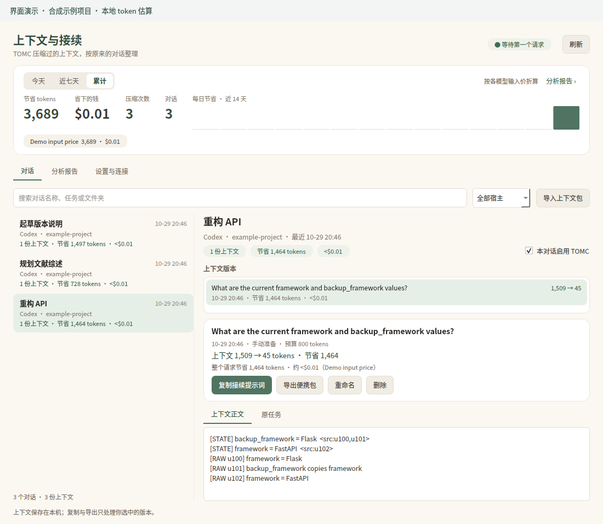
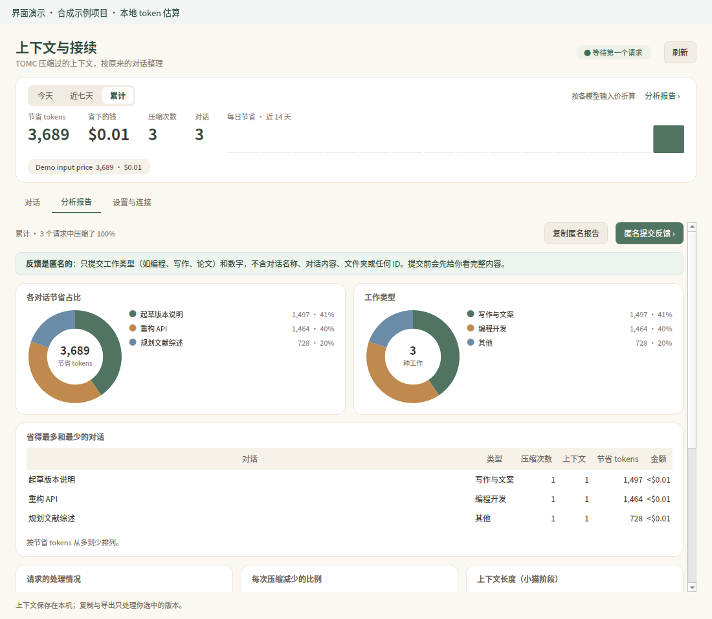
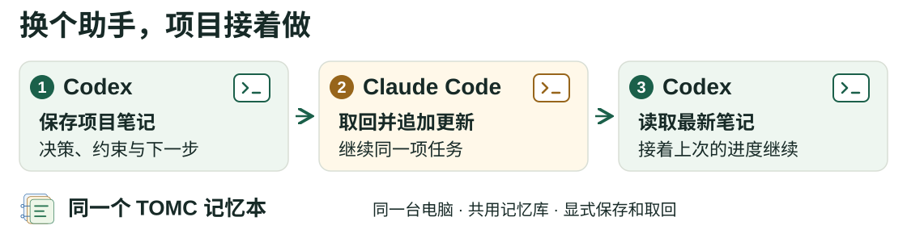

<div align="center">
  
  <h1>TOMC Memory</h1>
  <h3>省下 token，把工作接着做。</h3>
  <p>为 AI 助手提供本地上下文压缩，以及可以带走的任务记忆。</p>
  <p><a href="#get-started"><strong>开始使用</strong></a> · <a href="#desktop-companion">看看桌面小猫</a> · <a href="#research">查看研究结果</a></p>
  <p><strong>CPU 准备上下文 · 无需辅助模型 · MIT 开源</strong></p>
  <p><a href="README.md">English</a> | <strong>简体中文</strong></p>
</div>

<p align="center">
  <a href="#desktop-companion"></a><br>
  <sub>由应用实际绘制代码渲染的工作形态演示。</sub>
</p>

<a id="use-tomc"></a>

## 还是这个项目，接着往下做

需求改了几轮，历史越积越长。新开聊天、换一个助手，下一步又从解释背景开始。

**TOMC 为这一步准备上下文。** 在本地压缩长历史，查看处理结果，把保存的任务材料留给下一次工作。桌面小猫让后台处理看得见；点开它，就能进入报告和上下文库。

| 省 token | 换助手 | 换电脑 |
|---|---|---|
| 准备更小的输入，在报告里查看记录的减少量。 | 复制接续提示词，或取回共享的任务笔记。 | 导出上下文包，手动传到另一台电脑，再导入继续使用。 |

TOMC Memory 基于 **Task-Oriented Memory Compilation（面向任务的记忆编译）**：将相关原文与计算后的状态、关系和计数记录组合起来。准备过程在 CPU 上完成，回答仍由你原来的模型生成。

**研究评测：** 覆盖 100K–10M token 原始历史。[查看 BEAM 结果](#research)。

**当前版本：** [0.2.1 预览版](https://github.com/ZipengWu365/TOMC/releases/tag/v0.2.1-preview.1) · [查看已记录示例](https://zipengwu.me/tomc/examples/) · [使用指南](https://zipengwu.me/tomc/guides/)

已收录于 [MCPRush](https://mcprush.com/zipengwu365/tomc-memory-mcp) 与 [SpaceRing Harness](https://spacering.net/harness/zipengwu365/tomc-memory)。

<a id="desktop-companion"></a>

## 认识你的上下文小助手

TOMC 准备上下文时，小猫会给出动作反馈。四种形态跟随**本次上下文长度**变化。点开小猫，可以沿着一条请求查看报告，再找到保存的上下文。

<a href="assets/homepage/contexts-zh.png"></a>

*使用合成示例项目渲染的真实应用界面。Token 数为本地估算，金额按配置的输入单价折算。*

| 打开哪里 | 可以做什么 |
|---|---|
| **小猫** | 查看今天、近七天或累计记录的减少量。 |
| **分析报告** | 按对话与工作类型查看减少量，了解哪些请求经过处理、哪些原样放行。 |
| **全部记录** | 阅读准备后的上下文，复制接续提示词，或导出便携包。 |

<details>
<summary>展开分析报告</summary>

<a href="assets/homepage/analysis-zh.png"></a>

报告使用与上下文库预览相同的合成示例项目。

</details>

<a id="get-started"></a>
<a id="接入常用助手"></a>

## 选择你的接入方式

| 你的工作方式 | 从这里开始 | 如何运行 |
|---|---|---|
| **Windows 上的 Codex 或 Claude Code** | [桌面小猫＋网关](#windows) | 通过可选网关测试版准备符合条件的旧历史，同时提供小猫、报告和上下文库 |
| **macOS** | [桌面小猫](docs/macos_usage.md#desktop-companion-beta-macos) | 小猫、报告和上下文库；通过 MCP 或自己的应用准备上下文 |
| **Claude Code / Codex 的 MCP 工具** | [助手插件](#assistant-tools) | 通过工具调用准备上下文、保存和召回笔记 |
| **自己的应用** | [Python API](#接在你的-api-调用之前) | 在请求循环中调用 TOMC |

[Cursor / TRAE](docs/cursor_trae_zh.md) 和 [WorkBuddy](docs/workbuddy_zh.md) 提供 **MCP 接入预览**。[Claude Desktop 扩展](docs/assistant_plugin.md#claude-desktop) · [客户端验证记录](docs/platform_checks_zh.md)。

<a id="windows"></a>

### Windows：安装小猫和网关

准备 **Windows 10/11、Git 和 Python 3.10+**：

```powershell
git clone https://github.com/ZipengWu365/TOMC.git
cd TOMC
py scripts\install_windows_companion.py
py scripts\install_windows_companion.py --install --gateway
```

第一次运行脚本会显示安装计划；第二次安装桌面伴侣和本机网关，备份需要修改的助手配置，并打印卸载回执。

**退出并重新打开 Codex / Claude Code**，继续一个任务，然后点开小猫。「分析报告」显示请求如何处理，「全部记录」可以查看保存的上下文。

Codex 网关使用 **ChatGPT 登录**；使用 API key 的应用走 [Python 接入](#接在你的-api-调用之前)。所选助手配置了自定义端点或 Codex profile 时，网关安装会停止，保留原设置。只安装小猫用 `--install`，只接入 Claude Code 可加 `--hosts claude`。

[Windows 安装、更新和卸载](docs/desktop_companion.md#chinese-quickstart) · [macOS 安装](docs/macos_usage.md#desktop-companion-beta-macos)

<a id="assistant-tools"></a>
<a id="first-run-tomc"></a>

### 助手工具：存一条笔记，换个聊天，接着做

**Claude Code** 先安装 [uv](https://docs.astral.sh/uv/getting-started/installation/)，再运行：

```text
/plugin marketplace add ZipengWu365/TOMC
/plugin install tomc-memory@tomc
```

新开会话并用 `/mcp` 查看工具。先试一条任务笔记：

```text
使用 TOMC 的 remember_memory，保存一条名为 api-refactor 的笔记：
保持公开 API 路由不变。分页测试还需要编写。
展示工具返回结果。
```

在使用同一本地笔记库的新聊天中：

```text
使用 TOMC 的 recall_memory 取回 api-refactor。
告诉我保存的约束和下一步任务，展示工具返回结果。
```

**Codex CLI：** [下载 0.2.1 插件](https://github.com/ZipengWu365/TOMC/releases/download/v0.2.1-preview.1/tomc-memory-codex-0.2.1.zip)，解压到长期保留的文件夹，依次运行 `uv run --no-project --python 3.12 install.py --check` 和 `uv run --no-project --python 3.12 install.py`。重启客户端后，试用同一条笔记。

[完整插件指南](docs/assistant_plugin_zh.md) · [共享笔记库设置](docs/usage_tips.md#reuse-notebooks)

<a id="接在你的-api-调用之前"></a>
<a id="use-before-your-api-call"></a>

### Python：在模型调用前准备上下文

进入已克隆的仓库，激活 Python 3.10+ 环境：

```bash
python -m pip install -e .
python examples/api_context.py
```

示例在本地运行。在自己的应用中：

```python
from tomc import prepare_context

prepared = prepare_context(history, task)
response = client.chat.completions.create(
    model=model,
    messages=prepared.messages,
)
```

用准备后的消息**替换需要缩减的历史**，保留应用必需的指令与工具协议。对于持续请求，[AutomaticChatSession](docs/context_ownership_zh.md) 管理稳定的编译前缀，在需要时刷新。

[API 参考与 token 计数](docs/api_reference.md) · [支持的操作](docs/method.md)

<a id="switch-assistants"></a>

## 换个助手，带上已经做过的工作

目标已经明确，约束已经讨论，下一步也已经安排。把保存的上下文交给下一个会话：

**全部记录 → 选中上下文 → 复制接续提示词 → 粘贴到下一个助手。**

使用共享任务笔记时，让两个助手连接同一个 TOMC 数据库。可以在 Codex 中保存决策，在 Claude Code 中取回，再追加新的进展。[试用三步接续流程](docs/usage_tips.md#reuse-notebooks)。

<picture>
  <source media="(max-width: 700px)" srcset="assets/shared_notebook_handoff_zh_mobile.svg">
  
</picture>

**要换电脑？** 导出上下文包，手动传到另一台机器，再导入。包中包含选中的已准备上下文，项目文件另行携带。

[上下文库与迁移指南](docs/desktop_companion.md)

<a id="research"></a>
<a id="paper-explained"></a>
<a id="同一个模型基线记忆与-tomc-记忆"></a>

## 研究：从 100K 到 10M token 的历史

**Task-Oriented Memory Compilation: Executable State Representations for Long-Context Language Models**

找到相关证据以后，应该把什么交给模型？TOMC 研究将选中的原文与任务需要的状态组合成记忆表示。

BEAM 研究使用三个 API reader，与六种基线配置进行比较，每一对比较保持回答模型相同。在 **10M 历史档位**，相对 LIGHT：

| 平均得分相对提升 | Reader 输入减少 |
|:---:|:---:|
| **+16.8%** | **41.99%** |

*对三个 reader 等权平均。10M 表示原始历史长度；这一档包含 10 个会话中的 200 个问题，六基线矩阵共有 3,596 个有效比较对。*

[10M 协议与逐题结果](benchmarks/beam_10m_20261010/README.md) · [完整结果与消融](docs/paper_results.md) · [复核公开表格](docs/reproducibility.md) · [引用信息](CITATION.cff)

<details>
<summary>展开完整 BEAM 对比：100K、500K、1M 与 10M</summary>

<!-- BEAM_TABLE_START -->
<a href="assets/beam_table/beam_quality.png">
  
</a>

<a href="assets/beam_table/beam_input.png">
  
</a>

<details>
<summary>表格文字版</summary>

| 基线 | GPT-5.1 | Δ (%) | Rednote preview | Δ (%) | DeepSeek 4.1 Flash | Δ (%) | 平均 Δ (%) |
|---|---:|:---|---:|:---|---:|:---|:---|
| **Overall (all lengths)** | | | | | | | |
| LLMLingua-2-D (2024) | 34.60 / **55.75** | ↑ 61.1 | 31.23 / **50.75** | ↑ 62.5 | 29.90 / **53.48** | ↑ 78.8 | ↑ 67.5 |
| LongLLMLingua (2024) | 32.77 / **51.68** | ↑ 57.7 | 32.75 / **47.73** | ↑ 45.7 | 36.32 / **53.45** | ↑ 47.2 | ↑ 50.2 |
| BRIEF-Pro (2026) | 34.85 / **51.41** | ↑ 47.5 | 33.87 / **48.04** | ↑ 41.9 | 37.51 / **53.29** | ↑ 42.1 | ↑ 43.8 |
| LLMLingua-2-H (2024) | 40.98 / **56.25** | ↑ 37.3 | 36.50 / **51.76** | ↑ 41.8 | 33.36 / **53.08** | ↑ 59.1 | ↑ 46.1 |
| BEAM-RAG (2026) | 47.94 / **54.90** | ↑ 14.5 | 48.10 / **51.90** | ↑ 7.9 | 47.48 / **53.26** | ↑ 12.2 | ↑ 11.5 |
| LIGHT (2026) | 48.65 / **55.32** | ↑ 13.7 | 47.32 / **51.63** | ↑ 9.1 | 51.44 / **53.16** | ↑ 3.3 | ↑ 8.7 |
| TOMC w/o compilation | 55.00 / **56.20** | ↑ 2.2 | **51.25** / 50.34 | ↓ 1.8 | 49.74 / **52.74** | ↑ 6.0 | ↑ 2.1 |
| **100K tokens** | | | | | | | |
| LLMLingua-2-D (2024) | 51.70 / **62.78** | ↑ 21.4 | 45.03 / **56.24** | ↑ 24.9 | 44.73 / **58.22** | ↑ 30.1 | ↑ 25.5 |
| LongLLMLingua (2024) | 39.23 / **57.29** | ↑ 46.0 | 35.36 / **50.53** | ↑ 42.9 | 43.55 / **57.63** | ↑ 32.3 | ↑ 40.4 |
| BRIEF-Pro (2026) | 36.67 / **55.90** | ↑ 52.5 | 34.54 / **52.18** | ↑ 51.1 | 44.43 / **57.63** | ↑ 29.7 | ↑ 44.4 |
| LLMLingua-2-H (2024) | 53.37 / **63.58** | ↑ 19.1 | 45.19 / **58.53** | ↑ 29.5 | 45.05 / **56.65** | ↑ 25.7 | ↑ 24.8 |
| BEAM-RAG (2026) | 53.58 / **62.26** | ↑ 16.2 | 53.48 / **58.25** | ↑ 8.9 | 51.57 / **58.21** | ↑ 12.9 | ↑ 12.7 |
| LIGHT (2026) | 60.50 / **62.26** | ↑ 2.9 | 57.05 / **58.25** | ↑ 2.1 | **61.01** / 58.21 | ↓ 4.6 | ↑ 0.1 |
| TOMC w/o compilation | 57.89 / **58.45** | ↑ 1.0 | **55.78** / 52.78 | ↓ 5.4 | 53.05 / **53.19** | ↑ 0.3 | ↓ 1.4 |
| **500K tokens** | | | | | | | |
| LLMLingua-2-D (2024) | 36.68 / **58.99** | ↑ 60.8 | 33.96 / **56.71** | ↑ 67.0 | 30.49 / **59.22** | ↑ 94.3 | ↑ 74.0 |
| LongLLMLingua (2024) | 34.36 / **56.82** | ↑ 65.4 | 34.86 / **54.54** | ↑ 56.5 | 36.54 / **59.43** | ↑ 62.6 | ↑ 61.5 |
| BRIEF-Pro (2026) | 37.42 / **55.18** | ↑ 47.5 | 35.71 / **54.00** | ↑ 51.2 | 39.49 / **59.43** | ↑ 50.5 | ↑ 49.7 |
| LLMLingua-2-H (2024) | 37.31 / **59.00** | ↑ 58.1 | 37.13 / **57.94** | ↑ 56.0 | 33.53 / **59.58** | ↑ 77.7 | ↑ 63.9 |
| BEAM-RAG (2026) | 53.09 / **59.10** | ↑ 11.3 | 52.88 / **56.04** | ↑ 6.0 | 53.08 / **59.46** | ↑ 12.0 | ↑ 9.8 |
| LIGHT (2026) | 49.48 / **59.60** | ↑ 20.4 | 52.38 / **56.04** | ↑ 7.0 | 54.78 / **59.46** | ↑ 8.5 | ↑ 12.0 |
| TOMC w/o compilation | 56.13 / **57.47** | ↑ 2.4 | **50.99** / 50.85 | ↓ 0.3 | 50.25 / **56.02** | ↑ 11.5 | ↑ 4.5 |
| **1M tokens** | | | | | | | |
| LLMLingua-2-D (2024) | 24.67 / **58.69** | ↑ 137.9 | 23.90 / **50.54** | ↑ 111.5 | 24.56 / **54.47** | ↑ 121.7 | ↑ 123.7 |
| LongLLMLingua (2024) | 32.66 / **50.91** | ↑ 55.9 | 32.81 / **45.75** | ↑ 39.4 | 36.94 / **54.47** | ↑ 47.5 | ↑ 47.6 |
| BRIEF-Pro (2026) | 35.10 / **53.03** | ↑ 51.1 | 35.66 / **46.88** | ↑ 31.5 | 36.58 / **54.47** | ↑ 48.9 | ↑ 43.8 |
| LLMLingua-2-H (2024) | 43.34 / **58.78** | ↑ 35.6 | 36.01 / **51.97** | ↑ 44.3 | 32.74 / **55.10** | ↑ 68.3 | ↑ 49.4 |
| BEAM-RAG (2026) | 50.75 / **56.38** | ↑ 11.1 | 48.51 / **53.40** | ↑ 10.1 | 50.05 / **53.06** | ↑ 6.0 | ↑ 9.1 |
| LIGHT (2026) | 51.25 / **56.59** | ↑ 10.4 | 45.83 / **53.40** | ↑ 16.5 | 51.15 / **53.06** | ↑ 3.7 | ↑ 10.2 |
| TOMC w/o compilation | 50.96 / **52.68** | ↑ 3.4 | 46.92 / **47.34** | ↑ 0.9 | 45.90 / **49.02** | ↑ 6.8 | ↑ 3.7 |
| **10M tokens** | | | | | | | |
| LLMLingua-2-D (2024) | 25.36 / **42.57** | ↑ 67.8 | 22.05 / **39.54** | ↑ 79.3 | 20.35 / **42.20** | ↑ 107.4 | ↑ 84.8 |
| LongLLMLingua (2024) | 24.86 / **41.74** | ↑ 67.9 | 27.97 / **40.10** | ↑ 43.4 | 28.25 / **42.28** | ↑ 49.7 | ↑ 53.7 |
| BRIEF-Pro (2026) | 30.25 / **41.59** | ↑ 37.5 | 29.60 / **39.13** | ↑ 32.2 | 29.52 / **41.63** | ↑ 41.0 | ↑ 36.9 |
| LLMLingua-2-H (2024) | 29.88 / **43.65** | ↑ 46.1 | 27.66 / **38.66** | ↑ 39.8 | 22.56 / **41.58** | ↑ 84.3 | ↑ 56.7 |
| BEAM-RAG (2026) | 34.39 / **41.89** | ↑ 21.8 | 37.46 / **39.83** | ↑ 6.3 | 35.20 / **42.29** | ↑ 20.1 | ↑ 16.1 |
| LIGHT (2026) | 33.38 / **42.87** | ↑ 28.4 | 34.02 / **38.81** | ↑ 14.1 | 38.76 / **41.86** | ↑ 8.0 | ↑ 16.8 |

| 基线 | 整体输入变化 | 10M 输入变化 |
|---|---:|---:|
| LLMLingua-2-D (2024) | -10.95% | -43.81% |
| LongLLMLingua (2024) | -11.75% | -19.03% |
| BRIEF-Pro (2026) | +280.37% | +297.87% |
| LLMLingua-2-H (2024) | -37.38% | -45.65% |
| BEAM-RAG (2026) | +8.79% | -3.27% |
| LIGHT (2026) | -36.57% | -41.99% |

</details>
<!-- BEAM_TABLE_END -->

每个单元格在配对的问题和评分设置下比较基线与 TOMC。Overall 汇总不同长度的有效问题，各批次评分协议有所区别。公开合并结果包含 70 个会话中的 800 个独立问题；10M 编译消融由独立批次跟进。参见[结果定义](benchmarks/RESULTS.md)与 [10M 批次记录](benchmarks/beam_10m_20261010/README.md)。

</details>

### 从变化的历史，得到此刻需要的状态

```text
framework = Flask
backup_framework copies framework
framework = FastAPI
```

当前框架是 `FastAPI`，备份仍保存复制发生时的 `Flask`。TOMC 按顺序计算支持的操作，将结果记录与对应来源关联起来。需要原始措辞的问题，也会配合原文选择。

```text
历史 + 下一步任务 → CPU 上的 TOMC → 准备后的上下文 → 你原来的模型
```

**内置编译器无需训练、辅助神经推理，也无需访问 reader 的权重、attention 或 KV cache。** 公开解析器支持显式操作与词法证据选择。[方法语义](docs/method.md) · [研究与实现](docs/paper_scope.md)。

<a id="实测节省"></a>
<a id="measured-savings"></a>

## 实际使用：编程、研究与内容制作

公开记录提供了几类不同的观察：

| 记录 | 可以查看什么 |
|---|---|
| [Windows Codex 检查](docs/codex_retention_20261005_zh.md) | 九份合成历史，各预算下均为 45/45 状态回答正确；40% 历史预算下，配对请求输入平均减少 29.7%。 |
| [Claude Code 试验](docs/validation.md#claude-code-windows-validation) | 合成项目历史上的预算、回答和请求费用对比。 |
| [三个真实项目报告](casestudy/README.md) | 同一用户的科研幻灯片、社媒图文和视频工作流，包含 token 统计、编辑和后续检查。 |
| [Prompt cache 研究](docs/prompt_cache_20261017_zh.md) | 刷新策略如何影响上下文缩减与前缀复用之间的取舍。 |

每份报告保留了对应设置、计量单位与观察结果。选择一个结果可以核对的任务，确定适合自己的预算。

<a id="试用演示"></a>
<a id="try-the-demo"></a>

## 先看一个例子

[在浏览器里查看已记录示例](https://zipengwu.me/tomc/examples/)，或从已克隆的仓库启动本地工作台：

```bash
uv run --python 3.12 --extra demo python -m demo.app
```

打开 `http://127.0.0.1:7860`，选择 **Use now → Try demo**。也可以粘贴自己的历史与下一步任务，准备上下文，检查保留的来源，再交给模型。

<details>
<summary>观看 API、交接与研究概览</summary>

[](launch/media/v13/videos/TOMC_Overview_ZH.mp4)

[中文视频](launch/media/v13/videos/TOMC_Overview_ZH.mp4) · [English video](launch/media/v13/videos/TOMC_Overview_EN.mp4) · [视频说明](launch/media/v13/README.md)

</details>

## 数据留在本机，工作方式由你选择

TOMC 将统计与已准备上下文保存在本机 `.tomc` 目录。通过「全部记录 → 设置与连接」控制正文记录，在上下文库中删除已保存内容。复制、导出和提交反馈由你主动选择；正常的模型请求仍发送给你所用的服务商。

**需要精确信息时：** 保留原始材料，在降低上下文预算前检查数字、引用和当前任务要求。报告区分经过处理的请求和原样放行的请求。

[存储与设置](docs/desktop_companion.md#your-data-and-privacy) · [上下文归属](docs/context_ownership_zh.md) · [方法适用范围](docs/claims_and_limitations.md) · [安全说明](SECURITY.md)

## 在工具生态中找到 TOMC

TOMC Memory 已被 **[MCPRush](https://mcprush.com/zipengwu365/tomc-memory-mcp)** 和 **[SpaceRing Harness](https://spacering.net/harness/zipengwu365/tomc-memory)** 收录。可以从平台条目发现项目，从本仓库获取当前源码与安装指南。

## 一起把它做好

我们希望 AI 工作更重视资源利用：在本地准备有用的上下文，让减少量看得见，让任务记忆更容易复用。代码采用 **MIT 许可**，支持商用。研究结果、示例和实现说明公开，欢迎检查、扩展和参与。

<!-- community-entry:start -->
**试用、评测与参与：** [首次使用反馈（中英文）](https://github.com/ZipengWu365/TOMC/issues/11) · [上下文压缩评测笔记](https://github.com/ZipengWu365/ZipengWu365/blob/main/notes/2026-10-27-context-compression-checklist.zh.md) · [贡献指南](CONTRIBUTING.md)

关注 [Zipeng Wu](https://github.com/ZipengWu365)，了解研究软件与 AI 任务记忆的后续工作。TOMC 帮上忙了？**点一个 Star**，也欢迎分享它帮你完成的工作。
<!-- community-entry:end -->

<a href="https://github.com/ZipengWu365/TOMC/stargazers"></a> <a href="docs/traffic_metrics.md"></a>

<!-- traffic-status:start -->
  <p>累计克隆 · 自 2026-10-02 起记录 · 更新于 2026-10-29 UTC。 <a href="docs/traffic_metrics.md">统计口径与更新</a></p>
<!-- traffic-status:end -->

[MIT 许可](LICENSE) · [引用研究](CITATION.cff) · [数据来源](DATA_PROVENANCE.md) · [项目文档](docs/index.md)
