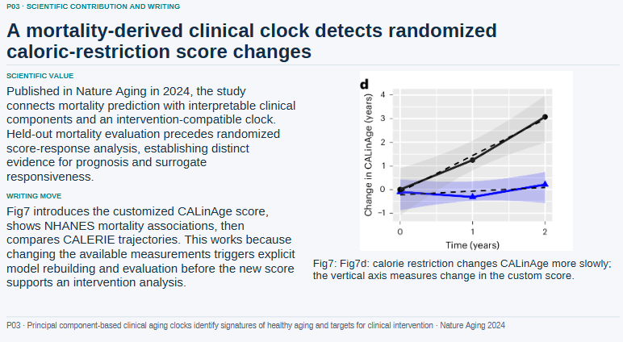

# TOMC in Practice: Three Real Projects

Updated: 2026-10-22 (public-evidence review; production cutoffs unchanged). This record brings together reported measurements from three completed projects, using each project's original reporting cutoff.

**Three user-reported projects, with token and time savings measured separately. In the updated research comparison, the report records savings of 160,760 tokens (16.84%) and 34.921 seconds (1.12%), including compression preparation.** These projects used TOMC without a dedicated token-saving skill. Ordinary content, video-editing and research skills were part of the production workflows, with TOMC as the only tool specifically used for token optimization.

The public tables support arithmetic checks. The private source reports and request receipts are not included, so this repository does not independently reproduce the experiments. See [evidence review and promotional scope](#evidence-review-and-promotional-scope).

## Results at a glance

| Real project | Without TOMC → With TOMC | Tokens saved | Time saved |
| --- | --- | --- | --- |
| Xiaohongshu / Rednote post, 12 matched pairs | 886,936 → 841,182 model tokens | **45,754 (5.16%)** | **About 2 min 30 s (7.72%)**, cumulative model requests |
| Kuaishou video, 5 paired background-text packets | 27,104 → 15,681 proxy tokens | **11,423 (42.15%)** | Complete-workflow time saving not measured |
| Research slides and revisions, 24 matched pairs | 954,543 → 793,783 model tokens | **160,760 (16.84%)** | **About 35 s (1.12%)**, requests plus compression preparation |

Xiaohongshu's request time was approximately 32 min 19 s → 29 min 49 s. Research was 51 min 50.872 s → 51 min 15.951 s with preparation included. The measured time ranges are labeled per row. Neither is a measurement of total human production time.

| Project | Deliverable | User messages | Comparison and call counts |
| --- | --- | --- | --- |
| Xiaohongshu | 20 pages, 6 groups, 4 chapters | 19, including 13 content-edit requests | 12 matched pairs, 24 model calls |
| Kuaishou | Approximately 5:12 video plus cover | 5 in the production phase | 5 paired text packets, 113 actual production model requests |
| Research | 10 papers, 28 English slides and Chinese speaker notes | 29 across the project, 16 during the TOMC phase | 24 matched pairs, 48 model calls. The current 10-paper subset has 13 pairs |

User-message counts and generation-task pairs are separate measures. One message can lead to multiple requests, tool calls and revisions. Research's 13-pair paper workflow is part of the 24-pair delivered-workflow comparison.

Xiaohongshu and research use actual model-reported usage. Kuaishou compares the same external material before and after preparation with the `o200k_base` proxy tokenizer. Its 42.15% describes packet reduction. Best-round savings remain in the individual case records, while the headline table uses aggregate savings.

## Settings: default mode and strength 80

| Project | User-reported setup | Parameters visible in saved records | Preparation frequency and method |
| --- | --- | --- | --- |
| Xiaohongshu | Default mode, described by the user as default strength 60 | `prepare_context(history, task)` with the default budget, retaining approximately 80% of lexical material | External context prepared before each measured B request, with essential facts protected separately |
| Kuaishou | Default mode, described by the user as default strength 60 | Explicit lexical budgets of 2,800, 3,000, 3,600, 2,300 and 3,500 across five rounds | One MCP `prepare_context` call per round, using `rag` for the first two and `tomc_raw` for the last three |
| Research slides | Compression strength 80, preparation before every call | The original experiment report records a 60% external-material retention target before each B request | Official Python entry point sharing the MCP compression core, called before each measured B request |

**The user confirmed that 80 means compression strength, not 80% material retention.** User-facing strength labels and logged budgets are recorded separately. The logs do not independently establish a mapping from strength 80 to 60% retention. In the [Python API](../src/tomc/easy.py), the default is `max(1024, ceil(history_tokens * 0.8))` under the lexical counter; this also appears in both cited TOMC source commits. That API accepts a lexical `budget`, with no `strength` argument. The README's default 80% retention therefore does not specify the research run's user-reported strength setting or its provider-token saving. The projects also differ in task and material, so they do not isolate the effect of changing strength alone.

All three projects record `gpt-6.1-sol` with `high` reasoning effort. Xiaohongshu and research comparisons used separate temporary `codex exec` sessions, with no additional tool calls inside each measured generation. Kuaishou used MCP context preparation within the actual production conversation. TOMC processed explicitly supplied external material. The host managed the active chat context.

## Case 1: A 20-page Xiaohongshu post


### Task and versions

A comparison of six sixth-generation K-pop girl groups, delivered as a 20-page post with 4 chapters. The completed-post project contained 19 user messages, including 13 content-edit requests. The primary comparison uses the 12 matched pairs in `R03–R14`, with 12 model calls per arm. Later promotional graphics and additional revisions are outside this snapshot.

The installation record lists plugin package `0.1.2`, core `0.1.0` and source commit `7380ca04adcd41e3c949fb35458771e46c02596e`. Codex CLI was `0.163.0-alpha.10.2`. The post snapshot cutoff was 2026-10-18 09:03:50.804, Asia/Shanghai.

Each pair matched task, source-history and protected-evidence hashes, model and reasoning effort. Each round's external history had a lexical estimate of 22,126. The default budget was 17,701, with approximately 17,695–17,701 retained. Data tables and essential facts were kept outside the compression region in both arms.

### Token comparison

| Metric | A: without TOMC | B: with TOMC | A−B |
| --- | --- | --- | --- |
| Input tokens, including cached input | 766,119 | 725,644 | 40,475 |
| Cached input, included above | 166,016 | 161,280 | 4,736 |
| Uncached input | 600,103 | 564,364 | 35,739 |
| Output tokens, including reasoning | 120,817 | 115,538 | 5,279 |
| Total tokens | 886,936 | 841,182 | 45,754 |

Aggregate total-token savings were **5.16%**, with input reduced by **5.28%**. The best single round was R03, from 67,466 to 61,826 total tokens, saving 5,640 tokens or **8.36%**.

| Round | A total tokens | B total tokens | Tokens saved | Reduction | A request seconds | B request seconds |
| --- | --- | --- | --- | --- | --- | --- |
| R03 | 67,466 | 61,826 | 5,640 | 8.36% | 194.951 | 161.552 |
| R04 | 72,933 | 72,780 | 153 | 0.21% | 175.601 | 207.613 |
| R05 | 67,976 | 64,846 | 3,130 | 4.60% | 112.781 | 95.753 |
| R06 | 72,951 | 68,179 | 4,772 | 6.54% | 212.758 | 180.427 |
| R07 | 77,778 | 74,826 | 2,952 | 3.80% | 163.707 | 164.705 |
| R08 | 80,618 | 76,932 | 3,686 | 4.57% | 179.130 | 151.675 |
| R09 | 75,410 | 70,243 | 5,167 | 6.85% | 115.156 | 92.102 |
| R10 | 84,313 | 78,822 | 5,491 | 6.51% | 175.218 | 150.510 |
| R11 | 50,352 | 48,192 | 2,160 | 4.29% | 77.976 | 90.297 |
| R12 | 77,336 | 73,036 | 4,300 | 5.56% | 118.124 | 116.020 |
| R13 | 52,502 | 50,018 | 2,484 | 4.73% | 54.489 | 58.493 |
| R14 | 107,301 | 101,482 | 5,819 | 5.42% | 359.052 | 320.115 |

Earlier round `R00a` used a different treatment, and `R01/R02` had contaminated comparisons. They are excluded from the savings calculation above. The historical ledger retains all 15 calls per arm before promotional work: A used 1,037,437 tokens and B used 980,203. That ledger is separate from the 12 valid matched pairs.

### Time, CPU and memory

| Metric | A: without TOMC | B: with TOMC | Observed difference or scope |
| --- | --- | --- | --- |
| Cumulative wall time for 12 model requests | 1,938.942 s | 1,789.262 s | 149.680 s less, approximately 7.72% |
| Cumulative outer preparation wall time | 11.829 s | 5.700 s | Includes process startup and scheduling |
| Requests plus outer preparation wall time | 1,950.771 s | 1,794.962 s | 155.810 s less |
| Cumulative internal preparation-worker wall time | 0.875201 s | 2.620329 s | B used 1.745128 s more |
| Cumulative preparation-worker CPU time | 0.890625 CPU s | 3.218750 CPU s | B used 2.328125 CPU s more |
| Maximum single-worker peak memory | 16,101,376 B (15.355 MiB) | 24,440,832 B (23.309 MiB) | B used 8,339,456 B more |
| Model-client CPU and peak memory | Not collected | Not collected | Resource measurements above cover the preparation worker |
| Local CPU utilization percentage | Not collected | Not collected | Distinct from cumulative CPU seconds |

CPU and memory measurements cover an isolated preparation process, including the Python interpreter and imports. Outer preparation time already includes internal worker time. Arm A also used a preparation worker to read the uncompressed material. In this observation, cumulative model waiting time fell while local preparation used slightly more CPU and memory.

These figures cover accumulated request and preparation time. Human review, layout, rendering and parallel production activities were not independently replayed for each arm. Whole-project labor-time savings were not measured.

### Files and installation footprint

| Logical file sizes across 12 rounds | A | B | A−B |
| --- | --- | --- | --- |
| external_history.txt | 825,744 B | 825,744 B | 0 B |
| prepared_context.txt | 825,744 B | 652,464 B | 173,280 B |
| prompt.txt | 1,904,119 B | 1,730,839 B | 173,280 B |
| response.txt | 220,085 B | 235,348 B | -15,263 B |

The saved `prepared_context.txt` files and the complete `prompt.txt` files containing that context each decreased by 173,280 B. They are separately stored files. UTF-8 reply bytes and model output tokens use different units, and B's reply files were larger in bytes. The 20 delivered PNGs totaled **12,870,832 B**, representing the shared final production output. Separate A/B image-storage savings were not measured.

Historical installation measurements were 157,379,705 B for the source checkout, 46,193,604 B for the plugin package and environment, and 33,628,251 B for the uv executable. These are logical file sizes at the measurement point, including environment or development files. They do not represent a minimum plugin download size. Complete initial installation time, CPU and download traffic were not collected.

### What this case suggests

Repeatedly carrying long background material can accumulate savings even with a conservative default budget. This task also needed substantial protected data and creative output, so total-token savings were smaller than the external-history reduction. Essential facts were protected separately after early omissions. Research background and historical explanations were suitable compression targets, while numbers and citations stayed intact.

## Case 2: A Kuaishou video and cover


### Task and comparison

A meeting-room discussion was edited from approximately 11 minutes 40 seconds of source footage into a 312.366667-second video, approximately 5:12, at 1080×1920 with H.264/AAC, plus a cover. The production phase contained 5 user messages, including editing revisions and account-workflow updates.

**All five rounds saved paired A/B text packets using the same source material and task.** A contained the full packet, and B contained TOMC-selected context. Both were counted with the same proxy tokenizer. The actual production conversation separately contained 113 model requests. Those requests do not constitute 113 A/B pairs.

Versions were plugin `0.1.2`, Python `3.12.14` and tiktoken `0.14.0`. The production measurement window was 2026-10-18 05:46:34.846 to 08:19:21.748, Asia/Shanghai. The main case includes rounds 001–005, with later promotional revisions recorded separately.

### Five-round token comparison and settings

| Round | A packet tokens | B packet tokens | Tokens saved | Reduction | TOMC service seconds |
| --- | --- | --- | --- | --- | --- |
| 001 | 4,200 | 2,899 | 1,301 | 30.98% | 0.0240093 |
| 002 | 5,523 | 3,076 | 2,447 | 44.31% | 0.0155380 |
| 003 | 6,644 | 3,724 | 2,920 | 43.95% | 0.0182711 |
| 004 | 5,143 | 2,342 | 2,801 | 54.46% | 0.0193568 |
| 005 | 5,594 | 3,640 | 1,954 | 34.93% | 0.2132424 |

The aggregate was **27,104 → 15,681**, saving **11,423** packet proxy tokens or **42.15%**. Round 004 reached **54.46%**.

| Round | Method | Lexical budget | Lexical input | Lexical output | Actual retention |
| --- | --- | --- | --- | --- | --- |
| 001 | rag | 2,800 | 4,032 | 2,693 | 66.79% |
| 002 | rag | 3,000 | 5,474 | 3,000 | 54.80% |
| 003 | tomc_raw | 3,600 | 6,540 | 3,599 | 55.03% |
| 004 | tomc_raw | 2,300 | 5,126 | 2,299 | 44.85% |
| 005 | tomc_raw | 3,500 | 6,097 | 3,499 | 57.39% |

Lexical estimates control TOMC's budget. The proxy tokenizer measures packet length. These are separate counting methods. Actual model requests also include task instructions, host history and tool records beyond the prepared material.

### Actual production-conversation usage

| Metric | Recorded production-phase usage |
| --- | --- |
| User messages | 5 |
| Model requests | 113 |
| Input tokens | 20,044,994 |
| Cached input, included above | 19,305,856 |
| Uncached input | 739,138 |
| Output tokens | 143,639 |
| Reasoning output, included above | 58,294 |
| Input plus output | 20,188,633 |
| TOMC calls | 5, all successful |

This table records the actual single production workflow. The five-round A/B table measures the external packets. A complete independent production run without TOMC was not performed, so whole-workflow token, cost, time and CPU savings remain unmeasured. Round 003 also used cover-image generation, whose internal tokens and cost were not returned.

### Time, CPU and memory

| Metric | Recorded value | Scope |
| --- | --- | --- |
| Sum of 5 TOMC service-reported durations | 0.2904176 s | Per-call values appear above |
| Sum of 5 outer TOMC tool wall times | 0.293 s | Tool start-to-finish intervals, including scheduling |
| Sum of host active-task durations across 5 rounds | 2,887.639 s, approximately 48 min 8 s | Includes models, tools and waiting |
| Elapsed time from the first start to the end of round 5 | 9,166.902 s, approximately 2 h 32 min 47 s | Includes user review and gaps between rounds |
| Independent A/B whole-production time and time saved | Not measured | Paired packets and actual production time are recorded separately |
| TOMC CPU seconds, utilization percentage and peak memory | Not collected | Service duration does not measure CPU time |
| Whole-production CPU and memory, including FFmpeg | Not fully collected | No inference from video duration |

TOMC tool time is already part of host active-task time. Service calls were short, while transcription, editing, rendering and human review had their own costs. The available records keep those scopes separate.

### File footprint

| Item | Logical file size | Scope |
| --- | --- | --- |
| Five A full external-context text files | 84,903 B | Sum of `A_full_context.txt` files |
| Five B prepared-context text files | 46,818 B | Sum of `B_TOMC_context.txt` files |
| Reduction in saved external-context text | 38,085 B | Excludes task instructions counted in packet-token comparisons |
| Source video | 810,471,146 B | Original footage |
| Final video | 396,542,970 B | Edited and encoded deliverable |
| Cover included here | 153,944 B | The user's selected cover |
| Separate plugin installation footprint | Not collected | Other projects' environment sizes are not substituted |

The source-to-final video size difference comes from editing and encoding. It is separate from TOMC's context reduction.

### What this case suggests, including later records

When only part of a long transcript is relevant to an edit, selecting external context can substantially reduce the packet. This run also omitted some family-budget background and a compromise-budget window. Production returned to the full transcript and timecodes. A useful workflow is to retain the original transcript and word-level timing, use prepared context to locate relevant sections, then check the original material during precise editing.

Later promotional rounds used shorter packets, several of which remained unchanged after preparation. The broader 14-round record contains 16 user messages, 183 model requests and 35,600,221 host tokens. Of 15 TOMC attempts, 12 succeeded and 3 failed, with failures in rounds 007/008. The 12 available packet pairs totaled 31,059 → 19,636, a 36.78% reduction. These broader historical figures are separate from the five production rounds above.

## Case 3: Literature analysis and research slides



### Main result: fewer tokens and a modest time saving

**Across 24 matched generation-task pairs, TOMC saved 160,760 tokens (16.84%) and 34.921 seconds of cumulative request time (1.12%), including compression preparation.** Local client CPU plus preparation increased by 2.71%, while maximum sampled request-client RSS decreased by 2.65%.

| Metric | A: without TOMC | B: with TOMC | Change |
| --- | --- | --- | --- |
| Total tokens | 954,543 | 793,783 | 160,760 fewer, 16.84% |
| Cumulative model-request wall time | 3,110.872 s | 3,072.498 s | 38.374 s less, 1.23% |
| Requests plus compression preparation | 3,110.872 s (51 min 50.872 s) | 3,075.951 s (51 min 15.951 s) | 34.921 s less, 1.12% |
| Sampled model-client CPU time | 119.600 CPU s | 119.430 CPU s | 0.170 CPU s less |
| Client CPU plus compression preparation | 119.600 CPU s | 122.839 CPU s | 3.239 CPU s more, 2.71% |
| Maximum sampled single-request peak RSS | 417,918,976 B | 406,831,104 B | 11,087,872 B less, 2.65% |
| Additional compression preparation | 0.000 s | 3.453 wall s and 3.409 CPU s | Included in the combined rows above |

CPU and memory cover the local request client. Compression-process memory and cloud model resources were not measured. CPU seconds measure cumulative processor time, not CPU utilization percentage. RSS is the largest sampled peak among requests, rather than total project memory.

### Task, conversations and comparison scope

The project analyzed literature on healthy aging and wearable world models and produced reviews of 10 papers, a 28-slide English deck and Chinese speaker notes. The updated source report includes a further revision addressing why the papers were publishable and what their figures demonstrated.

| Scope | Matched pairs | Model calls | Batches | A total tokens | B total tokens | Savings |
| --- | --- | --- | --- | --- | --- | --- |
| Delivered production and revisions, primary comparison | 24 | 48 | 1–21, 76–78 | 954,543 | 793,783 | 160,760, 16.84% |
| Current 10-paper workflow, subset of the primary comparison | 13 | 26 | 12–21, 76–78 | 602,877 | 479,752 | 123,125, 20.42% |

The project had 29 user messages, including 16 during the TOMC phase. The **24 pairs are generation tasks, not 24 conversation rounds**. Each task ran once in each arm. The 13-pair paper workflow is a subset of the 24-pair primary comparison, so their savings must not be added together.

This update supersedes the earlier 23-pair reporting cutoff by adding batch 78. Consequently, the current paper workflow now has 13 pairs instead of 12. The earlier 20.60% figure described the 12-pair snapshot before that revision. The current figures above include it.

The fixed production cutoff is 2026-10-19 04:14:31.838, Asia/Shanghai. The supplied report describes a recheck on 2026-10-21. Its author reports that 48 original call receipts and events, task/request hashes and 24 preparation records were verified. This repository update recalculates the report's per-call tables and summary formulas. The private raw receipt bundle was not supplied with the Markdown and is not republished here.

### Settings and execution

The user described the setting as compression strength 80, with preparation before every call. The saved execution records specify a **60% external-material retention target**, estimated with `regex-v1`, and `prepare_context` before each B request. The arm name remains `B_TOMC_60_every_call`. Strength and retention are separate recorded fields.

Python was `3.12.14`, TOMC commit was `d848a4a2d53e000a96dca519c1e28dcf68813acb`, and the research-project commit was `cd745fe048983669a6a38e6e33a574f79a2bd88a`. Both arms used `gpt-6.1-sol` with `high` reasoning effort and the same task instructions within each pair. Revisions could use each arm's own draft. Most early batches ran A before B, while batches 77 and 78 ran in parallel. Order was not randomized. Because revisions could use each arm's own earlier draft, later pairs need not have identical source text; they measure the evolving workflow comparison rather than an isolated compression-only effect. Tasks within a project are also dependent and are not independent experimental replicates.

The target does not mean every packet retained exactly 60%. Batch 4 retained 33.36%, and other rows also varied. The preparation table below shows the recorded lengths for each selected request.

### Token detail: all 24 delivered pairs

| Metric | A: without TOMC | B: with TOMC | A−B |
| --- | --- | --- | --- |
| Input tokens, including cached input | 815,151 | 642,647 | 172,504 |
| Cached input, included above | 38,144 | 45,312 | -7,168 |
| Uncached input | 777,007 | 597,335 | 179,672 |
| Output tokens, including reasoning | 139,392 | 151,136 | -11,744 |
| Total tokens | 954,543 | 793,783 | 160,760 |

Input decreased by 21.16%, while B produced 11,744 more output tokens. The net total-token saving is 16.84%. All 24 selected B calls used fewer total tokens, but only 10 had shorter model-request wall time. The highest single-call token reduction was batch 18 at 27.66%.

| Batch | Stage | A tokens | B tokens | Tokens saved | Reduction | A seconds | B seconds |
| --- | --- | --- | --- | --- | --- | --- | --- |
| 1 | Initial overview | 42,817 | 36,361 | 6,456 | 15.08% | 143.341 | 159.630 |
| 2 | Initial overview | 42,804 | 35,259 | 7,545 | 17.63% | 144.471 | 141.049 |
| 3 | Initial overview | 54,762 | 47,452 | 7,310 | 13.35% | 149.006 | 240.014 |
| 4 | Initial overview | 32,842 | 25,581 | 7,261 | 22.11% | 101.711 | 73.576 |
| 5 | Overview fact revision | 30,463 | 28,120 | 2,343 | 7.69% | 43.798 | 65.589 |
| 6 | Overview fact revision | 26,753 | 26,690 | 63 | 0.24% | 50.363 | 60.688 |
| 7 | Overview content revision | 30,114 | 29,278 | 836 | 2.78% | 117.325 | 202.223 |
| 8 | Overview content revision | 29,481 | 27,023 | 2,458 | 8.34% | 124.740 | 130.817 |
| 9 | Overview content revision | 18,708 | 17,218 | 1,490 | 7.96% | 36.350 | 21.028 |
| 10 | Overview content revision | 26,907 | 25,115 | 1,792 | 6.66% | 289.131 | 58.083 |
| 11 | Overview content revision | 16,015 | 15,934 | 81 | 0.51% | 10.566 | 7.882 |
| 12 | Detailed paper review | 41,920 | 32,448 | 9,472 | 22.60% | 161.671 | 97.352 |
| 13 | Detailed paper review | 40,290 | 32,539 | 7,751 | 19.24% | 161.672 | 107.794 |
| 14 | Detailed paper review | 37,435 | 31,304 | 6,131 | 16.38% | 127.404 | 100.626 |
| 15 | Detailed paper review | 65,632 | 47,743 | 17,889 | 27.26% | 98.766 | 132.021 |
| 16 | Detailed paper review | 43,136 | 34,363 | 8,773 | 20.34% | 103.514 | 129.400 |
| 17 | Detailed paper review | 31,296 | 26,957 | 4,339 | 13.86% | 84.118 | 122.319 |
| 18 | Detailed paper review | 61,862 | 44,751 | 17,111 | 27.66% | 97.850 | 112.481 |
| 19 | Detailed paper review | 35,522 | 28,741 | 6,781 | 19.09% | 118.264 | 93.771 |
| 20 | Detailed paper review | 34,177 | 29,954 | 4,223 | 12.36% | 91.453 | 112.694 |
| 21 | Detailed paper review | 44,292 | 34,194 | 10,098 | 22.80% | 117.652 | 137.330 |
| 76 | 28-slide English deck | 57,632 | 47,915 | 9,717 | 16.86% | 184.586 | 221.443 |
| 77 | Chinese speaker notes | 67,542 | 54,298 | 13,244 | 19.61% | 348.403 | 370.164 |
| 78 | Publication value and figure analysis | 42,141 | 34,545 | 7,596 | 18.03% | 204.718 | 174.525 |

### Current 10-paper workflow: the 13-pair subset

| Metric | A: without TOMC | B: with TOMC | A−B |
| --- | --- | --- | --- |
| Input tokens, including cached input | 525,076 | 398,530 | 126,546 |
| Cached input, included above | 15,360 | 30,336 | -14,976 |
| Uncached input | 509,716 | 368,194 | 141,522 |
| Output tokens, including reasoning | 77,801 | 81,222 | -3,421 |
| Total tokens | 602,877 | 479,752 | 123,125 |

The subset saves 123,125 total tokens, or 20.42%. Its cumulative model-request time is 1,900.071 s for A and 1,911.920 s for B, so B took 11.849 s longer before preparation. Summing the rounded preparation rows adds 2.354 wall s and 2.342 CPU s to B. On that rounded basis, request time plus preparation is approximately 14.203 s longer. The local client CPU totals are 73.090 CPU s and 73.930 CPU s before preparation.

This subset and the 24-pair primary comparison answer different scope questions. The primary comparison saves a small amount of cumulative time even though this subset takes longer.

### Preparation lengths and overhead

| Batch | Lexical input | Lexical output | Retained | Wall seconds | CPU seconds |
| --- | --- | --- | --- | --- | --- |
| 1 | 16,176 | 9,705 | 60.00% | 0.108 | 0.108 |
| 2 | 16,685 | 10,011 | 60.00% | 0.108 | 0.108 |
| 3 | 24,985 | 14,988 | 59.99% | 0.127 | 0.127 |
| 4 | 12,548 | 4,186 | 33.36% | 0.143 | 0.130 |
| 5 | 4,141 | 2,483 | 59.96% | 0.153 | 0.153 |
| 6 | 4,283 | 2,567 | 59.93% | 0.103 | 0.103 |
| 7 | 8,423 | 5,052 | 59.98% | 0.104 | 0.104 |
| 8 | 7,805 | 4,681 | 59.97% | 0.093 | 0.093 |
| 9 | 1,764 | 1,007 | 57.09% | 0.026 | 0.020 |
| 10 | 4,013 | 2,407 | 59.98% | 0.122 | 0.116 |
| 11 | 134 | 76 | 56.72% | 0.011 | 0.006 |
| 12 | 18,872 | 11,317 | 59.97% | 0.122 | 0.121 |
| 13 | 16,988 | 10,186 | 59.96% | 0.104 | 0.104 |
| 14 | 15,727 | 9,436 | 60.00% | 0.090 | 0.090 |
| 15 | 38,311 | 22,986 | 60.00% | 0.119 | 0.118 |
| 16 | 20,073 | 12,040 | 59.98% | 0.085 | 0.085 |
| 17 | 10,323 | 6,193 | 59.99% | 0.059 | 0.059 |
| 18 | 31,106 | 18,661 | 59.99% | 0.140 | 0.140 |
| 19 | 13,563 | 8,133 | 59.96% | 0.082 | 0.082 |
| 20 | 13,198 | 7,918 | 59.99% | 0.078 | 0.077 |
| 21 | 19,905 | 11,938 | 59.97% | 0.115 | 0.114 |
| 76 | 32,440 | 19,461 | 59.99% | 0.438 | 0.436 |
| 77 | 33,436 | 20,061 | 60.00% | 0.724 | 0.719 |
| 78 | 15,999 | 9,598 | 59.99% | 0.198 | 0.197 |

The exact primary-comparison preparation totals quoted in the source recheck are 3.452814627 wall s and 3.409327803 CPU s. The table rounds each call to three decimals, so summing displayed rows can differ by a few milliseconds.

The source provides the exact time-saving calculation:

```text
3,110.872489632 - (3,072.498458512 + 3.452814627)
= 34.921216493 seconds saved
```

The combined CPU calculation is `(119.430 + 3.409327803 - 119.600) / 119.600`, an increase of 2.71%.

These are accumulated CLI request durations, including waiting. Some requests overlapped. Shared paper reading, fact-checking, editing and layout were performed once and recorded separately, so the figures do not establish whole-project labor-time savings.

### Rendering, installation and storage

The updated report retains 14 successful 28-slide deck renders, totaling 155.894 wall s and 142.148 CPU s, plus 10 Chinese-notes exports totaling 48.687 wall s and 46.705 CPU s. These include revisions with different states and workloads. Render high-water memory can carry over from earlier operations in the same process, so those records are not independent A/B memory comparisons. Failed prototypes and failed renders were not all fully timed.

| Latest recorded deliverable size | A | B | B−A |
| --- | --- | --- | --- |
| 28-slide PPTX | 1,094,861 B | 1,095,803 B | +942 B |
| English-slide PDF | 1,524,545 B | 1,523,976 B | -569 B |
| Chinese-notes PDF | 1,898,065 B | 1,900,210 B | +2,145 B |
| Chinese-notes DOCX | 60,047 B | 60,893 B | +846 B |
| Total of the four files | 4,577,518 B | 4,580,882 B | +3,364 B |

These are the latest deliverable sizes in the supplied report. One original slide screenshot remains in this directory as the case illustration. It is not a replacement for the latest full deck or a new image comparison.

Historical installation sizes remain 158,401,058 B for TOMC source, 46,463,758 B for the Python environment and 11,124,117 B for cache. At the updated report's collection point, regular-file sizes without following symlinks were 158,007,842 B, 45,128,420 B and 9,768,341 B respectively. These logical file sizes do not establish allocated disk space or minimum installation size. The successful MCP validation took 1.915 s. Complete installation time and CPU were not recorded. Cleanup removed 150 obsolete output files totaling 102,465,226 B in 2.053 s, recorded separately from TOMC savings.

### Quality and follow-up work

The first 10 detailed drafts contained 66 missing-information fields in A and 90 in B, with 208 shared editing entries for A and 435 for B. In the newly included batch 78, A had no `QUERY` markers. B had markers in **7 papers and 15 fields, with 19 occurrences**. These are draft information gaps, not a measured factual-error rate.

Both arms then received shared source checking, figure interpretation, factual revisions and speaker-note editing. The final decks each contain 28 slides and passed the recorded structural checks. Final Chinese-note body counts are 12,622 characters for A and 13,113 for B. Equal page counts and passing structural checks do not substitute for blinded quality ratings or separately measured editing labor.

### Wider execution ledger

The 24 primary pairs exclude deferred second-batch work. Including that work gives 28 complete pairs, using 1,084,348 tokens in A and 903,889 in B, a 16.64% reduction. The actual completed-call ledger contains 30 A calls and 28 B calls, totaling 2,066,064 known tokens, plus unknown usage from two interrupted B calls. Unpaired work and interruptions are recorded as costs, not counted as savings.

The updated source also records 34 adopted preparation packets and 10 archived, unexecuted preparations. All 44 preparations totaled 5.423 wall s and 5.267 CPU s. Only the 24 matching preparations belong in the primary timing comparison.

## What do the saved tokens mean in dollars?

The original case estimates used rate assumptions recorded on 2026-10-19: US$2 per million uncached input tokens, US$0.10 per million cached input tokens and US$10 per million output tokens. The original pricing reference was the [GPT-6.1 Sol model page](https://developers.openai.com/api/docs/models/gpt-6.1-sol). The public-evidence review checks calculations under those assumptions; it does not independently verify the historical tariff or any invoice.

| Case | A equivalent per task | B equivalent per task | Difference per task | 100 similar tasks | 1,000 similar tasks |
| --- | --- | --- | --- | --- | --- |
| Xiaohongshu, 12 paired calls per arm | US$2.4249776 | US$2.3002360 | US$0.1247416 | 4,575,400 tokens, approximately US$12.47 | 45,754,000 tokens, approximately US$124.74 |
| Research, all 24 delivered pairs | US$2.9517484 | US$2.7105612 | US$0.2411872 | 16,076,000 tokens, approximately US$24.12 | 160,760,000 tokens, approximately US$241.19 |
| Research, 13-pair paper subset | US$1.7989780 | US$1.5516416 | US$0.2473364 | 12,312,500 tokens, approximately US$24.73 | 123,125,000 tokens, approximately US$247.34 |
| Kuaishou, five background-text packets | US$0.054208 | US$0.031362 | US$0.022846 | 1,142,300 proxy tokens, approximately US$2.28 | 11,423,000 proxy tokens, approximately US$22.85 |

The two research rows overlap and must not be added together. For Xiaohongshu and research, the formula is `(uncached input × 2 + cached input × 0.10 + output × 10) / 1,000,000`. Kuaishou estimates apply only the assumed US$2/M uncached input rate to packet proxy tokens, excluding output and host-cache effects. Under these assumptions, the equivalent cost reductions are 5.14% for Xiaohongshu and 8.17% for the primary research comparison (13.75% for its overlapping subset). Token reduction percentages do not equal these cost percentages. Kuaishou's proxy calculation does not establish a provider-token or billing saving.

The 100-task and 1,000-task projections multiply the unrounded single-case results, assuming the same workload, rates and cache/output mix. These are API-equivalent estimates. Actual subscription billing was not available. Labor, hardware, image-model and energy costs are outside the estimates. Best-round percentages are not applied to whole tasks.

## Practical lessons from these three projects

1. **Start with long background material that gets read repeatedly.** Literature notes, transcripts, external project history and old-version explanations were useful targets. The 24-pair research workflow removed 172,504 input tokens, showing how repeated preparation can accumulate savings.
2. **Protect exact evidence separately.** Keep numerical tables, citations, verbatim speech, timecodes, formulas and current task requirements intact. Compress background, then retrieve precise evidence when needed.
3. **Start with defaults and tune using omissions and final usage.** The first two projects used the user's reported default mode. Research used strength 80 and preparation before every call. Material length, relevance, output size, caching and repair work all affect the result.
4. **Short inputs may need no preparation.** Several later Kuaishou packets remained unchanged. Repeated preparation offers limited benefit when the new instruction is brief and the material is already compact.
5. **Track tokens, time and machine resources separately.** Xiaohongshu's cumulative requests took approximately 150 s less. The 24-pair research workflow saved 34.921 s including preparation, while its 13-pair paper subset took longer. Fewer tokens do not guarantee shorter waits in every stage. Local CPU, cloud inference and video rendering have different resource scopes.
6. **Test a token-saving skill combination as a separate experiment.** None of these cases measured that combination. A useful next comparison would hold task, material and quality requirements fixed while testing TOMC, a dedicated skill and both together.

These observations come from one user's three real projects. Each generation task had one run per arm rather than repeated randomized trials. The figures retain their task and configuration scope.

## Measurement definitions and provenance

Total tokens equal input plus output. Cached input is already included in input, and reasoning output is already included in output. Reduction rates use `(A−B)/A`. CPU seconds measure accumulated process CPU time, while wall seconds measure elapsed time. One MiB equals 1,048,576 B. Directory sizes are logical file bytes. Allocated disk space, system-wide CPU utilization, cloud CPU/GPU usage, power, energy and complete network traffic were not measured.

This directory publishes measurement fields and three user-selected deliverable images. Private conversations, transcripts, model replies, full papers and credentials remain local. The source labels and hashes below identify the owner's retained records. They are provenance entries rather than repository-relative file links.

| Source record | SHA256 |
| --- | --- |
| Xiaohongshu stage-usage report, v14 | `4de4fe4427325f5bf8c32fa6325f3bd4f33a677131679c0b2c47bd4bf64a0dfc` |
| Kuaishou per-round context-comparison CSV | `db34ce7db9cf902c644d906536263658b80e6e3a62e96a732f09f78547aa1133` |
| Kuaishou extended audit, `audit_summary.json` | `dd01ca7392da548fa1fd372815197ed0661bfb9fc1ca15c5ef647a0277681a57` |
| Research complete TOMC report, updated and rechecked 2026-10-21 | `6ca9c3b0528d1f453b8e7b79aa39451b5b79a9aedaeb9c6aca4804c4c41254dc` |

According to the PR author, the Kuaishou source CSV includes later promotional iterations. This case selects the first five production rounds. Xiaohongshu timing and resources were recalculated from `R03–R14` records in `result.json` and `preparation_metrics.json`, with file sizes summed from the associated files. Research now uses the updated report supplied on 2026-10-21, including batch 78. The PR author reports checking its 58 completed-call rows for token arithmetic and summing the selected 48 calls to verify the primary totals. Preparation, CPU, memory, rendering, quality and deliverable sizes were reconciled with the updated tables. Exact primary timing uses the precision quoted in the source recheck. The other two cases retain their original snapshots. This documentation update did not run new paid A/B model experiments.

### Evidence review and promotional scope

The 2026-10-22 review uses the public repository only. It recomputes all published per-pair token differences and percentages, aggregate token sums, input/cache/output identities, lexical retention ratios, preparation-duration sums, stated cost formulas and image bytes/hashes. The three headline token reductions are arithmetically consistent with the displayed rows. Summing rounded request rows differs from quoted aggregate times by 0.001 s in Xiaohongshu A and in each research arm; the rounded research preparation rows total 3.452 wall s and 3.410 CPU s. These differences are consistent with rounding. The quoted full-precision research formula evaluates to 34.921216493 s; its operands cannot be independently recovered from private receipts here.

| Evidence | Verifiable from this public PR | Remaining limitation |
| --- | --- | --- |
| Xiaohongshu | 12 published pair rows sum to 886,936 and 841,182 tokens; reported aggregate accounting and cost formulas are consistent | Source v14, per-request usage, matching hashes, preparation and resource records are private. Pair validity, exclusions and timing cannot be independently authenticated |
| Kuaishou | Five published packet rows sum to 27,104 and 15,681 proxy tokens; durations sum to 0.2904176 s | Original text packets, CSV and audit JSON are private, preventing independent re-tokenization. The 113-request production ledger has no complete A/B control |
| Research | 24 published pair rows and the 13-pair subset reproduce the reported token totals and rounded request sums; stated CPU/RSS and cost arithmetic is consistent | The source report, original receipts/events, task/request hashes, preparation records, per-call cache/output splits and full 58-call ledger are private. Matching, quality counts, CPU/RSS sampling and completeness remain author-reported |
| Three images | Files exist, decode, and match the published byte counts and SHA256 values | Illustrations show selected deliverables; they do not demonstrate equivalent A/B quality or validate the private workflow measurements |

Source-record SHA256 strings identify expected retained files. Without those files, a digest alone does not verify their contents, authenticity or completeness. Earlier checks of the source report's 58 rows are attributed to the PR author; this review verifies the 48 primary calls only through the 24 published pair totals. It does not independently recheck all original experiments.

Use these as **single-user case observations with reported measurements and explicit scopes**. The reported model-token totals for Xiaohongshu and research, and packet-proxy reduction for Kuaishou, may be cited with those qualifications. Keep the proxy label next to Kuaishou's 42.15%, and keep the research primary result separate from its overlapping subset.

These cases do not establish quality preservation, a general speedup, lower cloud compute or energy, or actual invoice savings. Research reports 90 missing-information fields in B versus 66 in A and 435 editing entries versus 208; these counts are not standardized error rates or timed labor. Shared source checking may repair omissions, but its separate A/B labor cost was not measured. Xiaohongshu protected evidence after early omissions, and Kuaishou returned to original transcripts/timecodes for omitted details. Final screenshots, equal slide counts and structural checks cannot resolve those quality limitations.

The research cumulative time difference is an observation from nonrandomized, single-run pairs with some overlapping execution. Only 10 of 24 B requests were faster, and batch 10 alone accounts for 231.048 s of request-time reduction, exceeding the aggregate 38.374 s reduction before preparation. No repeated trials, uncertainty interval or blinded quality comparison is supplied. The recorded 1.12% cumulative-time decrease must not be presented as a reliable whole-project productivity improvement. Further independent verification would require a privacy-reviewed receipt/pairing export and separate quality/editing-time evidence; no new paid model experiments were run for this review.

### Images included here

| Project | File | Bytes | SHA256 |
| --- | --- | --- | --- |
| Xiaohongshu | `xiaohongshu/post.png` | 1,585,626 | `d0aa2e7685427b2ffc65bb6b1dc4bf51050671548f101b349478936d71b52684` |
| Kuaishou | `kuaishou/cover.png` | 153,944 | `3ee75c547d6e5417fbd01214db2a1c40b38a37ea231ca8d748fcd4fb597d61cd` |
| Research slides | `research-ppt/slide.png` | 89,265 | `92637f03413d0ed83bbad17fb259cc6678287e7a2b992b8de8320d0210982900` |
