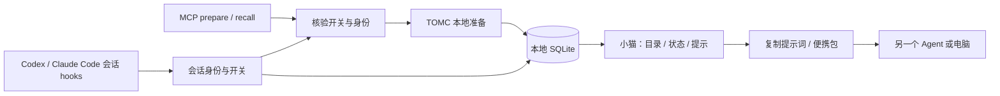

# TOMC 0.1.5 本机交付记录

2026-10-22 UTC。三个 Agent 并行完成会话接入、上下文存储与小猫界面，主 Agent 完成 MCP 联调、打包和本机安装。

## 可以使用的功能

- 点击小猫面板的「上下文与接续」，查看已保存的处理结果；支持搜索、正文预览、重命名与删除。
- 「复制接续提示词」复制完整、自包含的上下文与原任务，可直接交给另一个 Agent。不会自动向其他对话发送消息。
- 「导出便携包」生成 `CONTEXT.md`、`START_HERE.md`、`metadata.json`。另一台电脑可直接阅读，或在 TOMC 中导入。可以将选定导出目录放进 Git；TOMC 不自动提交或推送。
- TOMC 处理默认开启，每个已登记会话可以独立关闭，选择持久保存。全局处理开关和「保存上下文记录」开关彼此独立。
- 在新建、恢复或提交输入等宿主事件切换到另一会话时，小猫上方出现提示。不操作就保持原设置；新会话默认开启，曾关闭的会话继续关闭。
- 展示处理前后文本 token 估算和所选费率对应的参考金额。负减少量、空结果和未测量状态不会算作实际节省。

上下文目录只包含成功准备并保存的结果。安装不会自动导入所有历史聊天；旧版只有数字统计的记录无法还原正文。原输入没有另存一份，但短输入可能完整出现在准备结果中。

## 原生自动压缩的验证结论

Codex、Claude Code 的已核验 hooks 支持会话元数据、工具调用拦截和部分参数改写，没有提供这里所需的“替换完整原生模型请求历史”入口。因此本版是**按需准备上下文 + 会话管理 + 便携接续**；不是已经接管所有聊天的自动压缩器，也没有验证真实账单节省。

单纯点击另一聊天标签不一定发出 hook 事件；界面显示的是“最近事件会话”，不冒充前台焦点。后台工具完成和回复停止事件不会抢走活动卡片。

Claude hook 注入本次会话身份且不自动批准工具。Codex 只拒绝被关闭会话的准备调用；启动时提供身份字段供调用方传入。Codex 的参数归属仍属于声明身份，不能称为不可伪造的请求认证。缺少身份且存在关闭会话时，MCP 返回 `identity_required`，不会退回全局开启继续准备；不会猜测小猫当前卡片就是请求来源。

可控 API 应用已有独立请求包装器，其测试覆盖消息替换、近期消息及工具调用配对保留等行为；它没有接管这两个原生客户端。后续若要达成“每轮真正节省请求 token”，需要可控请求发送入口，并比较完整输入、缓存、额外请求和结果质量。

依据：[Codex hooks](https://learn.chatgpt.com/docs/hooks)、[Claude Code hooks](https://code.claude.com/docs/en/hooks)。细节见 [宿主验证报告](host_integration_validation_20261022.md)。

## 本机安装与需要完成的加载步骤

已通过官方 Codex plugin 命令安装 `tomc-memory@tomc-local` 0.1.5。独立源目录为 `~/.codex/tomc/context-preview.1`；Claude 原有的用户级 `tomc-memory` MCP 已指向其中同一运行时。没有手工修改插件缓存。

小猫的五个界面/上下文模块已更新，原图像、动画和启动入口保留。启动器为 `~/.codex/tomc/pet.pyw`，本轮已启动并核验进程与状态文件更新，stderr 无报错。

会话 hooks 已写入 `~/.codex/hooks.json` 和 `~/.claude/settings.json`。**在 Codex 输入 `/hooks`，审阅并信任 TOMC hooks，然后重新加载或新开会话；Claude Code 也需重新加载接入。** 这是宿主的 hook 信任要求；安装器不写 trust/permissions，也不替用户跳过确认。已打开的会话仍可能持有旧工具版本。

本轮未完成真实客户端内“两个聊天切换 → 弹窗 → 关闭 → 拦截”的端到端验收，不能仅凭配置文件存在宣布它已生效。

备份位于 `~/.codex/tomc/archive/`，包括 Codex 原配置和本次 `session-update-*` 收据/原文件；Claude hook 安装前还保存了 `settings.json.tomc-backup-*`。没有删除原数据库或旧运行时。

## 架构与存储

默认数据库仍为 `~/.tomc/memory.sqlite3`，可由 `TOMC_MEMORY_PATH` 覆盖。原 notebooks 和数字 usage 保留；新增表与它们独立：

| 数据 | 保存内容 | 说明 |
|---|---|---|
| 上下文快照 | 准备正文、原任务、标题、来源、时间、预算、估算计数、版本和哈希 | 默认保存，可关闭；删除快照不回减数字统计 |
| 会话目录 | 宿主、会话 ID、可选标题/项目、最近事件和开关 | 不读取 transcript 文件、不存 hook 中的完整 prompt |
| 设置与最近活动 | 全局处理、记录正文开关、最近事件会话序号 | 最近活动仅用于展示 |
| 准备收据 | 准备 ID、结果状态、归属、估算计数、快照历史引用 | 不存正文；所引用快照可能已被删除 |
| 导出目录 | 正文、接续说明、版本元数据和内容校验值 | 每次新建独立目录；不包含项目文件或完整宿主聊天数据库 |

导入验证版本、尺寸、路径和内容校验值。同 ID 同内容去重，冲突拒绝；来源信息保留，但不自动绑定本机会话，也不增加本机处理统计。文本和数据库都是本地明文，不承诺脱敏或加密。

MCP 现有十个工具。新增 `get_status`、`list_contexts`、`get_context`、`make_handoff` 为只读工具；原六个工具保留，prepare/recall 增加可选会话身份字段。

## 验证证据

| 验证 | 结果 |
|---|---|
| MCP 协议、上下文库、会话控制、hooks、统计与请求包装器 | 138 passed，1 skipped |
| 安装包与 Codex 安装器 | 17 passed，1 skipped |
| Qt 界面交互 | 7 passed |
| 小猫/Claude 安全升级器 | 12 passed，1 skipped |
| 解包后真实 UV/MCP 启动、中文路径、重启读取 | 通过 |
| 本机新安装路径的独立测试数据库调用 | 通过，十工具可发现 |

合计 **174 项通过，3 项平台相关跳过**：两项 Windows 符号链接权限限制，一项 POSIX 可执行位测试。测试和演示均使用独立数据库，未把演示数据加入真实统计。没有付费模型请求。静态界面截图是演示数据，不是用户历史或真实省钱证据。

构建物位于 `outputs/session_workspace_20261022/packages/`；界面预览位于同级 `review/20261022T203249Z/`。开发方案原稿见 [产品架构草案](TOMC_product_architecture_draft_20261022T201152Z_zh.md)。
