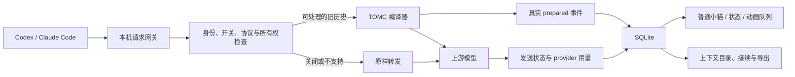

# TOMC 开发交接说明：真实聊天接入、上下文所有权与桌面反馈
版本：2026-10-23。面向接手开发者／编码 Agent。本文是开发说明，不是“功能全部完成”的声明。

## 1. 先读结论
当前 TOMC 已有本机请求网关、上下文编译器、SQLite 存储和 Qt 小猫。三个真实 Codex 聊天已经经过网关，单会话关闭也通过真实请求验证。
**尚未解决的核心：这些长聊天已有宿主原生压缩状态，当前适配器整体透传，所以 TOMC 额外压缩为零。**
接手者的第一任务是确定“谁管理活动聊天上下文、通过什么受支持接口让模型实际使用 TOMC 输出”，再实现与验收。不能靠启用 MCP、写配置或播放动画宣布省 token。

用户不希望每个聊天手动启动，也没有要求另外安装一个自研聊天客户端。若最终方案只能依赖自研客户端、宿主分支或新聊天迁移，应先明确这种产品代价，不能冒充原桌面插件无缝支持。

## 2. 用户要求与完成标准
1. 打开 Codex／Claude Code 后，适用聊天默认开启；旧聊天恢复、新聊天、并发聊天、子 Agent 都有明确身份和支持范围。
2. 单会话可关闭；不操作保持开启。切换提示不抢焦点、不反复打扰，不把后台请求当作用户切换。
3. 真正压缩且被请求采用时，有可核对的 token 输入变化、来源、状态；失败、透传、缓存复用不得伪造节省。
4. 每次真实新编译对应一次小猫动作；按**本次编译输入上下文长度**选四阶段，结束恢复普通猫。
5. 中文／English 一键切换并持久化，文本无乱码、无截断。
6. 点击小猫可浏览上下文目录、查看来源及版本、复制完整接续提示词。
7. 选择性导出到另一台电脑或交给另一个 Agent，验证能继续任务。GitHub 是可选的用户选择的传递方式，当前没有自动 Git 同步。

## 3. 从哪里接手
实际代码仓库：
`<repo>`

外层是论文项目，不要把本任务变成论文修改。
交接快照：branch `main`，HEAD `c03fbf1f2c4e6eb451ea3ecb04b484a6a97fc133`。检查时约 166 项工作区变动，其中 147 项未跟踪；这是会变化的现场数字。
**大量最新功能尚未进入提交：仅 clone 当前远端或只看 HEAD 不足以获得现场版本。** 接手前保存工作区清单、源代码与资产快照，逐项核对后在 `codex/` 分支开发。不要重置、清理或覆盖别人的改动。

本机安装与数据：
| 用途 | 路径／入口 |
|---|---|
| 网关 | `http://127.0.0.1:43187`；`/health` |
| 网关运行目录 | `%USERPROFILE%\.codex\tomc\gateway-016-20261022T210600Z` |
| 普通猫入口 | `%USERPROFILE%\.codex\tomc\pet.pyw` |
| 猫代码 | `%USERPROFILE%\.codex\tomc\pet-current\src\tomc` |
| Qt Python | `%USERPROFILE%\.codex\tomc\hourglass-ui\Scripts\python.exe`／`pythonw.exe` |
| 数据库 | `%USERPROFILE%\.tomc\memory.sqlite3` |
| 语言／价格 | `%USERPROFILE%\.tomc\ui_settings.json`、`pricing.json` |
| Codex 配置 | 用户 `.codex/config.toml` 的 `openai_base_url` |
| Claude Code 配置 | 用户 `.claude/settings.json` 中两项 TOMC 路由 env |
| 安装回执 | `%USERPROFILE%\.codex\tomc\archive` |
| 自启动 | 用户 Startup 中 TOMC Gateway.lnk 与 TOMC Cat.lnk |

这些是当前电脑路径，不要硬编码为产品安装路径。进程 PID 会变化，不能复制旧 PID 去停止进程。

## 4. 架构与代码索引


| 模块 | 主要文件与职责 |
|---|---|
| 请求边界 | `src/tomc/request_gateway.py`：解码、路由、身份、开关、透传、上游响应与数字回执 |
| Codex 协议 | `responses_request.py`：完整旧轮筛选、工具配对、原生／增量状态保护 |
| Claude 协议 | `anthropic_request.py`：主请求筛选、工具／签名／前缀兼容 |
| 编译 | `easy.py`、`gateway_protocol.py` 及其依赖：准备任务相关上下文 |
| 会话 | `session_store.py`、`session_hook.py`：开关、登记、最近宿主事件 |
| 活动事件 | `request_activity.py`：请求状态、单调序号 prepared 事件 |
| 用量 | `usage.py`、`cost_estimate.py`、`pricing_qt.py`：估算与参考价格 |
| 快照与搬迁 | `context_library.py`、`context_library_qt.py` |
| 猫与语言 | `usage_widget_qt.py`、`pet_growth.py`、`ui_language.py`、`oasis_qt.py` |
| 安装 | `install_request_gateway.py`、`activate_local_gateway.ps1`、`update_pet_ui.py`、`install_pet_startup.ps1` |

MCP 是按需工具入口；它本身不是宿主每次模型请求的自动拦截／历史替换接口。不要在活动聊天前后额外调用 MCP 重新压缩同一份宿主管理的历史来冒充自动接入。

## 5. 已证实的现场状态
| 项目 | 证据／限制 |
|---|---|
| 当前真实聊天接入 | `01a16537-0fd1-7c93-972e-8298f07c5570` 已有真实转发和上游用量 |
| 其他真实聊天 | BEAM 聊天与另一条原聊天也有网关请求；合计三个明确 ID，不等于所有历史聊天 |
| 默认与关闭 | 默认开启；当前聊天关闭后真实请求 reason=session_disabled；其他聊天继续开启；已恢复 |
| 当前额外压缩 | 三个聊天的新编译均为 0，最后 reason=native_compaction |
| 先前动画 | 2026-10-22 两个合成验收会话实际调用上游：输入 12,673／8,201，阶段 2／1，各有一次可见动作记录 |
| 四阶段与中英 | 有既往原生预览／语言验收记录，不能替代今天真实聊天端到端验收 |
| 普通猫 | 2026-10-23 发现未运行后恢复，补上 Windows 登录自启动；尚未重新登录验收该触发 |
| 跨电脑 | 有便携导出／导入实现；尚无真正第二台电脑端到端验收 |

证据入口：
- `docs/TOMC_reopened_chat_acceptance_20261023_zh.md`
- `outputs/open_session_acceptance_20261023/final-three-sessions.json`
- 同目录 `switch-disabled-observation.json`、`switch-restored.json`、`runtime-health.json`、`cat-startup-receipt.json`
- `docs/TOMC_animation_acceptance_20261022_zh.md`
- `outputs/native_real_compression_20261022T2218Z/observation.json`
- `docs/codex_desktop_reload_20261022.md`

## 6. P0：先解决上下文所有权与真实压缩接入
### 6.1 当前阻塞是什么
`responses_request.adapt_request` 遇到原生 compaction 项会整体透传；`context_management`、服务端／增量历史也有独立保护。
当前聊天确实存在宿主已生成的不透明压缩状态。这不是聊天文字碰巧提到“压缩”导致的误判。

需要细分并记录仅含结构元数据的原因：
- 显式 compact 操作；
- 普通 turn 携带以前的 compaction 状态；
- 服务端 context_management；
- previous_response_id／conversation 增量历史；
- 身份未知、协议未知、关闭、短历史等。

以上分类不应统一呈现为“正在压缩”。目前显式 compact 端点也不在普通 Responses 的 prepare 目标分支。

### 6.2 推荐实施顺序
**A. 先做受支持能力探针。** 对每个客户端版本验证是否存在能替换模型可见历史的正式扩展点，证明该接口确实生效、能恢复、能关闭。不把追加一段提示词视为替换旧历史；追加通常只会增加输入。

**B. 找到正式接管接口时，采用单一上下文所有者。** 定义历史版本、压缩代次、工具链边界、当前轮保护、恢复和回滚。确认宿主采用 TOMC 结果后再宣称“自动压缩”。不能随意全局关掉原生压缩；必须先有可工作的替代与长对话溢出处理。

**C. 找不到时，明确支持边界。** 可以交付“宿主原生管理 + TOMC 外部材料准备、接续与可视化”，但它不满足本项目“这些已有聊天由 TOMC 额外省 token”的全部要求。若只能修改宿主／自建客户端，应先提交架构决策和用户体验变化，不擅自把产品变成新客户端。

**D. 后续增量优化只作为研究分支。** 在具有明确上下文所有权的受控宿主中，可研究冻结完整原生窗口，只处理其后新增、完整结束且可解释的历史轮。必须知道原生窗口边界与来源，验证重放、工具续接、再次原生压缩与恢复。未经证明不得部署到当前用户聊天；不能直接删除 native_compaction guard。

### 6.3 原生协议边界
OpenAI 的 standalone compact 返回窗口可能还包含保留的其他项，不只是 encrypted 项；后续应保留其规范窗口。服务端 stateless 链的裁剪规则有不同适用范围。不能把两者混用。[OpenAI Compaction](https://developers.openai.com/api/docs/guides/compaction)

App-server 有触发原生 compaction 及其事件的协议；这并不自动给当前桌面 MCP 插件提供替换算法或附加到已有 stdio 的入口。[Codex App-server](https://learn.chatgpt.com/docs/app-server)

Claude 的 PreCompact／PostCompact 是宿主生命周期接口；事件可用不等于能用 TOMC 替换结果。应核对实际安装版本，尤其不能把“能阻止”误认为“已有替代压缩器”。[Claude Code hooks](https://code.claude.com/docs/en/hooks)

### 6.4 客户端加载差异
本机 bundled Codex `0.163.0-alpha.10.2` 隔离 A/B 探针已证实：文件更新、reloadUserConfig、重复 resume 都不改变已加载聊天的请求地址；重新启动 app-server 后恢复相同 ID 可以改变。当前 Desktop 通过 stdio 持有连接，无已核验的外部热切入口。不要要求每条聊天重新创建。

Claude Code 的 settings.env 热加载有本机代码与文档证据，但仍要看到实例实际请求才能确认。Claude Desktop 是不同产品和路由范围；不能把 CLI 配置算成覆盖它。
以上为版本相关观测，不是所有未来版本的永久限制。

## 7. P1：让状态、小猫与动画可验收
### 状态呈现
主面板分开显示：
- 处理偏好：默认开／当前会话关／全局暂停。
- 连接状态：未观察到请求／已观察到转发。
- 本次结果：TOMC 已压缩／宿主原生管理、TOMC 本次未压缩／短历史／复用／失败。
- 数字：本次输入、输出、计数口径；provider input/cache 单独展示。
“已经开启”不能代替“本次处理成功”；没有对照证据时费用只能标参考值。

目录行至少提供 host、明确 session ID、标题、最后请求状态、独立开关；后台更新不能把开关目标悄悄换成另一条聊天。“最近请求会话”不能叫“前台当前会话”。

### 重复弹窗
用户刚反馈“保持开启”反复出现。现场原因为 UI 对每次最近会话 event_seq 变化弹窗，而网关后台 model_request 可让多个聊天交替成为最近会话。
最小修复应屏蔽后台请求触发、启动时建立基线、对明确用户事件去重。真正“切换窗口就提示”需要可靠宿主焦点事件；没有该事件时不得伪造。
修复后的实现与部署结果见随附补记；接手时必须保留此修复。

### 动画事件
现有队列以 prepared 单调事件 + request_id 去重，不能由“服务可达”“每次消息”“收到用量”触发。
当前阈值：<10K 为 1；10K–<100K 为 2；100K–<1M 为 3；≥1M 为 4，依据本次 compiler input 估算，短轮可降档。

补充普通运行模式可选诊断：
`request_id / host / session_id / stage / context_input_tokens / started / completed / error / UI instance / timestamps`。
不需要记录正文。将编译成功、实际采用、上游失败区分开；处理动画不应冒充已节省费用。

“每次一次”需明确范围：运行中的 UI 每个事件播放一次；并发事件排队不覆盖；用量回执不重播；重启后不补播无限旧记录。崩溃时已开始但未完成的事件标记中断，别承诺无条件跨崩溃恰好一次。

### 启动与语言
小猫和网关独立，Windows 登录自启不等于每次打开 Codex 拉起。需明确手动退出小猫后的行为，避免与用户退出意图对抗；完善可诊断的错误日志、单实例及状态。
中英文按钮、长英文、DPI 250%、错误与空状态都要检查。结束回到普通猫；不留下 demo。

## 8. 数据与跨电脑边界
| 存储 | 内容／注意 |
|---|---|
| tomc_settings | 全局处理与快照保存偏好 |
| tomc_sessions | host + session_id、标题、逐会话开关、宿主事件 |
| tomc_active_session | 最近宿主事件，非桌面焦点 |
| tomc_request_activity | request ID、处理原因、发送状态、估算与 provider 数字 |
| tomc_context_prepared_events | 单调序号、真实编译 request ID、输入长度与时间 |
| context_usage_* / preparation_receipts | 估算统计、去重、收据；历史 growth 表不再决定形态 |
| tomc_context_snapshots | 准备后的 memory/task、版本、来源、hash |
| entries | 明确提交的笔记正文 |
| tomc_anthropic_prefixes | 兼容前缀正文及任务，用于签名／重放兼容 |
| ui_settings.json / pricing.json | 界面语言与价格设置 |

**整个 SQLite 库并非只含数字。** save_contexts=false 仅关闭新的快照保存，不删除旧记录，也不等于禁用 Claude 兼容前缀持久化。不得把该库直接作为公共调试附件。

当前便携包：CONTEXT.md、START_HERE.md、metadata.json。导入校验 hash、版本及固定文件，重复导入去重，不计新压缩、不绑定本机会话。
复制提示词可自包含正文；导出包里的提示词指导读取包内文件。包不含项目代码、工具、凭据或完整宿主状态。
Git 方案建议：用户明确选择的上下文导出目录、稳定相对路径、内容检查、冲突与版本策略。复制一个 C 盘绝对路径不能实现跨电脑。不要自动上传数据库或聊天原文。

## 9. 省 token 与钱如何验收
- 估算差额：同一确定计数器下，完整请求 before/after；另列 TOMC 实际处理的上下文长度，不能混用。
- 实测输入：上游 input_tokens、cached_tokens。一次处理后的回执没有未处理对照，不能单独证明减少量。
- 对照实验：使用经过授权的冻结历史、相同任务/模型/工具/输出上限，分别原始与处理；记录缓存、不同计费项和编译成本。禁止将成本高的真实双发默认套在用户每轮上。
- 质量：关键事实、约束、路径／版本、代码任务结果、工具配对、继续多轮后的稳定性。
- 费用：记录价格版本与缓存因素，区分估算参考价值和可验证费用差。缩短 JSON 不保证账单更低。

## 10. 并行开发分工与交付闸门
| Agent | 范围 | 首个交付 |
|---|---|---|
| A：Codex 接入 | 所有权、协议分类、已有聊天恢复、完整工具轮 | 版本能力矩阵 + 最小可复现实验；有无正式替换接口的结论 |
| B：Claude 接入 | 实际 Code 版本、hooks、主请求身份、签名前缀、关闭 | 多轮真实 Code 请求验证与边界，不把 Desktop 混入 |
| C：界面与动画 | 去重提示、清楚状态、动画收据、中英、启动 | 无弹窗风暴，真实事件逐 ID 对齐播放 |
| D：上下文与验收 | 导出导入、跨 Agent/电脑、质量用量矩阵 | 第二台电脑续接与真实会话验收报告 |
| 主 Agent | 统一数据协议、集成、审阅、部署、回滚 | 不以某一子任务通过宣布整体完成 |

先统一事件与身份契约再并行改共享文件。P0 接口不可行时应回报可复现实证与替代范围，不能一直堆 UI 功能回避。

## 11. 必须通过的验收矩阵
| 场景 | 通过条件 |
|---|---|
| 当前真实聊天与至少另一条原聊天 | 相同真实 ID，默认开启，有请求；可压缩时 TOMC 输出确实被采用，有质量/用量证据 |
| 已有原生压缩历史 | 明确所有权与协议边界；不能永远透传却称“全量自动压缩已实现” |
| 单会话关闭 | A 关闭→A 不新编译，B 正常；恢复 A；原有快照保留 |
| 并发／子 Agent | 不串开关、不串统计、不把后台请求当切换、不反复弹窗 |
| 每次真实编译 | request ID ↔ prepared ↔ 动画开始/结束；多次/突发/失败/重启场景分别报告 |
| 四阶段 | 各阈值边界、由长到短降档；素材预览与真实请求验证分别记录 |
| 中英 | 原生窗口按钮操作与持久化，中文/英文无乱码和截断 |
| 第二台电脑 | A 机真实快照→导出→B 机导入→新 Agent 继续任务；事实/下一步正确 |
| 故障与退出 | 网关不可达、锁库、猫关闭或崩溃时状态明确，恢复不重复计数 |
| 安装／回滚 | 配置精确备份、限定修改、运行包 hash 一致；仅重启所属组件 |

没有发生新编译的聊天，“动画验证”必须标未验证。默认开关、服务健康、测试会话、预览动画、同机临时目录均不能替代对应真实验收。

## 12. 接手的第一轮命令与文档
在实际代码仓库执行只读验收：
```powershell
.venv-usage\Scripts\python.exe -B scripts/audit_session_gateway.py --session-id 01a16537-0fd1-7c93-972e-8298f07c5570
```
输出 observed 只代表已有请求；继续看 prepared、reason、发送与上游数字。

从源码审查开始，按改动运行相关 tests：responses_request、anthropic_request、request_gateway、session_store、request_activity 对应测试，以及 context_library、usage_widget_language、pet_validation_scripts。先查本机 Qt 解释器与依赖，Windows 测试临时目录用新的工作区 --basetemp，勿覆盖证据目录。

不要为了“检查”自动对其他用户聊天发消息；不要从本机凭据文件复制 token；不要重放原始用户请求到陌生服务。本次交接只生成文档，不授权发布仓库、上传上下文或替换用户账户配置。

给接手者的最终交付要求：实现补丁、能力矩阵、真实验收表、对应数字/动画证据、安装与回滚说明，以及明确的未实现范围。不要只交“已开启”的截图。

