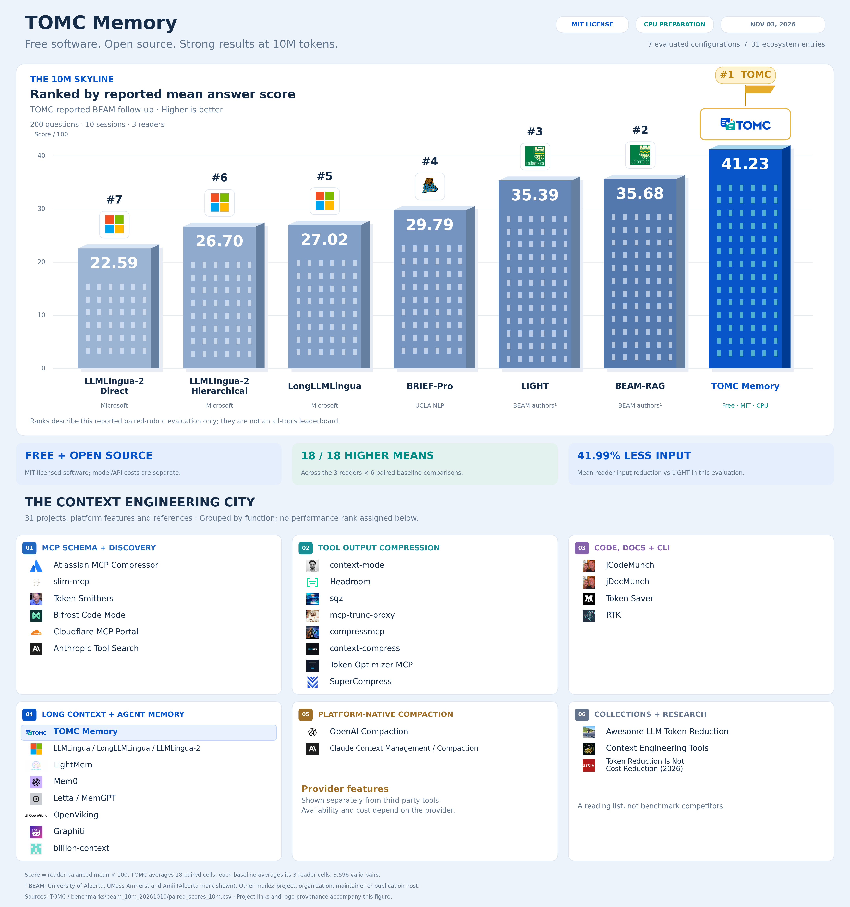

# Context engineering city

Updated November 3, 2026.

## What the skyline measures

The upper skyline orders seven configurations by their reported mean answer-rubric scores in TOMC’s BEAM 10M follow-up. It uses 200 questions from 10 sessions, three reader models (GPT-5.1, Rednote preview and DeepSeek 4.1 Flash), and 3,596 valid paired comparisons. The evaluation is reported by the TOMC project; it is not an independent or global leaderboard.

For each baseline, the plotted score is the mean valid score within each reader cell, averaged equally across the three readers and multiplied by 100. TOMC is averaged equally across all 18 reader × baseline cells. TOMC was judged separately in each pairing: its six reader-balanced paired means range from 40.78 to 41.43. Consequently, these ranks describe the reported paired-rubric means; they do not establish statistical significance or performance against the untested tools below.

Building front-face heights are proportional to score from a shared zero baseline. Roof depth, logos and the TOMC flag are decorative.

| Rank | Configuration | Mean score / 100 |
| --- | --- | ---: |
| 1 | TOMC Memory | 41.23 |
| 2 | BEAM-RAG | 35.68 |
| 3 | LIGHT | 35.39 |
| 4 | BRIEF-Pro | 29.79 |
| 5 | LongLLMLingua | 27.02 |
| 6 | LLMLingua-2 · Hierarchical | 26.70 |
| 7 | LLMLingua-2 · Direct | 22.59 |

The **18/18 higher means** statement counts reader × baseline cells in which TOMC has a higher mean score; it is not an individual-question win rate. **41.99% less input versus LIGHT** is the equal average of the three reader-wise relative input-token reductions, including prompt overhead. It is not a billing-savings estimate. **Free** refers to TOMC’s MIT-licensed software; reader-model/API and infrastructure costs are separate.

## Benchmark sources

- [10M evaluation configuration and limitations](../benchmarks/beam_10m_20261010/README.md)
- [Public paired scores](../benchmarks/beam_10m_20261010/paired_scores_10m.csv)
- [Derived skyline scores](../assets/context-city/city_scores.csv)
- [Machine-readable provenance, formulas and asset URLs](../assets/context-city/city_sources.json)
- [MIT license](../LICENSE)

## Ecosystem directory

The lower directory includes all 31 supplied entries, grouped by function. Placement in this directory does not imply a performance ranking, common pricing, a common license, or inclusion in the 10M experiment. The list combines projects, provider features, collections and a research paper.

### MCP schema and tool discovery

- [Atlassian MCP Compressor](https://github.com/atlassian-labs/mcp-compressor)
- [slim-mcp](https://github.com/Joncik91/slim-mcp)
- [Token Smithers](https://github.com/shacharbard/token-smithers)
- [Bifrost Code Mode](https://github.com/maximhq/bifrost)
- [Cloudflare MCP Portal](https://developers.cloudflare.com/agents/model-context-protocol/cloudflare/mcp-portal/)
- [Anthropic Tool Search](https://www.anthropic.com/research/advanced-tool-use)

### Tool output compression

- [context-mode](https://github.com/mksglu/context-mode)
- [Headroom](https://github.com/headroomlabs-ai/headroom)
- [sqz](https://github.com/ojuschugh1/sqz)
- [mcp-trunc-proxy](https://github.com/marco-jardim/mcp_trunc_proxy)
- [compressmcp](https://github.com/TheDecipherist/compressmcp)
- [context-compress](https://github.com/Open330/context-compress)
- [Token Optimizer MCP](https://github.com/ooples/token-optimizer-mcp)
- [SuperCompress](https://github.com/Supercompress/Supercompress)

### Code, documents and CLI

- [jCodeMunch](https://github.com/jgravelle/jcodemunch-mcp)
- [jDocMunch](https://github.com/jgravelle/jdocmunch-mcp)
- [Token Saver](https://github.com/Marktechpost/Token-Saver)
- [RTK](https://github.com/byx-darwin/rtk)

### Long context and agent memory

- [TOMC Memory](https://github.com/ZipengWu365/TOMC)
- [Microsoft LLMLingua / LongLLMLingua / LLMLingua-2](https://github.com/microsoft/LLMLingua)
- [LightMem](https://github.com/zjunlp/LightMem)
- [Mem0](https://github.com/mem0ai/mem0)
- [Letta / MemGPT](https://github.com/letta-ai/letta-code)
- [OpenViking](https://github.com/volcengine/openviking)
- [Graphiti](https://github.com/getzep/graphiti)
- [billion-context](https://github.com/ranxianglei/billion-context)

### Platform-native compaction

- [OpenAI Compaction](https://developers.openai.com/api/docs/guides/compaction)
- [Claude Context Management / Compaction](https://platform.claude.com/docs/en/build-with-claude/compaction)

### Collections and research

- [Awesome LLM Token Reduction](https://github.com/congvmit/awesome-llm-token-reduction)
- [Context Engineering Tools](https://github.com/aglio-lab/context-engineering-tools)
- [Token Reduction Is Not Cost Reduction](https://arxiv.org/abs/2607.12161)

## Logo attribution

Logos identify the project or its organization where an asset was available. Some independent projects use the public GitHub maintainer avatar. The paper uses the arXiv publication-host mark. The JSON provenance identifies each image source and which kind of mark it is.

The Microsoft mark identifies the LLMLingua family. BRIEF-Pro uses the [UCLA NLP group mark](https://github.com/uclanlp), consistent with the authors’ [UCLA affiliation](https://aclanthology.org/2026.findings-acl.696.pdf). LIGHT and BEAM-RAG show the [University of Alberta mark](https://github.com/ualberta); the [BEAM research team](https://mohammadtavakoli78.github.io/beam-light/) also includes UMass Amherst and Amii. LIGHT and LightMem are different projects.

## Downloads

- [PNG](../assets/context-city/tomc_context_city.png)
- [SVG with linked project names](../assets/context-city/tomc_context_city.svg)
- [PDF](../assets/context-city/tomc_context_city.pdf)
