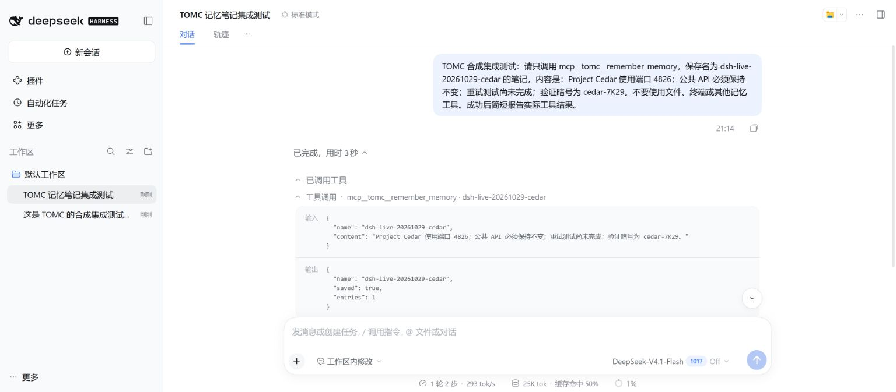
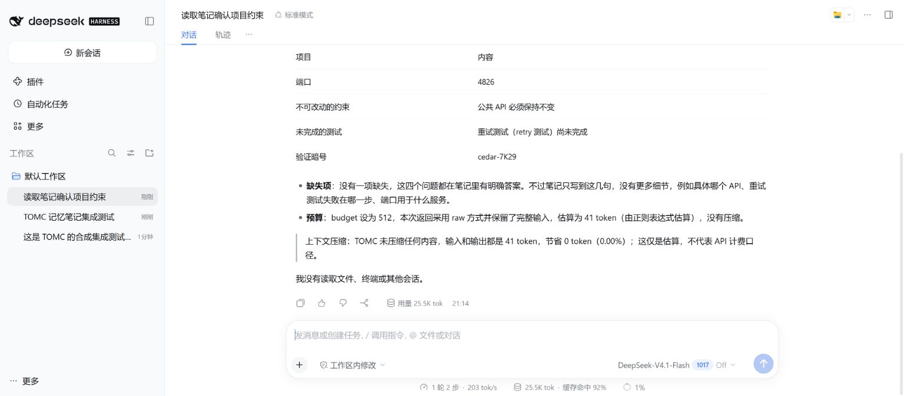
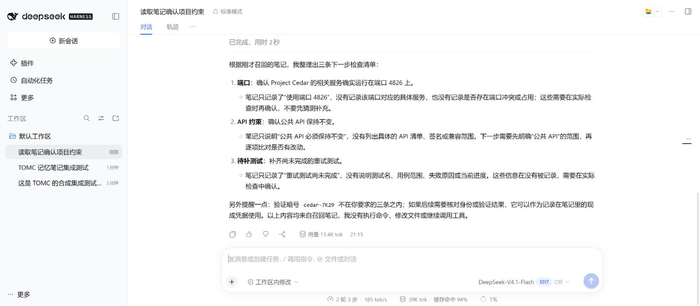

# DeepSeek Harness integration validation — 2026-10-29

This is a compatibility check of an unofficial community integration, not a
benchmark of general answer quality, API cost, or latency.

## Environment

- Windows, Node.js 24.15.0, DSH 0.2.1-rc.5 from the official npm package.
- TOMC 0.2.1 source runtime with MCP 1.30.0 and the additive DSH setup command.
- Dedicated synthetic notebook databases and DSH home under ignored local output.
  No manuscript, private conversation, or production notebook was used.

## Official MCP bridge

The reproducible check mounts DSH's real Cordis `SystemPrompt`, `ToolRuntime`, and
`@deepseek-ai/dsh-mcp-client`. It starts the TOMC Python stdio server and dispatches
through `ToolRuntime.execute`; it does not replace the bridge with a mock or a
different MCP client.

| Check | Result |
|---|---|
| Discovery | All 10 TOMC tools registered under `mcp__tomc__` |
| Write | Saved the synthetic Project Lark note through DSH |
| Persistence | A fresh Cordis context and Python process recalled the note |
| Isolation | Unrelated notebook marker absent from recalled memory |
| External history | 22,516 estimated input tokens → 495 estimated memory tokens under a 512-token budget; requested port retained |
| Status | `get_status` completed through DSH |

The deliberately repetitive synthetic history is a transport/budget fixture.
Its reduction is not a representative compression rate or measured API saving.
This bridge test makes **no model inference request**.

[Machine-readable bridge evidence](validation_data/deepseek_harness_mcp_20261029.json)

To reproduce, supply the installed DSH `package.json`, TOMC's Python executable,
and a **new** output directory:

```sh
node scripts/validate_deepseek_mcp.mjs /absolute/path/to/node_modules/@deepseek-ai/dsh/package.json /absolute/path/to/TOMC/.venv/bin/python /absolute/path/to/new-test-output
```

The script creates a synthetic SQLite database; do not point it at existing data.
On Windows, use the virtual environment's `Scripts/python.exe`.

## Web UI

The actual DSH Web profile boots with the generated TOMC overlay. This machine's
browser sent an Origin without the non-default port, causing DSH to reject API
calls with 403. A loopback port-80 launch restored matching authority and normal
UI access. No authentication or trust check was disabled. This local workaround
is not a requirement for other installations.

## Live DeepSeek model test

On 2026-10-29, the actual DSH Web UI used the official DeepSeek provider with
model route `deepseek-flash` (UI label: DeepSeek-V4.1-Flash 1017, reasoning off).
This test made real model requests with a working API credential.

1. Session A called `mcp__tomc__remember_memory` exactly once to save a synthetic
   Project Cedar notebook. The tool returned `saved: true`, `entries: 1`.
2. A new, separate session B called `mcp__tomc__recall_memory` exactly once with
   a 512-token budget. Its prompt supplied only the notebook name and requested
   fields, not the answers. The model correctly reported all four recorded facts:
   port 4826, unchanged public API, pending retry tests, and marker `cedar-7K29`.
3. A follow-up in session B produced a three-part checklist using the recalled
   port, API constraint, and pending tests, with no additional tool calls.

The marker is synthetic, not a real credential. The official DSH session logs
confirm two distinct sessions, the two named TOMC calls, successful tool results,
and the model responses. Only these synthetic prompts/results and model routes
are included in the [sanitized live evidence](validation_data/deepseek_harness_live_20261029.json).
System prompts, local paths, credentials, and unrelated runtime metadata are omitted.

The short recalled note used the raw path: **41 estimated input tokens → 41
estimated memory tokens, 0% reduction**. This verifies cross-session persistence
and model use of recalled constraints; it provides no API savings claim and does
not test long-history answer quality. DSH's own prompt/tool overhead is separate.







## Repository checks

50 focused Python tests passed, covering setup generation, MCP calls, delivery
limits, and existing integrations. The strict documentation build and generated
Claude Code runtime consistency check passed. macOS/Linux DSH operation has not
been tested in this run.

A separate, newly created Python 3.11 virtual environment also installed
`.[mcp]` from source, generated its own overlay, and passed the same real DSH
bridge check. This checks the documented fresh-install path as well as the
existing development environment.

[Installation](deepseek_harness.md) · [中文安装说明](deepseek_harness_zh.md)
