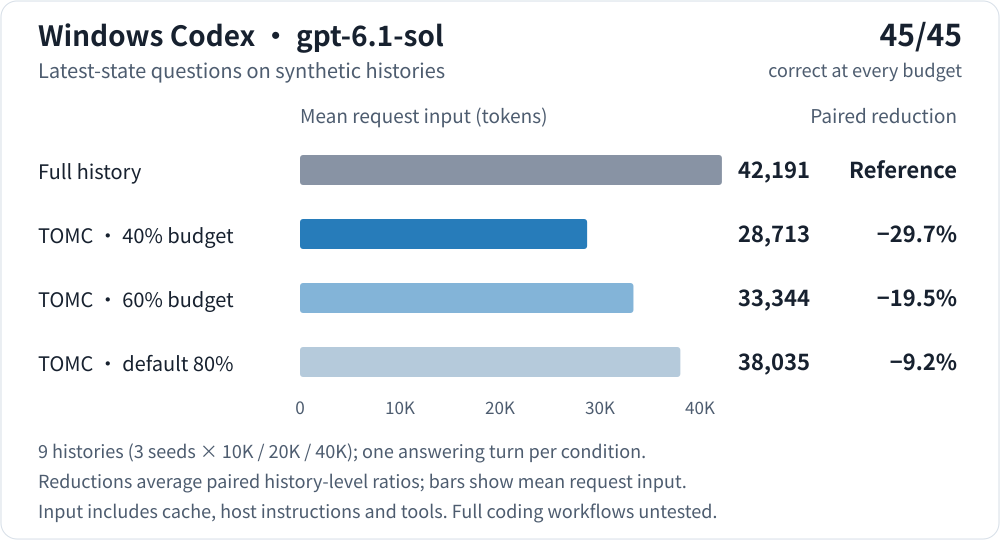
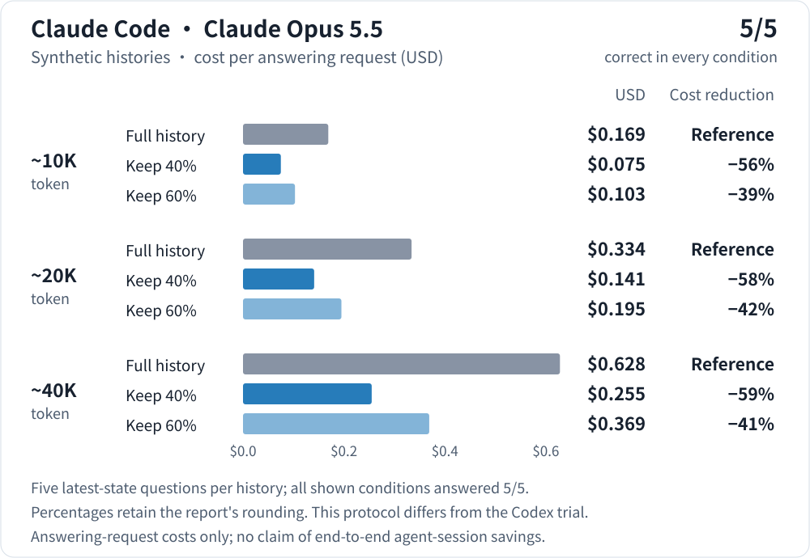
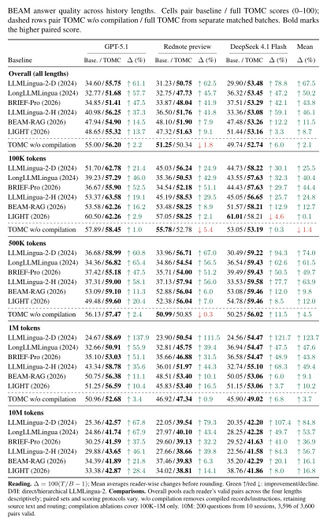
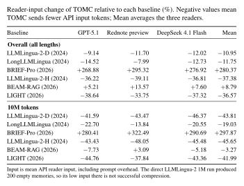
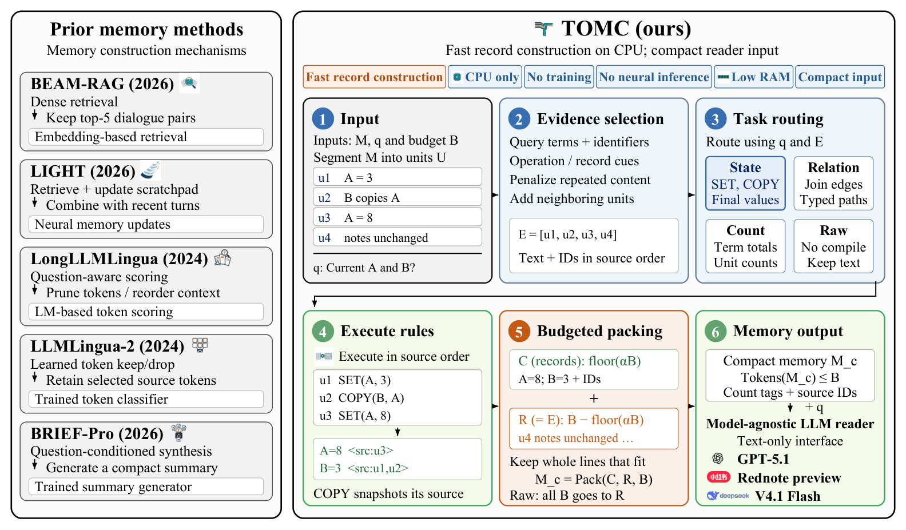

# Evidence and claims ledger

**English** | [简体中文](evidence_zh.md)

This page holds every number we use on the README, in the videos and in release notes, with where it comes from and under what conditions it was measured. Failures and weak spots are listed next to the wins.

<a id="read-this-first"></a>

## Read this first

- **Versions.** Each number names the version it was measured on. The v0.3.0 stale-value benchmark is new. Every assistant trial (Codex, Claude Code) was measured on 0.1.0 previews in October 2026 and has **not** been re-run with a model on v0.2.1 or v0.3.0. v0.3.0 changes which lines get kept, so those prepared contexts would now differ.
- **Benchmarks are not the product.** The BEAM and RULER results come from benchmark-specific adapters used for the paper, not from the `tomc` package you install. The paper is not public yet.
- **Two BEAM sets.** The *paper snapshot* covers 100K–1M tokens (manuscript commit `7399657`, 2026-09-28). The *10M follow-up* was added on 2026-10-10 with a different, pairwise scoring. Numbers that include 10M are labelled "including the 10M follow-up". Both sets are kept.
- **Not comparable with other projects' BEAM numbers.** See [why](#beam-comparability).
- **Default budget.** Without a budget, TOMC keeps 80% of a history up to 10K estimated tokens, sliding to 70% at 100K and 60% at 1M, never below 1,024 tokens (`src/tomc/easy.py`). The assistant trials ran under an older fixed 80% rule.
- **Recheck offline.** `make reproduce` reruns the arithmetic, regenerates the synthetic test data and reruns the offline benchmarks without network or model calls, and fails on any mismatch. See [Reproduce](#reproduce).

<a id="claims-ledger"></a>

## Claims ledger

"Runs" counts how many times each condition was measured. "n" is the number of scored items.

| # | Claim | Source | Model | Data | Budget | n | Runs | Version | Metric |
|---|---|---|---|---|---|---|---|---|---|
| E1 | Latest value present at the default budget: 100% (v0.2.1: 58%); at 10%: 85% (51%); at 40%: 98% (51%) | [benchmarks/stale/RESULTS.md](https://github.com/ZipengWu365/TOMC/blob/main/benchmarks/stale/RESULTS.md); `benchmarks/stale/run.py --check` | None (offline) | Synthetic notes and chats; facts changed 3–5 times; state, plain and mixed wording | 10/20/40/60/80% of history, and default | 144 questions per budget | 1 (deterministic) | v0.3.0 vs v0.2.1 (commit `3951794`) | Share of questions whose prepared context holds the latest value with no unflagged older STATE record |
| E2 | Codex: 40% budget cut request input by 29.7%, 45/45 correct | [validation.md](validation.md#windows-codex-retention-20261005), [report](codex_retention_20261005.md), [data](validation_data/windows_codex_retention_20261005.json) | Windows Codex 0.160.0, `gpt-6.1-sol`, `ultra` effort | 9 synthetic team chats: 3 seeds × ~10K/20K/40K `cl100k_base` tokens, nested within each seed | 40% of the lexical estimate | 45 answers from 9 related histories | 1 answering turn per history and condition | 0.1.0 preview.4 (commit `ad89208`), 2026-10-05 | Mean of 9 paired ratios of provider-reported input, including cached input, host instructions and tools |
| E3 | Codex: 60% budget −19.5%; default −9.2%; 45/45 each | Same as E2 | Same | Same | 60%; default (fixed 80% at test time) | 45 | 1 | Same | Same |
| E4 | Claude API-style: 40% budget cost −56/−58/−59%, 60% −39/−42/−41%, 5/5 each | [validation.md](validation.md#claude-code-windows-validation) ("Budget as a share") | Claude Opus 5.5 via Claude Code CLI with built-in tools and MCP off | 1 synthetic history per length: 9,970 / 20,063 / 40,451 `cl100k_base` tokens; 5 questions | 40%, 60% | 5 per cell | 1 per cell | 0.1.0 preview.2 runtime, 2026-10-02 | Cost reported by Claude Code (includes small background calls), vs the full-history request |
| E5 | Claude API-style at 10–20%: 3/5 to 5/5; every wrong answer was an older value of the same field | Same as E4 | Same | Same | 10%, 20% | 5 per cell, 6 cells | 1 per cell | Same | Correct answers |
| E6 | Claude default-budget check: 45/45 with −19.8% input; 50/60/70% gave 45/45 with −48.6/−39.0/−29.5% | [validation.md](validation.md#default-budget-keep-about-80) | Claude Opus 5.5, Claude Code 2.1.288, API-style | 9 histories (3 seeds × 3 lengths) | 50/60/70%; default (fixed 80% then) | 45 per budget | 1 per condition | 0.1.0 preview (Oct 2026) | Mean input change; correct answers |
| E7 | Claude Code recall at budget 8,192: cost −38% at ~20K and −65% at ~40K; unchanged at ~10K; 5/5 | [validation.md](validation.md#claude-code-windows-validation) | Claude Opus 5.5, Claude Code 2.1.287 (VS Code extension CLI), default tools | Same 3 histories as E4, imported as notebooks | 8,192 tokens | 5 per length | 1 per length | 0.1.0 preview.2 runtime, 2026-10-02 | Session cost reported by Claude Code |
| E8 | Budget 1,024 cut input by 85–96% but answered 2 to 4 of 5 | Same as E4/E7 | Same | Same | 1,024 | 5 per cell | 1 | Same | Correct answers |
| E9 | API example: 147 → 108 message tokens (−26.5%) with `cl100k_base`; 138 → 90 with the offline lexical estimate | [validation.md](validation.md) ("API-input product revision"); `examples/api_context.py` | None | One 6-line example | 64 | 1 example | Deterministic; rechecked by `make reproduce` | 0.1.0 preview.2; lexical count rechecked on v0.3.0 | Message-text tokens; no chat framing or tools |
| E10 | Snapshot example grows from 31 to 36 estimated tokens | `examples/snapshot.py` | None | 3-line example | 128 | 1 | Deterministic; rechecked by `make reproduce` | v0.3.0 | Lexical estimate; source labels add tokens |
| E11 | `tomc try`: 6,318 → 184 tokens (English), 6,210 → 195 (Chinese), ↓97% | `src/tomc/tryout.py`, `src/tomc/data/try_sample_*.json` | None | Built-in synthetic 120-day project chat | 200 (stated on the card; the default keeps more) | 1 sample per language | Computed each time you run it | v0.3.0 | Lexical estimate |
| E12 | BEAM paper snapshot: higher TOMC mean in 36/36 comparisons at 500K/1M, 17/18 at 100K, 18/18 overall; input −34.77% vs LIGHT, −34.35% vs LLMLingua-2-H | [paper_results.md](paper_results.md); `benchmarks/current_paper/`; `benchmarks/reproduce/current.py --check` | Readers GPT-5.1, Rednote preview, DeepSeek 4.1 Flash; judges in [Judges](#judges) | 600 planned questions per method and reader: 60 conversations at 100K/500K/1M | Memory cap 8,192 `cl100k_base` | 573–600 valid pairs per cell | 1 reader answer per question | Paper snapshot `7399657`, 2026-09-28; BEAM adapters | Mean judge score 0–100; equal mean of reader-wise input ratios |
| E13 | Including the 10M follow-up: higher TOMC mean in 54/54 at 500K/1M/10M, 18/18 overall; input −36.57% vs LIGHT, −37.38% vs LLMLingua-2-H; TOMC uses more than BRIEF-Pro (+280.37%) and BEAM-RAG (+8.79%) | `benchmarks/beam_10m_20261010/paired_scores_10m.csv`; `scripts/make_beam_table.py --check` | Same readers; 10M judge model not documented | Adds 200 questions from 10 sessions at 10M; 3,596 of 3,600 pairs valid | 8,192 | 800 distinct questions in 70 sessions | 1 | 10M added 2026-10-10, after the paper snapshot | Same; Overall pools different protocols and dates |
| E14 | 10M: 15 of 18 session-bootstrap 95% intervals exclude zero | `benchmarks/beam_10m_20261010/bootstrap_ci.json`; `benchmarks/reproduce/beam10m_bootstrap.py --check` | — | 10M pairs from E13 | — | 18 cells, 10 sessions | 10,000 resamples, seed 2026102901 | 10M follow-up | Mean paired difference, TOMC − baseline |
| E15 | Compiled records add +1.20 / −0.91 / +3.01 points (GPT-5.1 / Rednote / Flash); +2.1% relative on average | `benchmarks/current_paper/beam_comparisons.csv` (ablation rows) | Same readers; Pro grouped scoring | 100K–1M only | 8,192 | 595–598 valid pairs per reader | 1, separate dated batches | Paper snapshot | Full TOMC vs TOMC without compilation |
| E16 | Repaired NIAH: 87.28 vs 82.26 mean F1 without extra source; 43–44% less input | [paper_results.md](paper_results.md#ruler-derived-mechanisms-and-component-ablations); `niah_repaired.csv` | Same readers | RULER generators, 65,536-token limit | 4,096 | 100 pairs per reader | 1 | Paper snapshot | Token F1 |
| E17 | QA2: full TOMC 40.85 vs Query 47.49 (TOMC worse) | Same as E16 | Same | Same | 4,096 | 100 per reader | 1 | Paper snapshot | Token F1 |
| E18 | Construction: 4.21 s/call on CPU, 0 GiB CUDA, 3.75 GiB peak RSS; BRIEF-Pro 47.94 s/call, LongLLMLingua 72.07 s/call (11.4× and 17.1×) | `benchmarks/current_paper/construction.json`; [paper_results.md](paper_results.md#construction-efficiency-and-resources) | — | BEAM construction replays | — | 6 replays | — | Paper snapshot | Stage time, excluding imports, input loading, warm-up and reader inference; CPU model not documented; baselines ran on GPU |
| E19 | Older four-reader batch: TOMC ahead for all 4 readers, significant for 3 (Flash p = 0.27) | [HISTORICAL_BEAM.md](https://github.com/ZipengWu365/TOMC/blob/main/benchmarks/HISTORICAL_BEAM.md); `benchmarks/reproduce/results.py --check` | DeepSeek-V4-Pro, UOB GPT-5.1, Rednote dots3-note-prev, DeepSeek V4 Flash; judges named in the file | 60 conversations, 600 planned pairs per reader | — | 600 per reader | 10,000 bootstrap resamples; 100,000 sign flips | Frozen 2026-09-04; superseded | Score difference vs hybrid-RAG |
| E20 | Three real projects saved 5.16%, 42.15% (proxy tokenizer) and 16.84% of tokens | [casestudy/README.md](https://github.com/ZipengWu365/TOMC/blob/main/casestudy/README.md) | Varied | User-reported production projects | Default mode, strength 80 | 12 / 5 / 24 matched pairs | — | 2026-10 | Reported usage; source reports are not in the repository, so only the arithmetic can be checked |
| E21 | Video: Codex case 38,786 → 27,235 input tokens (−29.8%), 5/5 | v11–v13 media evidence files only | — | — | — | — | — | — | **No protocol or raw record in this repository.** A different test from E2 |
| E22 | Video: Claude Code session cost about −38% | = E7, the ~20K cell only | | | | | | | One cell; 10K unchanged, 40K −65% |
| E23 | Video: BEAM 54 comparisons, 36.6% less input than LIGHT | = E13 | | | | | | | |

<a id="assistant-trials"></a>

## Assistant trials (0.1.0 previews)

These trials used synthetic project chats with many updates and look-alike distractors. Updates were written as prose, so TOMC selected source lines (`tomc_raw`) and produced no state records. They test whether the latest values survive a smaller context, not general coding quality.

<a id="codex-trial"></a>

### Codex

Windows Codex 0.160.0, `gpt-6.1-sol`, `ultra` effort, installed plugins kept. TOMC prepared context through the installed MCP tool; a new chat then answered five latest-state questions per history.



| Context sent | Mean request input tokens | Mean paired input reduction | Correct answers |
|---|---:|---:|---:|
| Full history | 42,191 | Reference | 45/45 |
| TOMC · 40% history budget | 28,713 | 29.7% | 45/45 |
| TOMC · 60% history budget | 33,344 | 19.5% | 45/45 |
| TOMC · default 80% history budget | 38,035 | 9.2% | 45/45 |

Input is Codex's reported total, including cached input, host instructions and tool definitions. The reduction is the mean of nine paired ratios, not the ratio of the table's means. The 45 answers come from 9 related histories (lengths nested within each seed), not 45 independent projects. One answering turn per history and condition; asking the model to prepare or recall inside a chat adds turns. [Full report](codex_retention_20261005.md) · [Recorded data](validation_data/windows_codex_retention_20261005.json)

<a id="claude-trials"></a>

### Claude Code

Claude Opus 5.5. One synthetic history per length, five questions, **single runs**. "API-style" means the request went through the Claude Code CLI with its own system prompt, built-in tools and MCP turned off; it is not normal Claude Code use.



| History | Full history | TOMC keeps 40% | TOMC keeps 60% |
|---|---|---|---|
| ~10K tokens | US$0.169 · 5/5 | US$0.075 · 5/5 (−56%) | US$0.103 · 5/5 (−39%) |
| ~20K tokens | US$0.334 · 5/5 | US$0.141 · 5/5 (−58%) | US$0.195 · 5/5 (−42%) |
| ~40K tokens | US$0.628 · 5/5 | US$0.255 · 5/5 (−59%) | US$0.369 · 5/5 (−41%) |

In normal Claude Code use (default tools), recalling an imported notebook at budget 8,192 instead of pasting the history:

| History (`cl100k_base` tokens) | Full history in prompt | Recall, budget 1,024 | Recall, budget 8,192 |
|---|---|---|---|
| 9,970 | US$0.247 · 5/5 | US$0.141 · 4/5 | US$0.253 · 5/5 |
| 20,063 | US$0.400 · 5/5 | US$0.139 · 2/5 | US$0.249 · 5/5 |
| 40,451 | US$0.709 · 5/5 | US$0.137 · 3/5 | US$0.247 · 5/5 |

At ~10K tokens there was no saving. With a short 2,217-token history, the history text shrank by 94.8% but the answering request's input fell only 5.6%, because Claude Code adds about 39,000 tokens of its own instructions and tools, and the session cost went from US$0.121 to US$0.123. [Validation record](validation.md#claude-code-windows-validation)

<a id="default-budget"></a>

### Default budget

Nine histories (three seeds per length), Claude Opus 5.5, Claude Code 2.1.288, API-style requests. At that time the default was a fixed 80%.

| Share of history kept | Correct answers | Mean input change |
|---|---|---|
| 50% | 45/45 | −48.6% |
| 60% | 45/45 | −39.0% |
| 70% | 45/45 | −29.5% |
| 80% (default then) | 45/45 | −19.8% |

Smaller shares started returning old values: at 10–20%, single runs scored 3/5 to 5/5, and every wrong answer was an earlier value of the same field. Together with Codex's 9.2% at the default, this is where "the default saves roughly 10–20%" comes from.

<a id="stale-benchmark"></a>

## Stale-value benchmark (v0.3.0)

`python benchmarks/stale/run.py` builds synthetic histories where a fact changes three to five times, prepares context offline at six budgets and checks whether the latest value is there and no older value is shown as current without a flag. No model is called, so this measures what the context contains, not what a model answers. 144 questions per budget. Each cell reads v0.2.1 → v0.3.0.

| style / format | 10% | 20% | 40% | 60% | 80% | default |
|---|---|---|---|---|---|---|
| state / notes | 100% → 100% | 100% → 100% | 100% → 100% | 100% → 100% | 100% → 100% | 100% → 100% |
| state / chat | 100% → 100% | 100% → 100% | 100% → 100% | 100% → 100% | 100% → 100% | 100% → 100% |
| plain / notes | 54% → 67% | 54% → 79% | 54% → 96% | 54% → 100% | 67% → 100% | 62% → 100% |
| plain / chat | 54% → 79% | 54% → 79% | 54% → 100% | 62% → 100% | 88% → 100% | 88% → 100% |
| mixed / notes | 0% → 75% | 0% → 88% | 0% → 96% | 0% → 100% | 0% → 100% | 0% → 100% |
| mixed / chat | 0% → 88% | 0% → 83% | 0% → 96% | 0% → 100% | 0% → 100% | 0% → 100% |
| **all** | 51% → 85% | 51% → 88% | 51% → 98% | 53% → 100% | 59% → 100% | 58% → 100% |

Every remaining miss is at a 10–40% budget, on an update that does not name what changed ("Scratch that, go with Django."). The benchmark was written together with the v0.3.0 fixes, by the same author, so treat it as a regression test rather than an independent evaluation. [Generated table](https://github.com/ZipengWu365/TOMC/blob/main/benchmarks/stale/RESULTS.md)

<a id="real-projects"></a>

## Real projects

Three user-reported projects (a Rednote post, a Kuaishou video, research slides) recorded token savings of 5.16%, 42.15% (proxy tokenizer on background text only) and 16.84%. That is well below the synthetic tests. Answer quality was not blind-rated, and the source reports are not in the repository, so these numbers can be checked for arithmetic only. [Case studies](https://github.com/ZipengWu365/TOMC/blob/main/casestudy/README.md)

<a id="beam"></a>

## BEAM long-history benchmark

Each pair uses **the same reader model** on both sides: once with memory from the named baseline, once with TOMC's memory, on matched questions with matched scoring. Readers: GPT-5.1, Rednote preview, DeepSeek 4.1 Flash. Memory is capped at 8,192 `cl100k_base` tokens; "1M history" describes the original conversation, not a 1M-token request.

### Paper snapshot (100K–1M)

From [paper_results.md](paper_results.md), Overall rows (Baseline / TOMC, 0–100):

| Baseline memory | GPT-5.1 | Rednote preview | DeepSeek 4.1 Flash | Mean input change |
|---|---:|---:|---:|---:|
| LLMLingua-2-D | 37.69 / **60.16** | 34.30 / **54.49** | 33.13 / **57.29** | +7.87% |
| LongLLMLingua | 35.43 / **55.03** | 34.34 / **50.28** | 39.01 / **57.18** | -9.32% |
| BRIEF-Pro | 36.40 / **54.71** | 35.30 / **51.03** | 40.17 / **57.18** | +275.45% |
| LLMLingua-2-H | 44.67 / **60.45** | 39.47 / **56.16** | 37.13 / **57.09** | -34.35% |
| BEAM-RAG | 52.47 / **59.25** | 51.63 / **55.90** | 51.57 / **56.91** | +12.96% |
| LIGHT | 53.75 / **59.48** | 51.75 / **55.90** | 55.65 / **56.91** | -34.77% |

TOMC has the higher mean in 36 of 36 comparisons at 500K/1M and 17 of 18 at 100K. Per-length tables, valid pair counts and scoring protocols are in [paper_results.md](paper_results.md).

### Including the 10M follow-up (100K–10M)

The 10M tier adds 200 questions from 10 sessions (two per ability per session), 3,596 of 3,600 pairs valid, judged with an anonymous, position-balanced pairwise rubric. Overall pools each reader's valid pairs across all lengths, so it mixes protocols and dates; use it as a descriptive summary. [10M data](https://github.com/ZipengWu365/TOMC/blob/main/benchmarks/beam_10m_20261010/README.md)

<!-- BEAM_TABLE_START -->
<a href="../assets/beam_table/beam_quality.png">
  
</a>

<a href="../assets/beam_table/beam_input.png">
  
</a>

<details>
<summary>Tables as text</summary>

| Baseline | GPT-5.1 | Δ (%) | Rednote preview | Δ (%) | DeepSeek 4.1 Flash | Δ (%) | Mean Δ (%) |
|---|---:|:---|---:|:---|---:|:---|:---|
| **Overall (all lengths)** | | | | | | | |
| LLMLingua-2-D (2024) | 34.60 / **55.75** | ↑ 61.1 | 31.23 / **50.75** | ↑ 62.5 | 29.90 / **53.48** | ↑ 78.8 | ↑ 67.5 |
| LongLLMLingua (2024) | 32.77 / **51.68** | ↑ 57.7 | 32.75 / **47.73** | ↑ 45.7 | 36.32 / **53.45** | ↑ 47.2 | ↑ 50.2 |
| BRIEF-Pro (2026) | 34.85 / **51.41** | ↑ 47.5 | 33.87 / **48.04** | ↑ 41.9 | 37.51 / **53.29** | ↑ 42.1 | ↑ 43.8 |
| LLMLingua-2-H (2024) | 40.98 / **56.25** | ↑ 37.3 | 36.50 / **51.76** | ↑ 41.8 | 33.36 / **53.08** | ↑ 59.1 | ↑ 46.1 |
| BEAM-RAG (2026) | 47.94 / **54.90** | ↑ 14.5 | 48.10 / **51.90** | ↑ 7.9 | 47.48 / **53.26** | ↑ 12.2 | ↑ 11.5 |
| LIGHT (2026) | 48.65 / **55.32** | ↑ 13.7 | 47.32 / **51.63** | ↑ 9.1 | 51.44 / **53.16** | ↑ 3.3 | ↑ 8.7 |
| TOMC w/o compilation | 55.00 / **56.20** | ↑ 2.2 | **51.25** / 50.34 | ↓ 1.8 | 49.74 / **52.74** | ↑ 6.0 | ↑ 2.1 |
| **100K tokens** | | | | | | | |
| LLMLingua-2-D (2024) | 51.70 / **62.78** | ↑ 21.4 | 45.03 / **56.24** | ↑ 24.9 | 44.73 / **58.22** | ↑ 30.1 | ↑ 25.5 |
| LongLLMLingua (2024) | 39.23 / **57.29** | ↑ 46.0 | 35.36 / **50.53** | ↑ 42.9 | 43.55 / **57.63** | ↑ 32.3 | ↑ 40.4 |
| BRIEF-Pro (2026) | 36.67 / **55.90** | ↑ 52.5 | 34.54 / **52.18** | ↑ 51.1 | 44.43 / **57.63** | ↑ 29.7 | ↑ 44.4 |
| LLMLingua-2-H (2024) | 53.37 / **63.58** | ↑ 19.1 | 45.19 / **58.53** | ↑ 29.5 | 45.05 / **56.65** | ↑ 25.7 | ↑ 24.8 |
| BEAM-RAG (2026) | 53.58 / **62.26** | ↑ 16.2 | 53.48 / **58.25** | ↑ 8.9 | 51.57 / **58.21** | ↑ 12.9 | ↑ 12.7 |
| LIGHT (2026) | 60.50 / **62.26** | ↑ 2.9 | 57.05 / **58.25** | ↑ 2.1 | **61.01** / 58.21 | ↓ 4.6 | ↑ 0.1 |
| TOMC w/o compilation | 57.89 / **58.45** | ↑ 1.0 | **55.78** / 52.78 | ↓ 5.4 | 53.05 / **53.19** | ↑ 0.3 | ↓ 1.4 |
| **500K tokens** | | | | | | | |
| LLMLingua-2-D (2024) | 36.68 / **58.99** | ↑ 60.8 | 33.96 / **56.71** | ↑ 67.0 | 30.49 / **59.22** | ↑ 94.3 | ↑ 74.0 |
| LongLLMLingua (2024) | 34.36 / **56.82** | ↑ 65.4 | 34.86 / **54.54** | ↑ 56.5 | 36.54 / **59.43** | ↑ 62.6 | ↑ 61.5 |
| BRIEF-Pro (2026) | 37.42 / **55.18** | ↑ 47.5 | 35.71 / **54.00** | ↑ 51.2 | 39.49 / **59.43** | ↑ 50.5 | ↑ 49.7 |
| LLMLingua-2-H (2024) | 37.31 / **59.00** | ↑ 58.1 | 37.13 / **57.94** | ↑ 56.0 | 33.53 / **59.58** | ↑ 77.7 | ↑ 63.9 |
| BEAM-RAG (2026) | 53.09 / **59.10** | ↑ 11.3 | 52.88 / **56.04** | ↑ 6.0 | 53.08 / **59.46** | ↑ 12.0 | ↑ 9.8 |
| LIGHT (2026) | 49.48 / **59.60** | ↑ 20.4 | 52.38 / **56.04** | ↑ 7.0 | 54.78 / **59.46** | ↑ 8.5 | ↑ 12.0 |
| TOMC w/o compilation | 56.13 / **57.47** | ↑ 2.4 | **50.99** / 50.85 | ↓ 0.3 | 50.25 / **56.02** | ↑ 11.5 | ↑ 4.5 |
| **1M tokens** | | | | | | | |
| LLMLingua-2-D (2024) | 24.67 / **58.69** | ↑ 137.9 | 23.90 / **50.54** | ↑ 111.5 | 24.56 / **54.47** | ↑ 121.7 | ↑ 123.7 |
| LongLLMLingua (2024) | 32.66 / **50.91** | ↑ 55.9 | 32.81 / **45.75** | ↑ 39.4 | 36.94 / **54.47** | ↑ 47.5 | ↑ 47.6 |
| BRIEF-Pro (2026) | 35.10 / **53.03** | ↑ 51.1 | 35.66 / **46.88** | ↑ 31.5 | 36.58 / **54.47** | ↑ 48.9 | ↑ 43.8 |
| LLMLingua-2-H (2024) | 43.34 / **58.78** | ↑ 35.6 | 36.01 / **51.97** | ↑ 44.3 | 32.74 / **55.10** | ↑ 68.3 | ↑ 49.4 |
| BEAM-RAG (2026) | 50.75 / **56.38** | ↑ 11.1 | 48.51 / **53.40** | ↑ 10.1 | 50.05 / **53.06** | ↑ 6.0 | ↑ 9.1 |
| LIGHT (2026) | 51.25 / **56.59** | ↑ 10.4 | 45.83 / **53.40** | ↑ 16.5 | 51.15 / **53.06** | ↑ 3.7 | ↑ 10.2 |
| TOMC w/o compilation | 50.96 / **52.68** | ↑ 3.4 | 46.92 / **47.34** | ↑ 0.9 | 45.90 / **49.02** | ↑ 6.8 | ↑ 3.7 |
| **10M tokens** | | | | | | | |
| LLMLingua-2-D (2024) | 25.36 / **42.57** | ↑ 67.8 | 22.05 / **39.54** | ↑ 79.3 | 20.35 / **42.20** | ↑ 107.4 | ↑ 84.8 |
| LongLLMLingua (2024) | 24.86 / **41.74** | ↑ 67.9 | 27.97 / **40.10** | ↑ 43.4 | 28.25 / **42.28** | ↑ 49.7 | ↑ 53.7 |
| BRIEF-Pro (2026) | 30.25 / **41.59** | ↑ 37.5 | 29.60 / **39.13** | ↑ 32.2 | 29.52 / **41.63** | ↑ 41.0 | ↑ 36.9 |
| LLMLingua-2-H (2024) | 29.88 / **43.65** | ↑ 46.1 | 27.66 / **38.66** | ↑ 39.8 | 22.56 / **41.58** | ↑ 84.3 | ↑ 56.7 |
| BEAM-RAG (2026) | 34.39 / **41.89** | ↑ 21.8 | 37.46 / **39.83** | ↑ 6.3 | 35.20 / **42.29** | ↑ 20.1 | ↑ 16.1 |
| LIGHT (2026) | 33.38 / **42.87** | ↑ 28.4 | 34.02 / **38.81** | ↑ 14.1 | 38.76 / **41.86** | ↑ 8.0 | ↑ 16.8 |

| Baseline | Overall input change | 10M input change |
|---|---:|---:|
| LLMLingua-2-D (2024) | -10.95% | -43.81% |
| LongLLMLingua (2024) | -11.75% | -19.03% |
| BRIEF-Pro (2026) | +280.37% | +297.87% |
| LLMLingua-2-H (2024) | -37.38% | -45.65% |
| BEAM-RAG (2026) | +8.79% | -3.27% |
| LIGHT (2026) | -36.57% | -41.99% |

</details>
<!-- BEAM_TABLE_END -->

*D/H denote direct/hierarchical LLMLingua-2. Input change is TOMC relative to the baseline: negative means TOMC used fewer tokens. The direct LLMLingua-2 1M run produced 200 empty memories; its scores are kept, and its low input is a failure, not compression. Both LLMLingua-2 10M rows use a repaired batch with non-empty memories. The w/o compilation rows cover 100K–1M only.*

<a id="bootstrap"></a>

### How sure are the 10M differences?

We resampled the 10 sessions with replacement (10,000 times, seed 2026102901, re-seeded per cell) and took the 2.5th and 97.5th percentiles of the mean paired difference, TOMC − baseline, on the 0–100 scale, valid pairs only. Script: `benchmarks/reproduce/beam10m_bootstrap.py`; saved output: `benchmarks/beam_10m_20261010/bootstrap_ci.json`. With only 10 sessions these intervals are rough.

| Reader | LLMLingua-2-D | LongLLMLingua | BRIEF-Pro | LLMLingua-2-H | BEAM-RAG | LIGHT |
|---|---|---|---|---|---|---|
| GPT-5.1 | +17.21 [11.57, 22.34] | +16.89 [14.08, 19.23] | +11.33 [4.38, 18.56] | +13.77 [9.19, 18.79] | +7.50 [0.67, 13.69] | +9.49 [4.22, 15.24] |
| Rednote preview | +17.49 [12.62, 22.44] | +12.13 [6.61, 17.70] | +9.54 [3.42, 15.64] | +11.00 [6.71, 15.24] | +2.37 [−3.84, 8.45] | +4.79 [−3.31, 12.71] |
| DeepSeek 4.1 Flash | +21.85 [15.66, 27.77] | +14.03 [6.37, 21.78] | +12.10 [5.20, 19.09] | +19.02 [14.02, 24.07] | +7.09 [1.22, 12.86] | +3.10 [−3.72, 10.40] |

15 of 18 intervals exclude zero. The three that include zero are Rednote vs BEAM-RAG, Rednote vs LIGHT and Flash vs LIGHT. No intervals are available for 100K–1M: the repository holds only aggregates for those tiers.

<a id="judges"></a>

### Judges

- **100K–1M:** each cell uses one of five scoring protocols (A–E in [paper_results.md](paper_results.md)): single-answer DeepSeek Flash scoring (A, D, E), archived DeepSeek Pro grouped scoring (B) or archived Flash grouped scoring (C). The compilation ablation used Pro grouped scoring. Flash is also one of the readers, so in some Flash cells it scores its own answers. The exact judge model versions and prompts for these protocols are not yet documented in the repository.
- **10M:** the rubric and its reversed-order and single-answer calibration checks are documented; the judge model is not yet documented.
- **Older four-reader batch:** judges are named per reader in [HISTORICAL_BEAM.md](https://github.com/ZipengWu365/TOMC/blob/main/benchmarks/HISTORICAL_BEAM.md).

<a id="beam-comparability"></a>

### Why these BEAM scores can't be compared with other projects' BEAM numbers

- We used 800 questions (600 at 100K–1M, one per ability per conversation, plus 200 at 10M), not the full 2,000-question benchmark.
- Memory was capped at 8,192 tokens for every method.
- Scoring used our own judge prompts and five protocols, plus pairwise judging at 10M. Absolute scores differ across protocols, so even within this table only the two numbers inside one cell are directly comparable.
- The BEAM adapters, job grids and judge pipeline are not published, so the memories cannot be rebuilt from this repository.

Compare TOMC with a baseline inside one cell. Do not put these numbers next to BEAM scores published elsewhere.

<a id="ablation"></a>

## What the compiled records add

A separate ablation removes the compiled records and their instructions but keeps the same source text and routing (100K–1M, Pro grouped scoring). Mean quality changes by +1.20 points for GPT-5.1, −0.91 for Rednote and +3.01 for Flash: +2.1% relative on average. So **the records add little on average; most of TOMC's lead over the baselines comes from choosing source lines and routing.** Temporal reasoning goes up for all three readers; event ordering goes down for all three. The 10M ablation was still running as of 2026-10-10 and has not been published. [Claims and limitations](claims_and_limitations.md)

<a id="ruler"></a>

## RULER diagnostics

100 examples per task from RULER generators, 65,536-token limit, memory budget 4,096.

| Task | Result |
|---|---|
| NIAH, repaired pair | Full TOMC 87.28 mean F1; without the extra source block 82.26; removal saves 43–44% input (100 pairs per reader) |
| VT, state route | 100% item recall when replaying the full history; about 20.4–20.6% when replaying only selected evidence |
| QA2 | **TOMC worse.** Full TOMC 40.85 vs Query 47.49; plain source text beats records for every reader; removing extra source drops F1 to 8.44 |

The archived NIAH table had a packing error; only the repaired pair isolates the effect of removing source text. [Numbers and notes](paper_results.md#ruler-derived-mechanisms-and-component-ablations)

<a id="construction-cost"></a>

## Construction cost

TOMC averaged 4.21 s per call over six CPU replays, with 0 GiB CUDA allocation and 3.75 GiB peak process RSS. Timing excludes imports, input loading and tokenizer warm-up. BRIEF-Pro and LongLLMLingua took 47.94 and 72.07 s per call in their recorded stages (11.4× and 17.1× TOMC's), on GPU. Different hardware, stage times only, reader inference excluded; the CPU model is not documented. TOMC does not have the lowest host RAM. [Table](paper_results.md#construction-efficiency-and-resources)

<a id="negative-results"></a>

## Negative and boundary results

- **100K exception:** Flash with LIGHT scores 61.01 vs TOMC's 58.21. On the common ability set TOMC trails both controls on instruction following, BEAM-RAG on abstention and LIGHT on summarization.
- **QA2:** TOMC loses to plain Query selection (40.85 vs 47.49).
- **Direct LLMLingua-2 at 1M:** 200 empty memories; scores kept. Its very low input is a failure.
- **Event ordering:** declines with compiled records for all three readers.
- **10M intervals:** 3 of 18 include zero.
- **Older four-reader batch:** Flash's lead (+1.83 points) is not significant (p = 0.27).
- **Input:** TOMC uses more reader input than BRIEF-Pro and BEAM-RAG.
- **Assistant trials:** small budgets (1,024 tokens, or 10–20% of history) returned older values; the full history answered every question. In these tests TOMC reduced cost, not errors. At ~10K tokens there was no saving in Claude Code.
- **Real projects:** 5–17% savings, far below the synthetic tests.
- **Stale benchmark:** reworded updates that don't name the key are still missed at 10–40% budgets.

<a id="how-it-works"></a>

## How TOMC builds the context

Give TOMC a history, the next task and a token budget. On CPU, it picks source lines that match the task, and for supported forms (`key = value`, `B copies A`, `x -[rel]-> y`, counts) it replays the operations in order and writes records linked to their source lines. The reader model stays the same; only the text it receives changes.

<a href="../assets/paper_method.png"></a>

```text
drink = tea
backup_drink copies drink
drink = decaf tea
```

The current value is `drink = decaf tea`; `backup_drink = tea` keeps the value at the time of the copy. Run `python examples/snapshot.py` for the full example. Its source labels make this tiny case grow from 31 to 36 estimated tokens; it shows the copy rule, not answer quality. Ordinary prose is not turned into records; it stays as selected source text. [Method](method.md) · [Paper scope](paper_scope.md) · [Reader models and agent hosts](readers_and_agents.md)

<a id="reproduce"></a>

## Reproduce

```bash
make reproduce            # or: make reproduce PY=python
```

It checks the paper-snapshot arithmetic, the older four-reader statistics, the BEAM tables on this page, the 10M bootstrap, regenerates the 9 synthetic Codex/Claude histories and compares their hashes with the recorded data, reruns the stale-value and adaptive benchmarks and the two examples. It needs no network, API key or GPU, and leaves `git status` unchanged. What it cannot do: rebuild TOMC memories on BEAM (adapters, data files and judge pipeline are not published) or repeat paid model runs. [Details](reproducibility.md)

<a id="replications"></a>

## Independent replications

None yet. If you rerun anything here, including a failed attempt, please open a [Replication report](https://github.com/ZipengWu365/TOMC/issues/new?template=replication_report.yml). Results are listed in [REPLICATIONS.md](https://github.com/ZipengWu365/TOMC/blob/main/REPLICATIONS.md), failures included.
