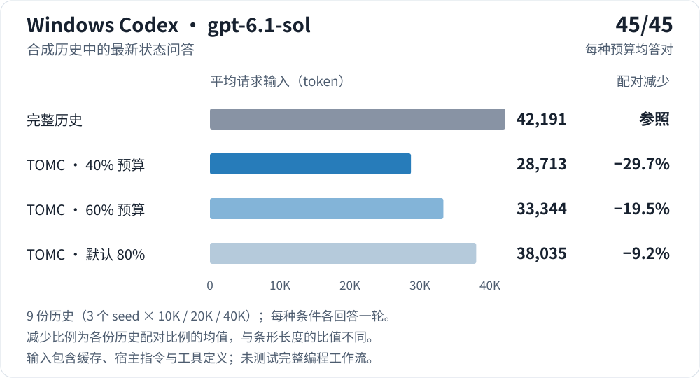
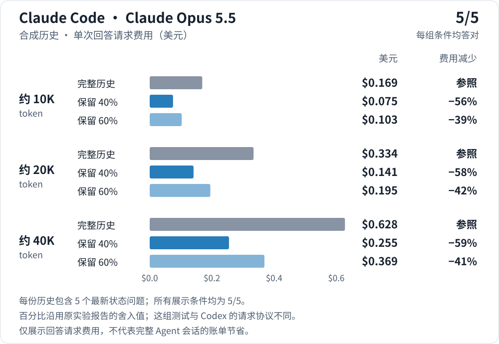
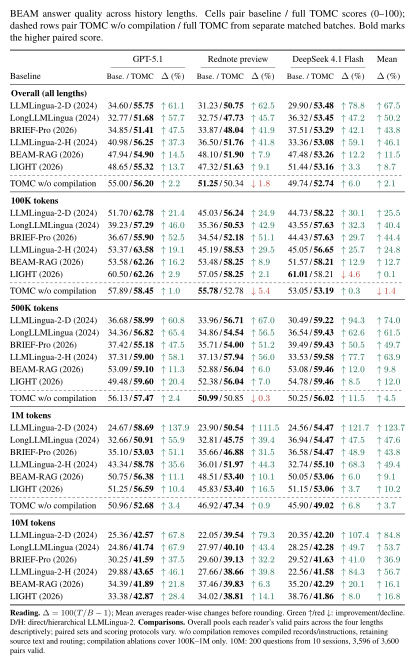
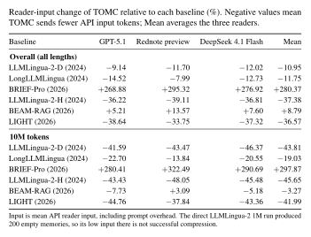
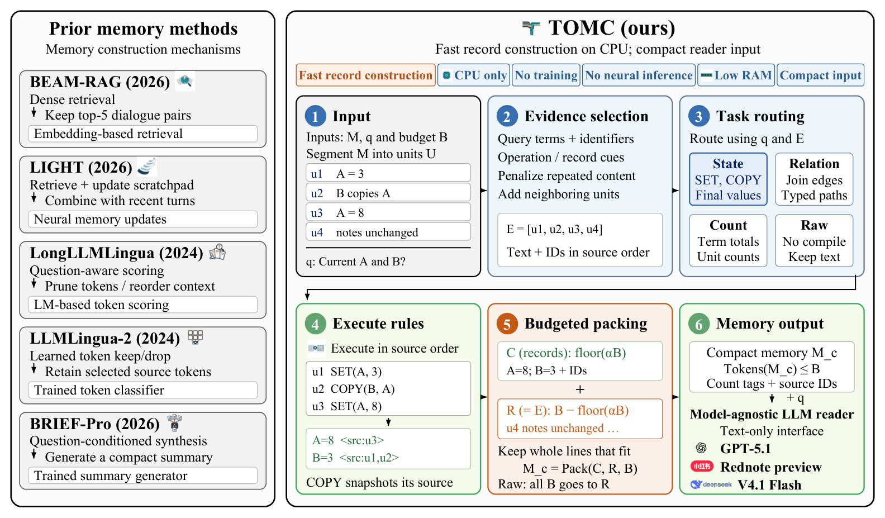

# 证据与数字台账

[English](evidence.md) | **简体中文**

README、视频和更新说明里用到的每个数字，都在这页写明出处和测试条件。没做好的结果和做好的结果放在一起。

<a id="read-this-first"></a>

## 先看这里

- **版本。** 每个数字都标了测的是哪个版本。v0.3.0 新增了旧值测评。Codex、Claude Code 的助手实测全部是 2026 年 10 月在 0.1.0 预览版上做的，之后在 v0.2.1、v0.3.0 上**没有**用模型重测。v0.3.0 改了挑选原文的规则，现在准备出来的上下文会和当时不一样。
- **测评不等于产品。** BEAM 和 RULER 的结果来自论文实验专用的适配器，不是你安装的 `tomc` 包。论文还没公开。
- **两套 BEAM 数字。** "论文快照"覆盖 10 万到 100 万 token（论文提交 `7399657`，2026-09-28）。"10M 补充实验"是 2026-10-10 加的，评分方式换成了成对比较。凡是包含 10M 的数字都会注明。两套都保留。
- **不能和其他项目公布的 BEAM 分数比。** 原因见[这里](#beam-comparability)。
- **默认预算。** 不传预算时，1 万估算 token 以内保留 80%，越长留得越少，10 万时 70%，100 万时 60%，最少 1,024 token（`src/tomc/easy.py`）。助手实测时用的还是旧规则：固定 80%。
- **离线复查。** `make reproduce` 不联网、不调模型，重算全部汇总数字，重新生成合成测试数据，重跑离线测评，有任何对不上就报错。见[复查](#reproduce)。

<a id="claims-ledger"></a>

## 数字台账

"次数"指每个条件测了几次，"n"指计分的题数。

| # | 说法 | 来源 | 模型 | 数据 | 预算 | n | 次数 | 版本 | 指标 |
|---|---|---|---|---|---|---|---|---|---|
| E1 | 默认预算下上下文里都有最新值：100%（v0.2.1 为 58%）；10% 预算 85%（51%）；40% 预算 98%（51%） | [benchmarks/stale/RESULTS.md](https://github.com/ZipengWu365/TOMC/blob/main/benchmarks/stale/RESULTS.md)；`benchmarks/stale/run.py --check` | 无（离线） | 合成笔记和聊天；每件事改 3 到 5 次；状态行、普通说法、混合三种写法 | 历史的 10/20/40/60/80% 和默认 | 每种预算 144 题 | 1（结果固定） | v0.3.0 对比 v0.2.1（提交 `3951794`） | 准备好的上下文里有最新值、且没有未标注的旧值记录的题目占比 |
| E2 | Codex：40% 预算，请求输入少 29.7%，45/45 全对 | [validation.md](validation.md#windows-codex-retention-20261005)、[报告](codex_retention_20261005_zh.md)、[数据](validation_data/windows_codex_retention_20261005.json) | Windows Codex 0.160.0，`gpt-6.1-sol`，`ultra` | 9 份合成团队聊天：3 个种子 × 约 1 万/2 万/4 万 `cl100k_base` token，同一种子的三种长度互相嵌套 | 词法估算的 40% | 45 题，来自 9 份相关的历史 | 每份历史每种条件 1 次回答 | 0.1.0 preview.4（提交 `ad89208`），2026-10-05 | 9 份历史各自配对比例的平均；输入为服务商报告的总量，含缓存、宿主指令和工具定义 |
| E3 | Codex：60% 预算少 19.5%；默认少 9.2%；都是 45/45 | 同 E2 | 同 | 同 | 60%；默认（当时固定 80%） | 45 | 1 | 同 | 同 |
| E4 | Claude API 式请求：保留 40% 费用少 56/58/59%，保留 60% 少 39/42/41%，都是 5/5 | [validation.md](validation.md#claude-code-windows-validation)（"Budget as a share"） | Claude Opus 5.5，经 Claude Code CLI 发出，关闭内置工具和 MCP | 每种长度 1 份合成历史：9,970 / 20,063 / 40,451 `cl100k_base` token；5 题 | 40%、60% | 每格 5 题 | 每格 1 次 | 0.1.0 preview.2 运行时，2026-10-02 | Claude Code 报告的费用（含少量后台调用），对比完整历史 |
| E5 | Claude API 式请求保留 10–20%：答对 3/5 到 5/5；答错的全是同一字段更早的值 | 同 E4 | 同 | 同 | 10%、20% | 每格 5 题，共 6 格 | 每格 1 次 | 同 | 答对题数 |
| E6 | Claude 默认预算检查：45/45，输入少 19.8%；保留 50/60/70% 也是 45/45，分别少 48.6/39.0/29.5% | [validation.md](validation.md#default-budget-keep-about-80) | Claude Opus 5.5，Claude Code 2.1.288，API 式 | 9 份历史（3 个种子 × 3 种长度） | 50/60/70%；默认（当时固定 80%） | 每种预算 45 题 | 每种条件 1 次 | 0.1.0 预览版（2026 年 10 月） | 平均输入变化；答对题数 |
| E7 | Claude Code 正常使用，召回预算 8,192：约 2 万 token 时费用少 38%，约 4 万时少 65%，约 1 万时不变；5/5 | [validation.md](validation.md#claude-code-windows-validation) | Claude Opus 5.5，Claude Code 2.1.287（VS Code 插件自带 CLI），默认工具 | 与 E4 同样 3 份历史，作为笔记本导入 | 8,192 | 每种长度 5 题 | 每种长度 1 次 | 0.1.0 preview.2 运行时，2026-10-02 | Claude Code 报告的会话费用 |
| E8 | 预算 1,024：输入少 85–96%，但 5 题只对 2 到 4 题 | 同 E4/E7 | 同 | 同 | 1,024 | 每格 5 题 | 1 | 同 | 答对题数 |
| E9 | API 示例：`cl100k_base` 计数 147 → 108（少 26.5%）；离线词法估算 138 → 90 | [validation.md](validation.md)（"API-input product revision"）；`examples/api_context.py` | 无 | 一个 6 行的例子 | 64 | 1 个例子 | 结果固定；`make reproduce` 复查 | 0.1.0 preview.2；词法计数在 v0.3.0 上复查 | 消息文本 token，不含聊天封装和工具 |
| E10 | 复制语义例子从 31 增加到 36 个估算 token | `examples/snapshot.py` | 无 | 3 行例子 | 128 | 1 | 结果固定；`make reproduce` 复查 | v0.3.0 | 词法估算；来源标记会增加 token |
| E11 | `tomc try`：英文 6,318 → 184，中文 6,210 → 195，少 97% | `src/tomc/tryout.py`、`src/tomc/data/try_sample_*.json` | 无 | 内置的合成 120 天项目聊天 | 200（卡片上写明；默认预算留得更多） | 每种语言 1 份 | 每次运行现算 | v0.3.0 | 词法估算 |
| E12 | BEAM 论文快照：500K/1M 的 36 组比较 TOMC 平均分都更高，100K 是 18 组里 17 组，整体 18/18；输入比 LIGHT 少 34.77%，比 LLMLingua-2-H 少 34.35% | [paper_results.md](paper_results.md)；`benchmarks/current_paper/`；`benchmarks/reproduce/current.py --check` | 回答模型 GPT-5.1、Rednote preview、DeepSeek 4.1 Flash；评分模型见[评分](#judges) | 每种方法每个模型计划 600 题：60 段对话，分 100K/500K/1M | 记忆上限 8,192 `cl100k_base` | 每格有效配对 573–600 | 每题 1 次回答 | 论文快照 `7399657`，2026-09-28；BEAM 适配器 | 评分 0–100 的平均；各模型输入比例等权平均 |
| E13 | 含 10M 补充：500K/1M/10M 的 54 组比较 TOMC 平均分都更高，整体 18/18；输入比 LIGHT 少 36.57%，比 LLMLingua-2-H 少 37.38%；比 BRIEF-Pro 多 280.37%，比 BEAM-RAG 多 8.79% | `benchmarks/beam_10m_20261010/paired_scores_10m.csv`；`scripts/make_beam_table.py --check` | 同上；10M 的评分模型没有记录 | 10M 新增 10 段对话的 200 题；3,600 组配对中 3,596 组有效 | 8,192 | 70 段对话共 800 道不同的题 | 1 | 10M 于 2026-10-10 加入，在论文快照之后 | 同上；整体一行混合了不同评分方式和日期 |
| E14 | 10M：18 格里 15 格的会话自助法 95% 区间不含 0 | `benchmarks/beam_10m_20261010/bootstrap_ci.json`；`benchmarks/reproduce/beam10m_bootstrap.py --check` | — | E13 的 10M 配对 | — | 18 格，10 段对话 | 重抽 10,000 次，种子 2026102901 | 10M 补充 | 配对分差均值，TOMC − 基线 |
| E15 | 编译记录带来的变化：+1.20 / −0.91 / +3.01 分（GPT-5.1 / Rednote / Flash），相对平均 +2.1% | `benchmarks/current_paper/beam_comparisons.csv`（消融行） | 同上；Pro 分组评分 | 只有 100K–1M | 8,192 | 每个模型 595–598 组有效配对 | 1，分批次、日期不同 | 论文快照 | 完整 TOMC 对比去掉编译的 TOMC |
| E16 | 修复后的 NIAH：87.28 对 82.26（去掉额外原文）；输入少 43–44% | [paper_results.md](paper_results.md#ruler-derived-mechanisms-and-component-ablations)；`niah_repaired.csv` | 同上 | RULER 生成器，序列上限 65,536 | 4,096 | 每个模型 100 组 | 1 | 论文快照 | token F1 |
| E17 | QA2：完整 TOMC 40.85，Query 47.49（TOMC 更差） | 同 E16 | 同 | 同 | 4,096 | 每个模型 100 | 1 | 论文快照 | token F1 |
| E18 | 构建：CPU 上 4.21 秒/次，CUDA 0 GiB，峰值内存 3.75 GiB；BRIEF-Pro 47.94 秒/次、LongLLMLingua 72.07 秒/次（11.4 倍和 17.1 倍） | `benchmarks/current_paper/construction.json`；[paper_results.md](paper_results.md#construction-efficiency-and-resources) | — | BEAM 构建重放 | — | 6 次重放 | — | 论文快照 | 阶段耗时，不含导入、加载、预热和回答模型推理；CPU 型号没有记录；两个基线跑在 GPU 上 |
| E19 | 早期四模型批次：4 个模型 TOMC 都领先，3 个显著（Flash p = 0.27） | [HISTORICAL_BEAM.md](https://github.com/ZipengWu365/TOMC/blob/main/benchmarks/HISTORICAL_BEAM.md)；`benchmarks/reproduce/results.py --check` | DeepSeek-V4-Pro、UOB GPT-5.1、Rednote dots3-note-prev、DeepSeek V4 Flash；评分模型写在文件里 | 每个模型 60 段对话，计划 600 组配对 | — | 每个模型 600 | 自助法 10,000 次；符号翻转 100,000 次 | 2026-09-04 冻结，已被取代 | 与 hybrid-RAG 的分差 |
| E20 | 三个真实项目分别省了 5.16%、42.15%（代理分词器）和 16.84% 的 token | [casestudy/README.md](https://github.com/ZipengWu365/TOMC/blob/main/casestudy/README.md) | 各不相同 | 用户自述的实际项目 | 默认模式，强度 80 | 12 / 5 / 24 组配对 | — | 2026-10 | 报告的用量；原始报告不在仓库里，只能核对算术 |
| E21 | 视频：Codex 案例输入 38,786 → 27,235（少 29.8%），5/5 | 只在 v11–v13 的素材证据文件里 | — | — | — | — | — | — | **仓库里没有这次测试的协议和原始记录。** 和 E2 不是同一个测试 |
| E22 | 视频：Claude Code 会话费用约少 38% | = E7 里约 2 万 token 那一格 | | | | | | | 只是一格；1 万时不变，4 万时少 65% |
| E23 | 视频：BEAM 54 组比较，输入比 LIGHT 少 36.6% | = E13 | | | | | | | |

<a id="assistant-trials"></a>

## 助手实测（0.1.0 预览版）

这些测试用的是合成项目聊天，里面有大量更新和同名干扰。更新都是普通说法，所以 TOMC 走的是挑原文（`tomc_raw`），没有生成状态记录。测的是上下文变小以后最新值还在不在，不是写代码的整体质量。

<a id="codex-trial"></a>

### Codex

Windows Codex 0.160.0，`gpt-6.1-sol`，`ultra`，已装的插件都保留。TOMC 先通过已安装的 MCP 工具准备上下文，再开新对话，每份历史回答 5 个最新状态问题。



| 发送的上下文 | 平均请求输入 token | 平均配对输入减少 | 正确回答 |
|---|---:|---:|---:|
| 完整历史 | 42,191 | 参照 | 45/45 |
| TOMC · 40% 历史预算 | 28,713 | 29.7% | 45/45 |
| TOMC · 60% 历史预算 | 33,344 | 19.5% | 45/45 |
| TOMC · 默认 80% 历史预算 | 38,035 | 9.2% | 45/45 |

输入是 Codex 报告的总量，含缓存输入、宿主指令和工具定义。减少比例是 9 份历史各自配对比例的平均，不是表里两个均值直接相除。45 题来自 9 份相关的历史（同一种子的三种长度互相嵌套），不是 45 个独立项目。每份历史每种条件只算一次回答；让模型在对话里准备或取回上下文还会多几轮。[完整报告](codex_retention_20261005_zh.md) · [原始记录](validation_data/windows_codex_retention_20261005.json)

<a id="claude-trials"></a>

### Claude Code

模型是 Claude Opus 5.5。每种长度只有 1 份合成历史，5 道题，**每格只跑一次**。"API 式"指通过 Claude Code CLI 发请求，但换掉了它的系统提示，关闭了内置工具和 MCP，不是平时用 Claude Code 的样子。



| 历史长度 | 完整历史 | TOMC 保留 40% | TOMC 保留 60% |
|---|---|---|---|
| 约 10K token | US$0.169 · 5/5 | US$0.075 · 5/5（−56%） | US$0.103 · 5/5（−39%） |
| 约 20K token | US$0.334 · 5/5 | US$0.141 · 5/5（−58%） | US$0.195 · 5/5（−42%） |
| 约 40K token | US$0.628 · 5/5 | US$0.255 · 5/5（−59%） | US$0.369 · 5/5（−41%） |

平时那样用 Claude Code（默认工具），把历史直接贴进对话，对比从导入的笔记本里召回（预算 8,192）：

| 历史（`cl100k_base` token） | 完整历史贴进对话 | 召回，预算 1,024 | 召回，预算 8,192 |
|---|---|---|---|
| 9,970 | US$0.247 · 5/5 | US$0.141 · 4/5 | US$0.253 · 5/5 |
| 20,063 | US$0.400 · 5/5 | US$0.139 · 2/5 | US$0.249 · 5/5 |
| 40,451 | US$0.709 · 5/5 | US$0.137 · 3/5 | US$0.247 · 5/5 |

约 1 万 token 时没有省钱。历史只有 2,217 token 时，历史文本少了 94.8%，但回答那次请求的输入只少 5.6%，因为 Claude Code 自己每次要带约 39,000 token 的指令和工具定义；整个会话费用从 US$0.121 变成 US$0.123。[验证记录](validation.md#claude-code-windows-validation)

<a id="default-budget"></a>

### 默认预算

9 份历史（每种长度 3 个种子），Claude Opus 5.5，Claude Code 2.1.288，API 式请求。当时的默认是固定保留 80%。

| 保留比例 | 正确回答 | 平均输入变化 |
|---|---|---|
| 50% | 45/45 | −48.6% |
| 60% | 45/45 | −39.0% |
| 70% | 45/45 | −29.5% |
| 80%（当时的默认） | 45/45 | −19.8% |

再往下就开始报旧值：保留 10–20% 时，单次运行答对 3/5 到 5/5，答错的全是同一字段更早的值。加上 Codex 默认预算省 9.2%，这就是"默认大约省 1 到 2 成"的来源。

<a id="stale-benchmark"></a>

## 旧值测评（v0.3.0）

`python benchmarks/stale/run.py` 生成合成历史，让一件事改 3 到 5 次，在 6 种预算下离线准备上下文，检查最新值在不在，以及有没有把旧值当成当前值又没标出来。不调用模型，所以测的是上下文里有什么，不是模型答得对不对。每种预算 144 题。每格是 v0.2.1 → v0.3.0。

| 写法 / 格式 | 10% | 20% | 40% | 60% | 80% | 默认 |
|---|---|---|---|---|---|---|
| 状态行 / 笔记 | 100% → 100% | 100% → 100% | 100% → 100% | 100% → 100% | 100% → 100% | 100% → 100% |
| 状态行 / 聊天 | 100% → 100% | 100% → 100% | 100% → 100% | 100% → 100% | 100% → 100% | 100% → 100% |
| 普通说法 / 笔记 | 54% → 67% | 54% → 79% | 54% → 96% | 54% → 100% | 67% → 100% | 62% → 100% |
| 普通说法 / 聊天 | 54% → 79% | 54% → 79% | 54% → 100% | 62% → 100% | 88% → 100% | 88% → 100% |
| 混合 / 笔记 | 0% → 75% | 0% → 88% | 0% → 96% | 0% → 100% | 0% → 100% | 0% → 100% |
| 混合 / 聊天 | 0% → 88% | 0% → 83% | 0% → 96% | 0% → 100% | 0% → 100% | 0% → 100% |
| **全部** | 51% → 85% | 51% → 88% | 51% → 98% | 53% → 100% | 59% → 100% | 58% → 100% |

剩下没过的题都在 10–40% 预算，而且都是没说改的是什么的更新，比如"Scratch that, go with Django."。这个测评和 v0.3.0 的修复是同一个人一起写的，请把它当回归测试看，不是独立评测。[生成的表格](https://github.com/ZipengWu365/TOMC/blob/main/benchmarks/stale/RESULTS.md)

<a id="real-projects"></a>

## 真实项目

三个用户自述的项目（小红书图文、快手视频、科研幻灯片）分别省了 5.16%、42.15%（只算背景材料，用代理分词器）和 16.84% 的 token，明显低于合成测试。回答质量没有做盲评，原始报告也不在仓库里，所以只能核对算术。[案例记录](https://github.com/ZipengWu365/TOMC/blob/main/casestudy/README.md)

<a id="beam"></a>

## BEAM 长历史测评

每一对比较里，两边用**同一个回答模型**：一次读指定基线准备的记忆，一次读 TOMC 的记忆，题目一样，评分方式一样。回答模型：GPT-5.1、Rednote preview、DeepSeek 4.1 Flash。记忆上限 8,192 `cl100k_base` token；"100 万历史"指原始对话的长度，不是发给模型 100 万 token。

### 论文快照（100K–1M）

摘自 [paper_results.md](paper_results.md) 的整体一行（基线 / TOMC，0–100 分）：

| 基线记忆 | GPT-5.1 | Rednote preview | DeepSeek 4.1 Flash | 平均输入变化 |
|---|---:|---:|---:|---:|
| LLMLingua-2-D | 37.69 / **60.16** | 34.30 / **54.49** | 33.13 / **57.29** | +7.87% |
| LongLLMLingua | 35.43 / **55.03** | 34.34 / **50.28** | 39.01 / **57.18** | -9.32% |
| BRIEF-Pro | 36.40 / **54.71** | 35.30 / **51.03** | 40.17 / **57.18** | +275.45% |
| LLMLingua-2-H | 44.67 / **60.45** | 39.47 / **56.16** | 37.13 / **57.09** | -34.35% |
| BEAM-RAG | 52.47 / **59.25** | 51.63 / **55.90** | 51.57 / **56.91** | +12.96% |
| LIGHT | 53.75 / **59.48** | 51.75 / **55.90** | 55.65 / **56.91** | -34.77% |

500K/1M 的 36 组比较 TOMC 平均分都更高，100K 是 18 组里 17 组。分长度的表格、有效配对数和评分方式见 [paper_results.md](paper_results.md)。

### 含 10M 补充（100K–10M）

10M 新增 10 段对话的 200 题（每段对话每种能力 2 题），3,600 组配对中 3,596 组有效，评分用匿名、左右位置平衡的成对比较。"整体"把每个模型所有长度的有效配对合在一起，混合了不同评分方式和日期，只能当描述性汇总看。[10M 数据](https://github.com/ZipengWu365/TOMC/blob/main/benchmarks/beam_10m_20261010/README.md)

<!-- BEAM_TABLE_START -->
<a href="../assets/beam_table/beam_quality.png">
  
</a>

<a href="../assets/beam_table/beam_input.png">
  
</a>

<details>
<summary>表格文字版</summary>

| 基线 | GPT-5.1 | Δ (%) | Rednote preview | Δ (%) | DeepSeek 4.1 Flash | Δ (%) | 平均 Δ (%) |
|---|---:|:---|---:|:---|---:|:---|:---|
| **Overall (all lengths)** | | | | | | | |
| LLMLingua-2-D (2024) | 34.60 / **55.75** | ↑ 61.1 | 31.23 / **50.75** | ↑ 62.5 | 29.90 / **53.48** | ↑ 78.8 | ↑ 67.5 |
| LongLLMLingua (2024) | 32.77 / **51.68** | ↑ 57.7 | 32.75 / **47.73** | ↑ 45.7 | 36.32 / **53.45** | ↑ 47.2 | ↑ 50.2 |
| BRIEF-Pro (2026) | 34.85 / **51.41** | ↑ 47.5 | 33.87 / **48.04** | ↑ 41.9 | 37.51 / **53.29** | ↑ 42.1 | ↑ 43.8 |
| LLMLingua-2-H (2024) | 40.98 / **56.25** | ↑ 37.3 | 36.50 / **51.76** | ↑ 41.8 | 33.36 / **53.08** | ↑ 59.1 | ↑ 46.1 |
| BEAM-RAG (2026) | 47.94 / **54.90** | ↑ 14.5 | 48.10 / **51.90** | ↑ 7.9 | 47.48 / **53.26** | ↑ 12.2 | ↑ 11.5 |
| LIGHT (2026) | 48.65 / **55.32** | ↑ 13.7 | 47.32 / **51.63** | ↑ 9.1 | 51.44 / **53.16** | ↑ 3.3 | ↑ 8.7 |
| TOMC w/o compilation | 55.00 / **56.20** | ↑ 2.2 | **51.25** / 50.34 | ↓ 1.8 | 49.74 / **52.74** | ↑ 6.0 | ↑ 2.1 |
| **100K tokens** | | | | | | | |
| LLMLingua-2-D (2024) | 51.70 / **62.78** | ↑ 21.4 | 45.03 / **56.24** | ↑ 24.9 | 44.73 / **58.22** | ↑ 30.1 | ↑ 25.5 |
| LongLLMLingua (2024) | 39.23 / **57.29** | ↑ 46.0 | 35.36 / **50.53** | ↑ 42.9 | 43.55 / **57.63** | ↑ 32.3 | ↑ 40.4 |
| BRIEF-Pro (2026) | 36.67 / **55.90** | ↑ 52.5 | 34.54 / **52.18** | ↑ 51.1 | 44.43 / **57.63** | ↑ 29.7 | ↑ 44.4 |
| LLMLingua-2-H (2024) | 53.37 / **63.58** | ↑ 19.1 | 45.19 / **58.53** | ↑ 29.5 | 45.05 / **56.65** | ↑ 25.7 | ↑ 24.8 |
| BEAM-RAG (2026) | 53.58 / **62.26** | ↑ 16.2 | 53.48 / **58.25** | ↑ 8.9 | 51.57 / **58.21** | ↑ 12.9 | ↑ 12.7 |
| LIGHT (2026) | 60.50 / **62.26** | ↑ 2.9 | 57.05 / **58.25** | ↑ 2.1 | **61.01** / 58.21 | ↓ 4.6 | ↑ 0.1 |
| TOMC w/o compilation | 57.89 / **58.45** | ↑ 1.0 | **55.78** / 52.78 | ↓ 5.4 | 53.05 / **53.19** | ↑ 0.3 | ↓ 1.4 |
| **500K tokens** | | | | | | | |
| LLMLingua-2-D (2024) | 36.68 / **58.99** | ↑ 60.8 | 33.96 / **56.71** | ↑ 67.0 | 30.49 / **59.22** | ↑ 94.3 | ↑ 74.0 |
| LongLLMLingua (2024) | 34.36 / **56.82** | ↑ 65.4 | 34.86 / **54.54** | ↑ 56.5 | 36.54 / **59.43** | ↑ 62.6 | ↑ 61.5 |
| BRIEF-Pro (2026) | 37.42 / **55.18** | ↑ 47.5 | 35.71 / **54.00** | ↑ 51.2 | 39.49 / **59.43** | ↑ 50.5 | ↑ 49.7 |
| LLMLingua-2-H (2024) | 37.31 / **59.00** | ↑ 58.1 | 37.13 / **57.94** | ↑ 56.0 | 33.53 / **59.58** | ↑ 77.7 | ↑ 63.9 |
| BEAM-RAG (2026) | 53.09 / **59.10** | ↑ 11.3 | 52.88 / **56.04** | ↑ 6.0 | 53.08 / **59.46** | ↑ 12.0 | ↑ 9.8 |
| LIGHT (2026) | 49.48 / **59.60** | ↑ 20.4 | 52.38 / **56.04** | ↑ 7.0 | 54.78 / **59.46** | ↑ 8.5 | ↑ 12.0 |
| TOMC w/o compilation | 56.13 / **57.47** | ↑ 2.4 | **50.99** / 50.85 | ↓ 0.3 | 50.25 / **56.02** | ↑ 11.5 | ↑ 4.5 |
| **1M tokens** | | | | | | | |
| LLMLingua-2-D (2024) | 24.67 / **58.69** | ↑ 137.9 | 23.90 / **50.54** | ↑ 111.5 | 24.56 / **54.47** | ↑ 121.7 | ↑ 123.7 |
| LongLLMLingua (2024) | 32.66 / **50.91** | ↑ 55.9 | 32.81 / **45.75** | ↑ 39.4 | 36.94 / **54.47** | ↑ 47.5 | ↑ 47.6 |
| BRIEF-Pro (2026) | 35.10 / **53.03** | ↑ 51.1 | 35.66 / **46.88** | ↑ 31.5 | 36.58 / **54.47** | ↑ 48.9 | ↑ 43.8 |
| LLMLingua-2-H (2024) | 43.34 / **58.78** | ↑ 35.6 | 36.01 / **51.97** | ↑ 44.3 | 32.74 / **55.10** | ↑ 68.3 | ↑ 49.4 |
| BEAM-RAG (2026) | 50.75 / **56.38** | ↑ 11.1 | 48.51 / **53.40** | ↑ 10.1 | 50.05 / **53.06** | ↑ 6.0 | ↑ 9.1 |
| LIGHT (2026) | 51.25 / **56.59** | ↑ 10.4 | 45.83 / **53.40** | ↑ 16.5 | 51.15 / **53.06** | ↑ 3.7 | ↑ 10.2 |
| TOMC w/o compilation | 50.96 / **52.68** | ↑ 3.4 | 46.92 / **47.34** | ↑ 0.9 | 45.90 / **49.02** | ↑ 6.8 | ↑ 3.7 |
| **10M tokens** | | | | | | | |
| LLMLingua-2-D (2024) | 25.36 / **42.57** | ↑ 67.8 | 22.05 / **39.54** | ↑ 79.3 | 20.35 / **42.20** | ↑ 107.4 | ↑ 84.8 |
| LongLLMLingua (2024) | 24.86 / **41.74** | ↑ 67.9 | 27.97 / **40.10** | ↑ 43.4 | 28.25 / **42.28** | ↑ 49.7 | ↑ 53.7 |
| BRIEF-Pro (2026) | 30.25 / **41.59** | ↑ 37.5 | 29.60 / **39.13** | ↑ 32.2 | 29.52 / **41.63** | ↑ 41.0 | ↑ 36.9 |
| LLMLingua-2-H (2024) | 29.88 / **43.65** | ↑ 46.1 | 27.66 / **38.66** | ↑ 39.8 | 22.56 / **41.58** | ↑ 84.3 | ↑ 56.7 |
| BEAM-RAG (2026) | 34.39 / **41.89** | ↑ 21.8 | 37.46 / **39.83** | ↑ 6.3 | 35.20 / **42.29** | ↑ 20.1 | ↑ 16.1 |
| LIGHT (2026) | 33.38 / **42.87** | ↑ 28.4 | 34.02 / **38.81** | ↑ 14.1 | 38.76 / **41.86** | ↑ 8.0 | ↑ 16.8 |

| 基线 | 整体输入变化 | 10M 输入变化 |
|---|---:|---:|
| LLMLingua-2-D (2024) | -10.95% | -43.81% |
| LongLLMLingua (2024) | -11.75% | -19.03% |
| BRIEF-Pro (2026) | +280.37% | +297.87% |
| LLMLingua-2-H (2024) | -37.38% | -45.65% |
| BEAM-RAG (2026) | +8.79% | -3.27% |
| LIGHT (2026) | -36.57% | -41.99% |

</details>
<!-- BEAM_TABLE_END -->

*D/H 分别是直接和分层 LLMLingua-2。输入变化是 TOMC 相对基线的变化，负数表示 TOMC 用得更少。直接 LLMLingua-2 在 1M 时有 200 份记忆是空的，分数照样保留，它的输入低是失败造成的，不是压缩得好。两行 LLMLingua-2 的 10M 结果用的是修复后、记忆不为空的批次。"TOMC w/o compilation"只覆盖 100K–1M。*

<a id="bootstrap"></a>

### 10M 的差距有多稳？

把 10 段对话有放回地重抽 10,000 次（种子 2026102901，每格重新设种子），取 TOMC − 基线配对分差均值（0–100 分，只用有效配对）的 2.5% 和 97.5% 分位数。脚本：`benchmarks/reproduce/beam10m_bootstrap.py`；结果：`benchmarks/beam_10m_20261010/bootstrap_ci.json`。只有 10 段对话，这些区间比较粗。

| 模型 | LLMLingua-2-D | LongLLMLingua | BRIEF-Pro | LLMLingua-2-H | BEAM-RAG | LIGHT |
|---|---|---|---|---|---|---|
| GPT-5.1 | +17.21 [11.57, 22.34] | +16.89 [14.08, 19.23] | +11.33 [4.38, 18.56] | +13.77 [9.19, 18.79] | +7.50 [0.67, 13.69] | +9.49 [4.22, 15.24] |
| Rednote preview | +17.49 [12.62, 22.44] | +12.13 [6.61, 17.70] | +9.54 [3.42, 15.64] | +11.00 [6.71, 15.24] | +2.37 [−3.84, 8.45] | +4.79 [−3.31, 12.71] |
| DeepSeek 4.1 Flash | +21.85 [15.66, 27.77] | +14.03 [6.37, 21.78] | +12.10 [5.20, 19.09] | +19.02 [14.02, 24.07] | +7.09 [1.22, 12.86] | +3.10 [−3.72, 10.40] |

18 个区间里 15 个不含 0。含 0 的三个是 Rednote 对 BEAM-RAG、Rednote 对 LIGHT、Flash 对 LIGHT。100K–1M 没法算区间：仓库里只有这几档的汇总数字。

<a id="judges"></a>

### 评分模型

- **100K–1M：** 每格用 5 种评分方式之一（[paper_results.md](paper_results.md) 里的 A–E）：DeepSeek Flash 单题评分（A、D、E）、存档的 DeepSeek Pro 分组评分（B）、存档的 Flash 分组评分（C）。编译消融用的是 Pro 分组评分。Flash 本身也是回答模型之一，所以部分 Flash 的格子里它在给自己的回答打分。这些评分方式具体用的模型版本和提示词，仓库里还没有记录。
- **10M：** 评分规则和正反顺序、单题校准检查有记录；评分模型还没有记录。
- **早期四模型批次：** 每个模型的评分模型写在 [HISTORICAL_BEAM.md](https://github.com/ZipengWu365/TOMC/blob/main/benchmarks/HISTORICAL_BEAM.md) 里。

<a id="beam-comparability"></a>

### 为什么不能和其他项目的 BEAM 分数比

- 我们只用了 800 题（100K–1M 每段对话每种能力 1 题共 600 题，加 10M 的 200 题），不是完整的 2,000 题。
- 所有方法的记忆上限都是 8,192 token。
- 评分用的是我们自己的提示词和 5 种评分方式，10M 还换成了成对比较。不同评分方式的绝对分数不一样，所以就算在这张表里，也只有同一格的两个数能直接比。
- BEAM 适配器、任务配置和评分流程都没有公开，没法用这个仓库重建记忆。

只在同一格里比 TOMC 和基线。不要把这些数字和别处公布的 BEAM 分数放在一起比。

<a id="ablation"></a>

## 编译记录到底帮了多少

单独的消融实验去掉编译记录和对应说明，原文和路由保持不变（100K–1M，Pro 分组评分）。平均分变化：GPT-5.1 +1.20，Rednote −0.91，Flash +3.01，相对平均 +2.1%。也就是说，**编译记录平均帮得不多，TOMC 比基线强的大部分来自挑原文和路由。** 三个模型的时间推理都变好了，事件排序都变差了。10M 的消融截至 2026-10-10 还在跑，没有公布。[结果与局限](claims_and_limitations.md)

<a id="ruler"></a>

## RULER 诊断

每个任务 100 个样例，来自 RULER 生成器，序列上限 65,536，记忆预算 4,096。

| 任务 | 结果 |
|---|---|
| NIAH，修复后的配对 | 完整 TOMC 平均 F1 87.28；去掉额外原文后 82.26；输入少 43–44%（每个模型 100 组） |
| VT，状态路线 | 对完整历史重放时召回 100%；只重放挑出来的证据时约 20.4–20.6% |
| QA2 | **TOMC 更差。** 完整 TOMC 40.85，Query 47.49；每个模型都是纯原文比记录好；去掉额外原文后 F1 掉到 8.44 |

存档的 NIAH 表有打包错误，只有修复后的那组配对能单独看出去掉原文的影响。[数字与说明](paper_results.md#ruler-derived-mechanisms-and-component-ablations)

<a id="construction-cost"></a>

## 构建开销

六次 CPU 重放平均 4.21 秒/次，CUDA 分配 0 GiB，进程峰值内存 3.75 GiB，不含导入、加载输入和分词器预热。BRIEF-Pro 和 LongLLMLingua 在记录的阶段里分别是 47.94 和 72.07 秒/次（TOMC 的 11.4 倍和 17.1 倍），跑在 GPU 上。硬件不同，只比阶段耗时，不含回答模型推理；CPU 型号没有记录。TOMC 的内存占用不是最低的。[表格](paper_results.md#construction-efficiency-and-resources)

<a id="negative-results"></a>

## 没做好的和有边界的结果

- **100K 的例外：** Flash 配 LIGHT 得 61.01，TOMC 58.21。在共同能力集上，TOMC 的指令遵循不如两个对照，拒答不如 BEAM-RAG，总结不如 LIGHT。
- **QA2：** TOMC 输给了直接挑原文的 Query（40.85 对 47.49）。
- **直接 LLMLingua-2 在 1M：** 200 份空记忆，分数保留。它的输入特别低是失败。
- **事件排序：** 加上编译记录后，三个模型都下降。
- **10M 区间：** 18 个里有 3 个含 0。
- **早期四模型批次：** Flash 领先 1.83 分，不显著（p = 0.27）。
- **输入：** TOMC 用的输入比 BRIEF-Pro 和 BEAM-RAG 多。
- **助手实测：** 预算太小（1,024 token，或历史的 10–20%）会报旧值；完整历史每题都对。这些测试里 TOMC 省的是钱，不是减少错误。在 Claude Code 里约 1 万 token 时没省钱。
- **真实项目：** 只省了 5–17%，远低于合成测试。
- **旧值测评：** 没点名改的是什么的改口，在 10–40% 预算下还是会漏。

<a id="how-it-works"></a>

## TOMC 怎么准备上下文

给 TOMC 一段历史、下一步任务和 token 预算。它在 CPU 上挑出和任务相关的原文；对支持的写法（`key = value`、`B copies A`、`x -[rel]-> y`、计数）按顺序重放这些操作，写成记录，并链接到原文所在行。回答模型不用换，变的只是它读到的文本。

<a href="../assets/paper_method.png"></a>

```text
drink = tea
backup_drink copies drink
drink = decaf tea
```

当前 `drink` 是 `decaf tea`，`backup_drink` 保留复制时的 `tea`。运行 `python examples/snapshot.py` 看完整例子。来源标记让这个小例子从 31 个估算 token 变成 36 个；它演示复制规则，不衡量回答质量。普通说法不会变成记录，只会作为挑出来的原文保留。[方法](method.md) · [论文范围](paper_scope.md) · [回答模型与助手宿主](readers_and_agents_zh.md)

<a id="reproduce"></a>

## 复查

```bash
make reproduce            # 或者：make reproduce PY=python
```

它会核对论文快照的算术、早期四模型批次的统计、本页的 BEAM 表格和 10M 自助法区间；重新生成 9 份 Codex/Claude 合成历史并和记录里的哈希比对；重跑旧值测评、自适应预算测评和两个示例。不联网、不要 API key、不要 GPU，跑完 `git status` 不变。做不到的：在 BEAM 上重建 TOMC 记忆（适配器、数据文件和评分流程没有公开），以及重复付费的模型调用。[详细说明](reproducibility.md)

<a id="replications"></a>

## 独立复现

目前还没有。如果你重跑了这里的任何内容，失败了也算，请提交一份[复现报告](https://github.com/ZipengWu365/TOMC/issues/new?template=replication_report.yml)。结果会记在 [REPLICATIONS.md](https://github.com/ZipengWu365/TOMC/blob/main/REPLICATIONS.md) 里，失败的也列出来。
