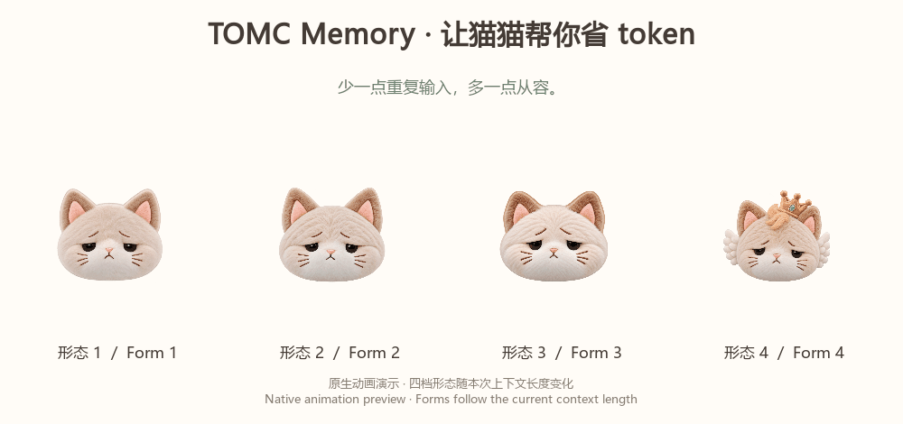
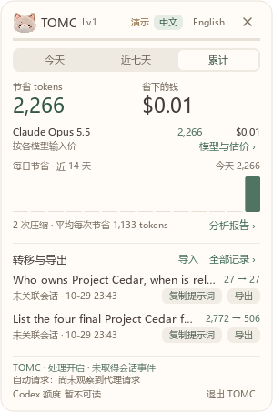

**TOMC Memory | 让猫猫帮你省 token，换 Code Agent 也能接着干**

我还给 TOMC 做了一只桌面小猫：处理上下文时，它会笑着把散乱的纸片收起来；点开就能看节省统计、任务笔记和上下文库。它有四档形态，皇冠猫还有一段沙漠变绿洲的动画。**少一点重复输入，多一点绿色心意。**

*四档形态随本次上下文长度变化；桌面小猫可单独安装。*

大家好，我是 TOMC 的作者，也是 DeepSeek API 用户，累计使用已超过 **1.28 亿 tokens**。我们在研究中做了一种上下文压缩方法：根据当前任务，把长历史整理成更紧凑的记忆，让模型用更少的上下文完成任务。

我们在 **BEAM 长历史 benchmark** 上，覆盖 **100K、500K、1M 和 10M tokens**，对比了 **LLMLingua-2、分层 LLMLingua-2、LongLLMLingua、BRIEF-Pro、BEAM-RAG 和 LIGHT**。评测覆盖 **2,000 道题**，结果见 [GitHub 实验结果报告](https://github.com/ZipengWu365/TOMC#same-reader-baseline-memory-vs-tomc-memory)。在三个回答模型与六种基线构成的 **18 项整体比较中，TOMC 的平均任务得分全部更高**；整体模型输入相比 LIGHT 减少约 **36.6%**。

我把这项研究做成了开源工具 **TOMC Memory**，主要有三个特点：

1. **省输入：** 在本地 CPU 上压缩、整理任务上下文，无需额外大模型或 GPU。
2. **换 Code Agent 继续：** 保存项目要求、决定和待办，在连接同一记忆库的 Agent 之间接着做。目前提供 **Codex、Claude Code、Cursor、TRAE、腾讯 WorkBuddy、Claude Desktop 和 DeepSeek Harness** 的接入方式。
3. **换电脑接着用：** 导出任务笔记，带到另一台电脑继续，不用重新交代背景。

我们已经做了 Codex 和 Claude Code 的实际模型测试。其中，Codex 的九份合成项目历史测试中，完整请求输入平均减少 **29.7%**，压缩前后均答对 **45/45** 个问题。现在也已在 **DeepSeek Harness** 中跑通保存笔记、新会话召回和继续任务。[实测记录](https://github.com/ZipengWu365/TOMC/blob/main/docs/validation.md)

也有朋友把 TOMC 用在小红书内容、视频制作和科研 PPT 中。根据他提交的实测报告，小红书项目的总模型 tokens 减少 **5.16%**，科研 PPT 及修改任务减少 **16.84%**。[朋友的使用案例](https://github.com/ZipengWu365/TOMC/blob/main/casestudy/README.md)

项目已被 **[Odel](https://odel.app/modules/zipengwu365/tomc-memory)、[MCP Harbor](https://www.mcpharbor.app/tools/zipengwu365-tomc/)、[ProtocolProbe](https://protocolprobe.com/mcp/servers/io.github.ZipengWu365/tomc-memory)** 等多个 MCP 平台收录，也能在 **[SkillsLLM](https://skillsllm.com/skill/tomc)** 和 **[AugmentClaude](https://augmentclaude.com/s/tomc-memory-zipengwu365)** 找到。希望把这项研究和工具带给 WorkBuddy 社区，也欢迎大家拿自己的长任务试试。

[项目源码](https://github.com/ZipengWu365/TOMC) · [中文安装说明](https://github.com/ZipengWu365/TOMC/blob/main/docs/workbuddy_zh.md) · [桌面小猫安装](https://github.com/ZipengWu365/TOMC/blob/main/docs/desktop_companion.md)

*界面展示：独立 MCP 测试中的上下文估算统计，金额按参考模型单价折算。*

*非官方开源社区插件。*

---

**TOMC Memory | A token-saving cat, with memory you can carry across code agents**

I also built a desktop cat for TOMC. It smiles and gathers scattered notes while preparing context; click it to see context savings, task notes, and saved contexts. There are four visual forms, and the crowned cat comes with a desert-to-oasis animation. **Less repeated input, a little more care for our planet.**

*Forms follow the current context length. The desktop companion is installed separately.*

Hi everyone, I’m the author of TOMC and a DeepSeek API user, with over **128 million tokens** used so far. Our research explores task-oriented context compression: turning long histories into compact memory that helps a model complete its task with less input.

We evaluated TOMC on **BEAM**, covering **100K, 500K, 1M, and 10M-token histories**, against six baselines: **LLMLingua-2, hierarchical LLMLingua-2, LongLLMLingua, BRIEF-Pro, BEAM-RAG, and LIGHT**. Our evaluation covered **2,000 questions**; see the [experimental results in our GitHub repository](https://github.com/ZipengWu365/TOMC#same-reader-baseline-memory-vs-tomc-memory). Across the **18 overall comparisons involving three answering models and six baselines, TOMC achieved higher mean task scores in every comparison**. Overall model input was approximately **36.6% lower than LIGHT’s**.

I turned this research into **TOMC Memory**, an open-source tool with three practical features:

1. **Reduce input:** Compress and prepare task context locally on CPU, without an additional LLM or GPU.
2. **Switch code agents:** Save project requirements, decisions, and unfinished work so another agent connected to the same memory database can continue. Integration options are available for **Codex, Claude Code, Cursor, TRAE, Tencent WorkBuddy, Claude Desktop, and DeepSeek Harness**.
3. **Switch computers:** Export your task notes and bring them to another computer without explaining the project from scratch.

We have run real-model tests in Codex and Claude Code. In the Codex test across nine synthetic project histories, complete request input decreased by **29.7%** on average, while both the full-history and compressed conditions answered **45/45 questions correctly**. We have also tested saving notes, recalling them in a fresh session, and continuing a task in **DeepSeek Harness**. [Test records](https://github.com/ZipengWu365/TOMC/blob/main/docs/validation.md)

A friend has also used TOMC for social content, video production, and research slides. His contributed report records **5.16% fewer total model tokens** for a Xiaohongshu content project and **16.84% fewer** for research slides and revisions. [Community case studies](https://github.com/ZipengWu365/TOMC/blob/main/casestudy/README.md)

TOMC is listed on multiple MCP platforms, including **[Odel](https://odel.app/modules/zipengwu365/tomc-memory), [MCP Harbor](https://www.mcpharbor.app/tools/zipengwu365-tomc/), and [ProtocolProbe](https://protocolprobe.com/mcp/servers/io.github.ZipengWu365/tomc-memory)**, and is also available in the **[SkillsLLM](https://skillsllm.com/skill/tomc)** and **[AugmentClaude](https://augmentclaude.com/s/tomc-memory-zipengwu365)** directories. I’d like to bring this research and tool to the WorkBuddy community and hear how it works on your longer-running tasks.

[Source code](https://github.com/ZipengWu365/TOMC) · [Installation guide](https://github.com/ZipengWu365/TOMC/blob/main/docs/workbuddy.md) · [Desktop cat](https://github.com/ZipengWu365/TOMC/blob/main/docs/desktop_companion.md)

*UI example: estimated context savings from an isolated MCP test; cost uses a reference model price.*

*Unofficial, open-source community plugin.*

