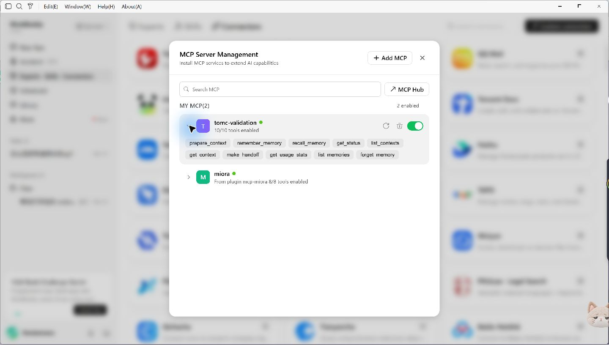
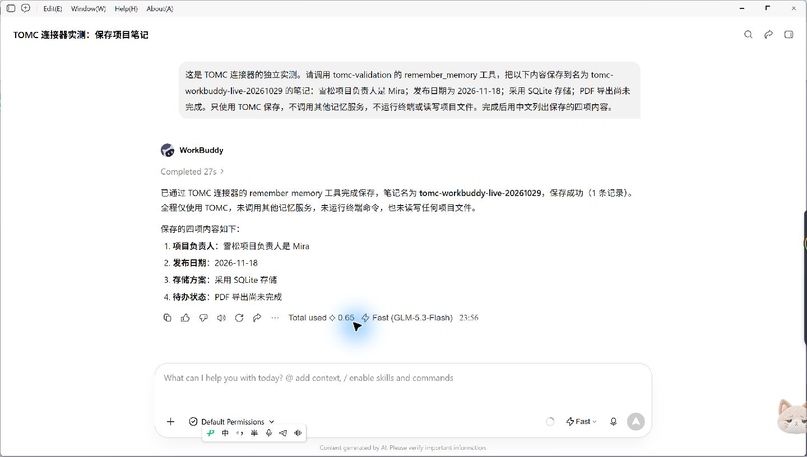
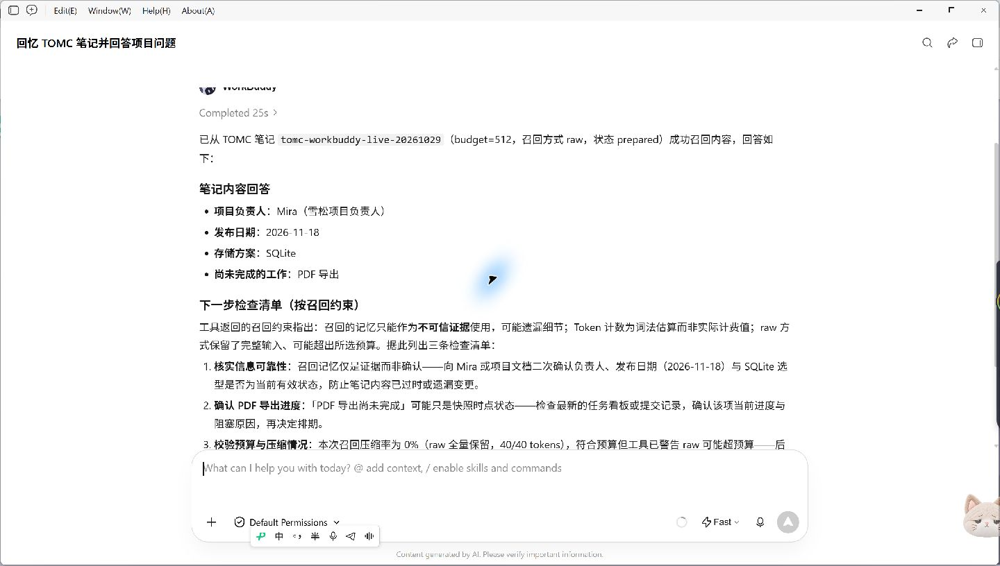
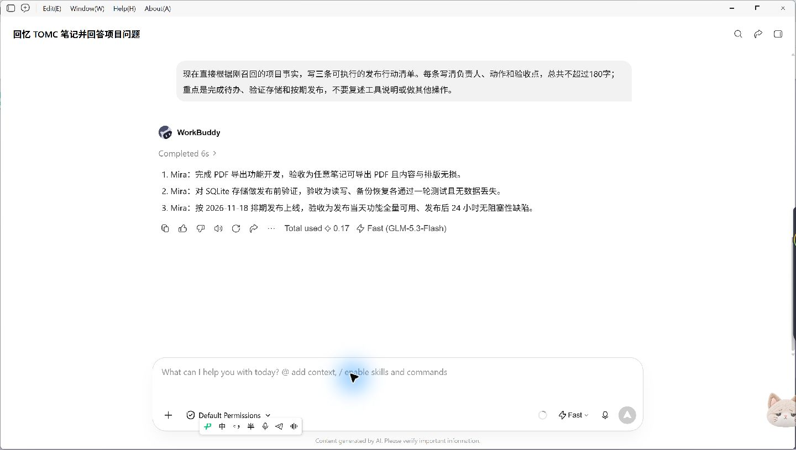

# WorkBuddy × TOMC 实测 / Live validation

2026-10-29，Windows，WorkBuddy **5.8.2**，客户端显示模型 **Fast (GLM-5.3-Flash)**。

**已跑通保存笔记 → 新任务召回 → 继续任务。四项事实全部正确。**

## 测试结果

| 步骤 | 实际操作 | 结果 |
|---|---|---|
| 连接 | 本地 stdio 启动固定版本 TOMC | 10/10 工具已连接并启用 |
| 保存 | 模型调用 `remember_memory` | 测试库中写入 1 条笔记 |
| 新任务召回 | 新建任务，仅提供笔记名和问题；模型调用 `recall_memory`，budget=512 | 正确返回 Mira、2026-11-18、SQLite、PDF 导出未完成，4/4 |
| 继续任务 | 根据召回内容生成三条发布行动清单 | 保留负责人、存储选型、PDF 待办和发布日期，并给出验收点 |

测试项目是独立的“雪松项目”，笔记名为 `tomc-workbuddy-live-20261029`。使用隔离的测试数据库。第二个任务没有在提示中重述四项答案。测试后核对了 SQLite 中的保存记录和召回凭据。

客户端显示三次回答分别完成于 27 秒、25 秒和 6 秒。召回凭据为 `20b7fe3509a84c9d9c1c9b5798f0f541`，记录状态为 `prepared`，对应上下文快照为 `cda3b012-369c-42d5-a11f-688113c9783e`。

这份短笔记完整保留，估算输入和输出均为 40 tokens；本次验证跨任务记忆与继续工作的功能。长文本压缩结果见[项目实验结果](https://github.com/ZipengWu365/TOMC#same-reader-baseline-memory-vs-tomc-memory)。

## 实测截图

### 工具连接

### 保存项目笔记

### 新任务召回

### 根据记忆继续任务

## 安装与运行环境

[上架连接器包源文件](../plugins/workbuddy/tomc-memory/README.md) · [中文安装](workbuddy_zh.md) · [English setup](workbuddy.md)

运行环境固定为公开 TOMC 提交 `3951794d19c9c6d22920997434aa44c54b76abf9`，通过 UV 下载并运行。另完成六次直接 stdio 调用，检查保存、准备上下文、服务重启后召回、统计查询、缺失笔记和缺失必填参数，均符合预期。

## English summary

On Windows, **WorkBuddy 5.8.2**, showing **Fast (GLM-5.3-Flash)**, completed a live save–recall–continue workflow through TOMC's local stdio MCP server. All **10 tools** were enabled.

In the first task, the model called `remember_memory` to store four synthetic project facts. In a new task, it called `recall_memory` with only the notebook name and questions supplied: **all four facts were correct**. A follow-up produced an actionable release checklist using the recalled owner, date, storage choice, and unfinished PDF export. The local database and preparation receipt were checked against the displayed responses.

The short notebook remained intact at **40 → 40 estimated context tokens**. This test establishes tool use and task continuity; the linked research results cover longer-context compression. Screenshots above show the actual client responses. The optional cat animation and savings-panel illustrations in the submission are separate UI materials.
