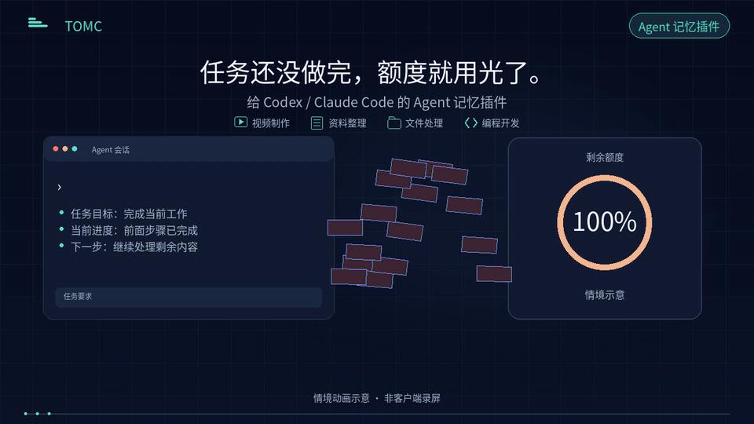

# TOMC v12 · Agent memory plugin preview

TOMC compresses and compiles task context, and lets a new session explicitly recall saved task notes. The animation introduces an Agent memory plugin for Codex / Claude Code with examples such as making videos, organizing research, working with files and software development.

| Language | Landscape · 16:9 |
|---|---|
| 中文 | [MP4](videos/TOMC_Agent_Complete_ZH.mp4) · [Subtitles](subtitles/TOMC_Agent_Complete_ZH.srt) · [Cover](covers/TOMC_Agent_Complete_ZH.png) |
| English | [MP4](videos/TOMC_Agent_Complete_EN.mp4) · [Subtitles](subtitles/TOMC_Agent_Complete_EN.srt) · [Cover](covers/TOMC_Agent_Complete_EN.png) |

## 本次表达

v12 将片末模型名称修正为 **Claude Opus 5.5**；测试模型、开场、30 秒节奏、音轨和原有指标保持不变。本目录提供中英文横版视频、预览动图、封面及字幕。

- 放大右上角“Agent 记忆插件”，开场显示 Codex / Claude Code。
- 保留开场的额度痛点，用“任务还没做完，额度就用光了”和“继续处理任务”表达一般任务；视频制作、资料整理、文件处理、编程开发用小图标和短文字展示。
- 介绍上下文压缩编译与任务记忆：同设备共享本地 SQLite；跨设备手动 Git 推送／拉取并按顺序更新；新会话显式读取已保存笔记。
- 保留五个已测试模型名称，并区分模型 API 与 Agent 助手的接入方式。

## Evidence scope

The task scenes are illustrations. This media revision adds no video-production benchmark, new model call or new device test. It does not demonstrate increased subscription allowance, a quota reset, or a guaranteed number of additional tasks. Reduced context input can reduce consumption in the measured conditions; savings vary by task and host accounting.

The recorded Codex synthetic answering case reports input tokens **38,786 → 27,235**, with **5/5** answers correct in each condition. The separate Claude Code native-recall trial reports recorded session cost **US$0.400 → US$0.249**, with **5/5** answers correct in each condition. These use different protocols and do not establish a shared saving rate for all five named models or complete Agent workflows. See [model test scope](MODEL_TEST_SCOPE_v12.md), [verified media](evidence/complete_v12_media_check.json) and the [recorded validation](../../../docs/validation.md).

Task memory requires explicit save and recall. Moving notes does not automatically move every task file, software environment or credential. The five model names are supplied or confirmed by the author; the DeepSeek 4 PRO entry has no independently supplied per-run protocol. Brand marks identify tools and models and imply no official endorsement.

This is a research preview, welcoming trials, feedback and collaboration. The repository now uses the [MIT License](../../../LICENSE), including commercial use. The copyright holder authorized the MIT change on 2026-10-10. Historical v10/v11 media and their dated audit records remain in their original directories.

## Revision and checks

v12 corrects the Claude display name to **Claude Opus 5.5**. Both landscape MP4s are 1920 × 1080, 30 seconds and 30 fps; full decoding passed. The 960 × 540 GIF previews each run for 30 seconds. The original audio and subtitles are unchanged. The [media audit](evidence/complete_v12_media_check.json) and [preservation check](evidence/complete_v12_preservation.json) record the full v12 download kit, which also contains portrait cuts; this repository directory publishes its landscape assets.
