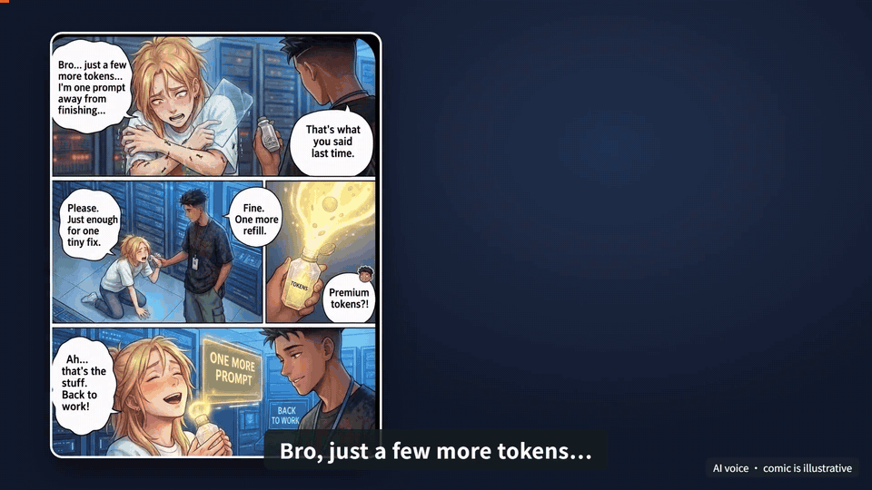

# TOMC v13 · Overview video

The v13 overview replaces the v12 30-second animation at the top of the README. It explains what TOMC does in about one and a half minutes: smaller inputs, switching assistants and carrying task notes to another computer, followed by the BEAM long-history results.

| Language | Landscape · 16:9 | Length |
|---|---|---|
| English | [MP4](videos/TOMC_Overview_EN.mp4) · [Subtitles](subtitles/TOMC_Overview_EN.srt) · [Cover](covers/TOMC_Overview_EN.png) | 1:37 |
| 中文 | [MP4](videos/TOMC_Overview_ZH.mp4) · [字幕](subtitles/TOMC_Overview_ZH.srt) · [封面](covers/TOMC_Overview_ZH.png) | 1:28 |

The GIFs are about 23-second previews cut from the opening, the three uses, the two recorded tests and the BEAM results. Click through for the full video with sound.

## Evidence scope

Not every number in the video has a written protocol in the repository. Each one, with its status:

- **Codex synthetic case:** input tokens 38,786 → 27,235 (−29.8%), 5/5 answers correct in each condition. **No protocol or raw record for this single case is in the repository.** It appears only in the media evidence files of v11–v13. It is a different test from the documented Windows Codex comparison (nine synthetic histories, mean paired input reduction 29.7% at a 40% budget, 45/45; [report](../../../docs/codex_retention_20261005.md)). The two numbers are close but must not be read as one result.
- **Claude Code trial:** recorded session cost US$0.400 → US$0.249 (about −38%), 5/5 answers correct in each condition. This is one cell of the [native-recall trial](../../../docs/validation.md#claude-code-windows-validation): the ~20K-token history, budget 8,192, a single run with one synthetic history, preview.2 runtime, 2026-10-02. At ~10K tokens the cost was unchanged; at ~40K it was 65% lower. It is a cost report, not a token count.
- **BEAM long-history benchmark:** three models (GPT-5.1, Rednote preview, DeepSeek 4.1 Flash) × six baselines × 500K / 1M / 10M histories. TOMC has the higher mean score in all 54 comparisons (500K and 1M from the paper snapshot; 10M from the 2026-10-10 follow-up with pairwise judging). At 100K it is 17 of 18. Averaged equally over the three models across 100K–10M, its input is 36.6% lower than LIGHT's; it uses more input than BRIEF-Pro and BEAM-RAG. These are mean scores from our own setup and are not comparable with other projects' BEAM numbers.

These tests use different protocols and do not establish one saving rate for every task, model or workflow. The video says so on screen and suggests a small side-by-side test on your own task. See the [evidence page](../../../docs/evidence.md), which lists every number with its source and conditions, and the [recorded validation](../../../docs/validation.md).

Saving notes in Codex and recalling them in Claude Code requires explicit save and recall. Moving notes to another computer is a manual export and import of task notes; project files and credentials do not move with them. The comic panels and scenes are illustrations. The voice is AI-generated (noted on screen). Brand names identify tools and models and imply no endorsement.

## Revision and checks

Both videos are 1920 × 1080 at 30 fps, re-encoded for the repository (H.264, AAC 128 kb/s). Compared with the social-media cut, the repository cut ends on the GitHub Star page only; the follow request in the last line and its button were removed and that line was re-voiced. The v12 animation and its audit records remain in [v12](../v12/README.md).
